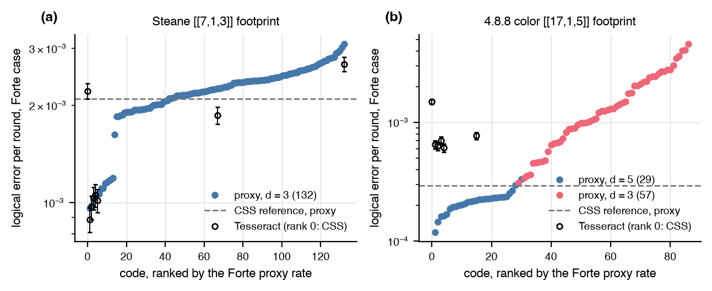

# Letter assignments on the Steane and 4.8.8 footprints

On the 3x3 rotated-surface footprint every commuting assignment of Pauli
letters to the stabilizer supports is a [[9,1,3]] code, most of them beat
the CSS code under the Forte preset, and the mass of the minimum-weight
undetectable fault sets predicts the rate
([SAT population](sat_population.md)). Does any of that hold on footprints
that are not surface codes?

## Setup

- Footprints: the three weight-4 faces of the Steane code, and the eight faces of the [[17,1,5]] triangular 4.8.8 color code (one octagon and seven weight-4 faces), with two generators per face. The CSS code on the faces is the reference.
- Codes: CMSGen samples assignments that are nonzero on the face, zero outside it, distinct within a face, and pairwise commuting; dependent sets are rejected and codes are deduplicated by stabilizer group. 300 groups on the Steane footprint and 120 on the 4.8.8 footprint, with no distance constraint.
- Scores: the exact distance and the number of minimum-weight logicals from the weight enumerators; the proxy tier with the exact circuit distance under the Forte preset (sequential timing, scale 0.25, a model assembled from public specifications, not a device measurement) and a biased idle profile (bias 5, parallel timing), with rounds equal to the footprint's distance; Tesseract at 50,000 shots per basis under the Forte case on the reference and the best codes.

## Result



| | Steane footprint | 4.8.8 footprint |
|---|---|---|
| sampled groups | 300 | 120 |
| distance 1 / 3 / 5 | 168 / 132 / none | 34 / 57 / 29 |
| d = 1 codes with the same letter in both generators of a face on a qubit of that face only | 152 of 168 | 27 of 34 |
| full-distance codes below CSS, Forte | 41 of 132 (37 with every code in batches) | 27 of 29 |
| full-distance codes below CSS, biased idle | 100 of 132 (6 with every code in batches) | 20 of 29 |
| best over CSS, Forte / biased idle | 0.46 / 0.34 (0.78 in batches) | 0.40 / 0.58 |
| Spearman between the two cases | 0.31 | 0.84 |
| Spearman, fault mass against rate, Forte / biased idle | 0.64 / 0.20 | 0.81 / 0.79 |
| circuit distance, every code and the reference | 2 | 3 |
| Tesseract over proxy, Forte, median (range) | 0.98 (0.83 to 1.06), 8 codes | 4.4 (3.5 to 5.5), 6 codes |

- The footprint fixes the distance on the surface lattice and not here. 56 percent of the Steane-footprint assignments and 28 percent of the 4.8.8 ones have distance 1, nearly all because a qubit lying in a single face carries the same letter in both generators of that face, so that single-qubit Pauli commutes with every generator; another 48 percent of the 4.8.8 assignments drop to distance 3. The SAT distance clauses of the population pipeline would exclude both.
- On the full-distance 4.8.8 codes the surface picture holds. 27 of 29 beat the CSS color code under the Forte preset (the best at 0.40 of it) and 20 of 29 under biased idle, the two cases rank them alike, and the fault mass predicts the rate (0.90 and 0.95 over every code of distance 3 or more). Every code, the reference included, has circuit distance 3 in both bases from the weight-8 check measured by a bare ancilla. The proxy is 3.5 to 5.5 times low here, at 1.8 expected faults per shot, the excess coming from shots with three or more faults. Tesseract keeps the conclusion: the four best codes and the median full-distance code sit at 0.41 to 0.52 of the CSS code's Tesseract rate (0.40 to 0.74 by the proxy), and it cannot separate the four best from each other.
- On the Steane footprint it does not. 41 of 132 beat the CSS Steane code under Forte, the two cases disagree on the ranking, and the fault mass predicts the rate weakly. The 100 of 132 under biased idle is the schedule, not the letters: the CSS Steane code has no hook-safe interleaved order and is measured in batches, most deformations interleave, and with every code measured in batches 6 of 132 beat it. Every code has circuit distance 2.
- Tesseract agrees with the proxy within 17 percent on the eight Steane-footprint codes it was run on (the reference, the five best, the median, and the worst), at 0.19 expected faults per shot.

## Reproduce

```
uv run --with pycmsgen python -m experiments.footprints.run run --footprint steane --count 300
uv run --with pycmsgen python -m experiments.footprints.run run --footprint steane --count 300 --extraction batched
uv run --with pycmsgen python -m experiments.footprints.run run --footprint color488 --count 120 --workers 4
uv run python -m experiments.footprints.run confirm --footprint steane --top 5
uv run python -m experiments.footprints.run confirm --footprint color488 --top 8
uv run python -m experiments.footprints.run report
uv run python -m experiments.footprints.run figure
```

The write-up, with the best codes' stabilizers and the per-case tables, is
[`experiments/footprints/REPORT.md`](https://github.com/unitaryfoundation/autoqec-sim/blob/main/experiments/footprints/REPORT.md).
