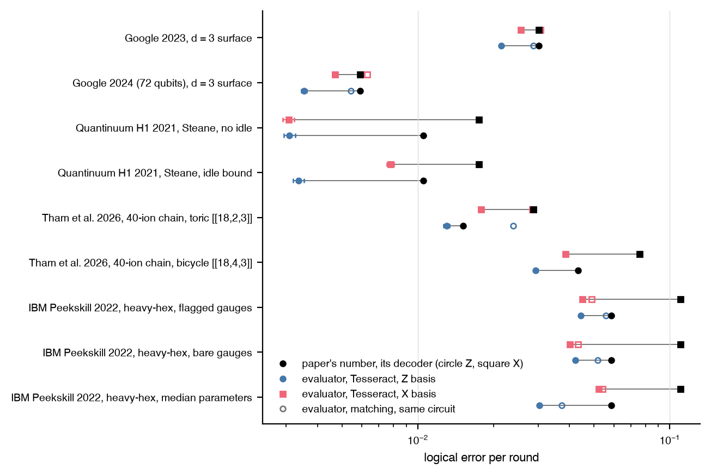

# The evaluator against published memory experiments

How far is the evaluator's logical error per round from the numbers five
published memory experiments report, when its noise profile is built from
each paper's own parameters and its circuit is the package's own?

This is a comparison between the package's noise model on the package's
circuit and a reported number. It is not a prediction about a device. The
circuits differ from the devices' (bare or one-flag extraction, no
adaptive protocol, no transport), several parameters are assumptions
named in the report, and leakage is omitted everywhere.

## Setup

- Rows: the distance-3 rotated surface code under the Google 2023 [@acharya2023] and 2024 [@acharya2025] component tables; the Steane code under the Quantinuum H1 2021 error model [@ryananderson2021]; the toric [[18,2,3]] and bivariate-bicycle [[18,4,3]] codes under the 40-ion chain model of Tham et al. [@tham2026]; and the distance-3 heavy-hexagon subsystem code, measured through its gauge generators with one flag on each weight-4 Z gauge, under the ibm_peekskill model of Sundaresan et al. [@sundaresan2023].
- Noise: every rate, coherence time, and duration is read from the cited table of the paper; the few values the papers do not state are marked as assumptions in the report, row by row.
- Scores: the proxy tier at one to three rounds, and Tesseract sampling at the paper's round count, converted to a per-round rate with the memory-decay convention the papers use; minimum-weight matching on the same circuit beside it for the surface, toric, and heavy-hexagon codes, where a data error flips at most two checks of each type. The paper's column is its own per-round number with its own decoder.

## Result



| row | paper, per round | Tesseract, per round | matching, per round | Tesseract over paper |
|---|---|---|---|---|
| Google 2023, distance-3 surface, 25 cycles | 3.0e-2 (bases averaged) | Z 2.1e-2, X 2.6e-2 | Z 2.9e-2, X 3.1e-2 | 0.71, 0.85 |
| Google 2024 (72 qubits), distance-3 surface, 25 cycles | 5.9e-3 (bases averaged) | Z 3.5e-3, X 4.7e-3 | Z 5.4e-3, X 6.3e-3 | 0.60, 0.80 |
| Quantinuum H1 2021, Steane, no idle, 6 rounds | Z 1.05e-2, X 1.75e-2 | Z 3.1e-3, X 3.1e-3 | not a matching code | 0.30, 0.18 |
| Quantinuum H1 2021, Steane, idle bound, 6 rounds | Z 1.05e-2, X 1.75e-2 | Z 3.4e-3, X 7.8e-3 | not a matching code | 0.32, 0.45 |
| Tham et al. 2026, 40-ion chain, toric [[18,2,3]], 6 rounds | Z 1.51e-2, X 2.88e-2 | Z 1.30e-2, X 1.78e-2 | Z 2.4e-2, X 2.9e-2 | 0.86, 0.62 |
| Tham et al. 2026, 40-ion chain, bicycle [[18,4,3]], 6 rounds | Z 4.33e-2, X 7.58e-2 | Z 2.94e-2, X 3.86e-2 | not a matching code | 0.68, 0.51 |
| IBM Peekskill 2022, heavy-hex, flagged gauges, 10 rounds | Z 5.85e-2, X 1.10e-1 | Z 4.44e-2, X 4.50e-2 | Z 5.6e-2, X 4.9e-2 | 0.76, 0.41 |
| IBM Peekskill 2022, heavy-hex, bare gauges, 10 rounds | Z 5.85e-2, X 1.10e-1 | Z 4.22e-2, X 4.02e-2 | Z 5.2e-2, X 4.3e-2 | 0.72, 0.37 |
| IBM Peekskill 2022, heavy-hex, median parameters, 10 rounds | Z 5.85e-2, X 1.10e-1 | Z 3.04e-2, X 5.21e-2 | Z 3.7e-2, X 5.4e-2 | 0.52, 0.47 |

- The evaluator's Tesseract number on its own circuit sits below the paper's in all nine rows: at 0.4 to 0.9 of it for the surface, toric, bicycle, and heavy-hexagon rows, and at 0.2 to 0.45 for the Steane rows. Everything the model leaves out (leakage, crosstalk, transport, the devices' adaptive protocols) adds error, so the gap has the expected sign.
- At distance 3 the decoder accounts for as much of the gap as the model. Matching on the same Google circuits lands at 0.92 to 0.98 of the 2023 belief-matching figure and at 0.76 to 0.89 of the 2024 real-time-matching figure, while Tesseract sits 15 to 40 percent below the papers' tensor-network and neural-network figures.
- The Steane rows measure the circuit, not the gate rates. The package's bare 24-gate extraction has circuit distance 2, against the paper's flagged adaptive protocol, which runs 36 to 60 gates by our count from its circuit figure, with transport between them; adding the paper's depth-one memory-error bound as a Z-dominated idle moves the X-basis ratio from 0.18 to 0.45.
- On the heavy-hexagon rows the paper's circuit-level parameter vector gives the same number in both bases, 0.72 to 0.76 of the paper's Z value and 0.37 to 0.41 of its X value, with or without the flags. The per-qubit medians with the T1 and T2 idle model put X above Z, the direction the paper reports, at 0.52 and 0.47.
- The toric and bicycle rows under the chain model sit at 0.86 and 0.62 (toric) and 0.68 and 0.51 (bicycle) of the paper's block numbers; the profile's two-qubit rate is read from a figure, and the paper decodes with a beam decoder.

## Reproduce

```
uv run --with pymatching python -m experiments.hardware_comparison.run run
uv run python -m experiments.hardware_comparison.run report
uv run python -m experiments.hardware_comparison.run figure
```

The write-up, with every parameter, its source, and the assumptions per
row, is
[`experiments/hardware_comparison/REPORT.md`](https://github.com/unitaryfoundation/autoqec-sim/blob/main/experiments/hardware_comparison/REPORT.md).
