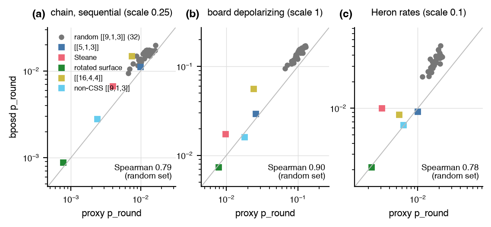

# Memory objective runs

Does the closed-form proxy of the [memory objective](../memory_objective.md)
rank codes the way a sampled decoder does, and does the objective see a
bias-tailored code? The objective scores a code by the logical error per
round of an `R`-round syndrome-extraction memory experiment, which the
encoder-based reward of the [noise-aware experiment](noise_aware.md)
cannot do for a local-Clifford deformation.

## Setup

- Profiles: the chain preset at scale 0.25 with sequential timing, the board recipe at `p = 1e-3`, and the Heron r2 rates at scale 0.1. Every tier is a leading-order or sampled estimate that needs the expected number of faults per shot below about one, which the presets at scale 1 exceed on these circuits.
- Codes: five benchmark codes ([[5,1,3]], Steane, the rotated surface code, the [[16,4,4]] code, a non-CSS [[9,1,3]] code) and 32 random [[9,1,3]] codes with generator weights 3 to 9; `R = d` or 3 rounds.
- Tiers: `proxy` (closed form from the detector error model), `sampled` (exact maximum likelihood when detectors plus observables fit 20 bits, else a lookup decoder), and `bposd` (the board's pinned BP+OSD [@roffe2020; @panteleev2021], validation only).

## Result



| | chain, scale 0.25 | board | Heron, scale 0.1 |
|---|---|---|---|
| Spearman, proxy against bposd, 32 random codes | 0.79 | 0.90 | 0.78 |
| Spearman, bposd seed against bposd seed, same codes | 0.53 | 0.95 | 0.88 |
| proxy cost per code, both bases, one thread | 0.08 to 0.22 s at n <= 9; 1.7 to 2.3 s at n = 16 | | |

- On the chain profile the proxy is closer to one BP+OSD sample than two BP+OSD samples are to each other. Against the sampled tier (exact maximum likelihood on the [[5,1,3]] code, a weight-2 lookup decoder on the rest) the proxy is within 30 percent on 13 of the 14 benchmark rows below one expected fault per shot; the [[16,4,4]] code under Heron rates at 0.9 faults per shot sits at 0.68.
- Steane is the outlier on every profile: BP+OSD decodes it 1.7 to 3.2 times worse than both maximum-likelihood tiers.


- Bias: with every rate at 2.5e-4 and a slot idle channel of bias `eta`, the ratio `p_round(surface) / p_round(XZZX)` is 1.00 at `eta = 0.5` (an exact tie, the deformation is a relabeling), 1.80 at 10, and 2.27 at pure Z under sequential timing, up to 2.10 under parallel timing. Under the Forte preset the proxy prefers XZZX by 1.22; under the chain preset the two tie, since its idle is small and its readout flips dominate.
- Flags: one flag per generator lifts `d_circ` from 2 to 3 for [[5,1,3]], Steane, the [[16,4,4]] code, and the non-CSS 3x3 code and lowers the chain-preset rate by 2.6 to 4.4 times; on the board recipe the extra gates cost more than the flags gain.
- Lattice: on `square:3x3` the surface and XZZX codes route nothing, while the non-CSS 3x3 code needs 63 extra two-qubit gates per round and its board rate goes from 0.018 to 0.26.
- PPO smoke run (3x3 lattice, chain profile, `R = 3`, 400k env steps): distance 3 at 83k steps, 92 distinct target-distance codes evaluated at 0.47 s each, best `p_round` 0.0016 against 0.00077 for the rotated surface code.

## Reproduce

```
uv run python -m experiments.memory_objective.run benchmark
uv run python -m experiments.memory_objective.run random
uv run python -m experiments.memory_objective.run bias
uv run python -m experiments.memory_objective.run report
```

The other subcommands are `random-check`, `lattice`, and `ppo`; `bposd`
needs `uv run --with ldpc`. The write-up is
[`experiments/memory_objective/REPORT.md`](https://github.com/unitaryfoundation/autoqec-sim/blob/main/experiments/memory_objective/REPORT.md);
the design note is the [memory objective](../memory_objective.md) page.
