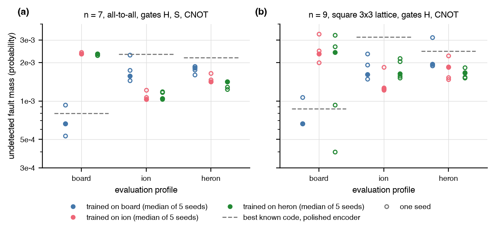

# Noise-aware discovery

Does the code PPO discovers depend on the noise profile it trains
against, and in the direction the profile's structure predicts? This is
the experiment the proposal cites [@olle2024] for.

## Setup

- Three `autoqec_sim.noise` profiles scaled to the same total fault mass: board depolarizing, the Forte ion-chain preset [@chen2024] with sequential timing (idle dephasing dominates), and Heron r2 rates [@harper2026] on the setting's graph.
- Three settings: 7 qubits all-to-all with H, S, and CNOT at target distance 3; the 3x3 lattice with H and CNOT at distance 3; the 4x4 lattice with H and CNOT at distance 4. Five PPO seeds per cell, 45 runs, 31 process-hours.
- Reward: the shifted distance reward plus, on states at the target distance, the circuit-level undetected fault mass of the encoder and the LDPC penalty at `w_max = 4`, with the padding penalty of the rediscovery regression.

## Result



| Comparison, median of five seeds | n = 7 | 3x3 |
|---|---|---|
| board-trained against ion- or heron-trained codes, on the board profile | 3.4x less mass (25 of 25 seed pairs, p = 0.008) | 3.3x (25 of 25, p = 0.008) |
| ion-trained against board-trained codes, on the ion profile | 1.6x less (25 of 25, p = 0.008) | 1.3x (22 of 25, p = 0.048) |
| ion- against heron-trained codes | within 2 to 9 percent on either profile | heron-trained win on heron by 1.3x and 1.1x |

- The dependence is large where the profiles differ in structure, and it runs through the encoding circuit's fault propagation. Board-trained circuits detect every idle fault; ion-trained circuits leave idle X and Y faults undetected, faults the ion profile hardly emits.
- No profile produced codes with `d_Z > d_X` more often than another (0 or 1 of 5 seeds everywhere), and none of the 30 codes is CSS or local-Clifford equivalent to a CSS code. An idle Z fault propagates through the later gates of the same circuit and reaches the output as a mixed error, so the reward never sees a Z-biased error to tailor against.
- The discovered degenerate codes beat Steane [@steane1996] at n = 7 and the rotated surface code with its XZZX [@bonillaataides2021] and Hadamard-deformed variants on the 3x3 lattice, all with polished encoders, under every profile. A Hadamard at the end of the encoder relabels weight-1 faults only, so this single-fault objective cannot see a local-Clifford deformation; the [memory objective](memory_objective.md) was built to.
- The 4x4 setting did not fit the budget: none of its 15 runs (16M env steps each) produced a distance-4 state. The [scaling probe](scaling.md) explains why.

## Reproduce

```
uv run --extra rl python -m experiments.noise_aware.run run --setting 3x3 --profile ion --seed 0
uv run --extra rl python -m experiments.noise_aware.run baselines --setting 3x3
uv run --extra rl python -m experiments.noise_aware.run report
uv run --extra rl python -m experiments.noise_aware.run figure
```

`--threads N` caps torch and BLAS; the release numbers came from the
3-worker, 6-thread queue `experiments/noise_aware/runs/run_sweep.sh`. The
write-up, with the calibration, the cross-evaluation matrices, the
mechanism breakdown, the code lists, and the baselines, is
[`experiments/noise_aware/REPORT.md`](https://github.com/unitaryfoundation/autoqec-sim/blob/main/experiments/noise_aware/REPORT.md).
