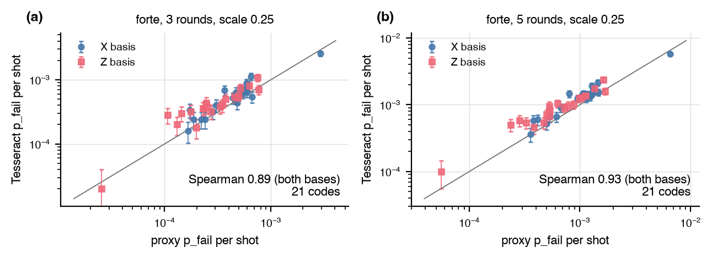

# The proxy tier against Tesseract at distance 5

Does the shot-free proxy tier rank codes the way a near-maximum-likelihood
sampled decoder does once the circuit distance is 5, where the proxy's
weight-3 form comes from the enumeration of weight-5 and weight-6
undetectable fault sets rather than from a pair table?

## Setup

- Codes: the 5x5 rotated surface code, its XZZX deformation, and 19 random single-qubit Clifford deformations of it on the same footprint, all of distance 5 (`experiments/proxy_tesseract/codes.json`).
- Noise: the Forte preset with sequential timing at scale 0.25, a model assembled from public specifications, not a device measurement; three and five rounds (1.7 and 2.8 expected faults per shot), both memory bases, the interleaved extraction schedule.
- Scores: the proxy tier (closed form, no shots, no decoder) with its weight-5-only variant and the weight-5 fault mass, against Tesseract with 50,000 shots per basis on the same detector error model.

## Result



| 21 codes | 3 rounds, Z | 3 rounds, X | 3 rounds, both | 5 rounds, Z | 5 rounds, X | 5 rounds, both |
|---|---|---|---|---|---|---|
| Spearman, proxy against Tesseract | 0.95 | 0.85 | 0.89 | 0.97 | 0.91 | 0.93 |
| Spearman, weight-5 sets of the proxy only | 0.96 | 0.84 | 0.88 | 0.97 | 0.94 | 0.89 |
| Spearman, weight-5 fault mass | 0.89 | 0.70 | 0.51 | 0.92 | 0.76 | 0.65 |
| Tesseract over proxy, median | 1.33 | 1.19 | 1.31 | 1.28 | 1.24 | 1.29 |
| Tesseract failures per code, median | 19 | 27 | 51 | 48 | 71 | 109 |
| seconds per basis, proxy against 50,000 Tesseract shots | | | 13 against 64 | | | 16 against 92 |

- The proxy ranks the codes as Tesseract does: 0.89 over both bases at three rounds and 0.93 at five, where Tesseract's own sampling noise (51 and 109 failures per code, 14 and 10 percent) sets the ceiling. The Z basis, with lower rates driven by fewer fault sets, agrees at 0.95 and 0.97.
- The proxy runs about 30 percent low in level (Tesseract over proxy 1.31 and 1.29 median, 0.86 to 1.58 over codes), and the ratio does not grow between 1.7 and 2.8 expected faults per shot. The leading-order form misses the higher-order terms; the ranking survives them.
- The weight-5 sets alone rank as well as the full weight-3 form (0.88 and 0.89), while the weight-5 fault mass alone does not (0.51 and 0.65 over both bases). The predictive content is in which half of each minimum-weight set the decoder gets wrong, not in the total mass, so the mass is not a substitute for the proxy at this distance.
- Under this preset model, as scored by Tesseract, 10 of the 19 random deformations beat XZZX at three rounds and 15 of 19 at five. The same two codes lead at both round counts: 4.8e-4 and 5.6e-4 per shot over both bases at three rounds against 1.0e-3 for XZZX and 2.6e-3 for the CSS code, and 1.1e-3 and 1.4e-3 at five rounds against 2.4e-3 and 5.9e-3.

## Reproduce

```
uv run python -m experiments.proxy_tesseract.run run --rounds 3 --shots 50000
uv run python -m experiments.proxy_tesseract.run run --rounds 5 --shots 50000
uv run python -m experiments.proxy_tesseract.run report
uv run python -m experiments.proxy_tesseract.run figure
```

The write-up, with the per-code table at each round count, is
[`experiments/proxy_tesseract/REPORT.md`](https://github.com/unitaryfoundation/autoqec-sim/blob/main/experiments/proxy_tesseract/REPORT.md).
