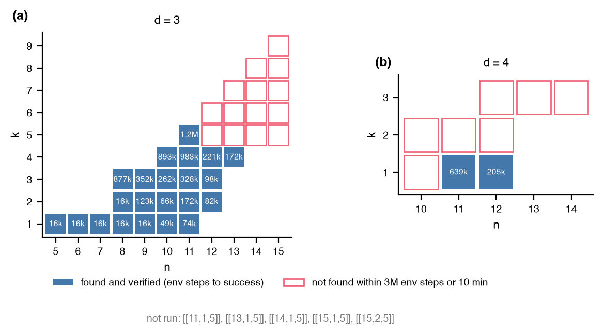

# QDX's targets

How many of the `[[n, k, d]]` targets that QDX [@olle2024] publishes for
all-to-all connectivity at `n <= 15` does this package's PPO reach, at
matched gate set, connectivity, and success criterion, with one run of
3M environment steps or 10 minutes per target?

## Setup

- Targets: QDX's archive of discovered codes gives 50 triples with `d` up to 5. The 36 at d = 3 and the 9 at d = 4 were run; the five at d = 5 were not.
- Agent: one PPO run per target with gates H, S, and CNOT, all-to-all connectivity, batch 512, an episode cap of 30, 40, or 60 gates for d = 3, 4, or 5, and the Knill-Laflamme reward over all Paulis of weight below d. Success means every such error is detected or in the group; verified means the exact distance of the resulting code is at least d.
- QDX weighted the same error set by a depolarizing channel and ran four agents per target on a GPU, so wall times are not comparable between the two; success within budget and circuit length are.

## Result



| | targets run | found and verified | not found in budget |
|---|---|---|---|
| d = 3 | 36 | 22 | 14 |
| d = 4 | 9 | 2 ([[11,1,4]] and [[12,1,4]]) | 7 |

- Every d = 3 target up to n = 11 is found, in 16k env steps (two seconds) at k = 1 and up to 1.2M steps (230 s) for [[11,5,3]]. From n = 12 on, the agent finds every target with k <= 4 and misses every one with k >= 5.
- The found circuits are 17 to 35 gates long, against QDX's shortest of 9 to 25 and medians of 12 to 30 for the same targets. The reward has no length term, so the first successful circuit is the one reported.
- 21 of the unsuccessful runs stopped at the 10-minute cap after 6 to 57 percent of the step budget, while sharing the machine with other jobs that cut the step rate by up to eightfold from n = 12 on. The misses at n >= 12 are misses at this wall time, not at 3M steps.

## Reproduce

```
uv run --extra rl python -m experiments.qdx_targets.run run --tier d3
uv run --extra rl python -m experiments.qdx_targets.run report
uv run --extra rl python -m experiments.qdx_targets.run figure
```

The write-up, with the QDX columns read from its archive, is
[`experiments/qdx_targets/REPORT.md`](https://github.com/unitaryfoundation/autoqec-sim/blob/main/experiments/qdx_targets/REPORT.md).
