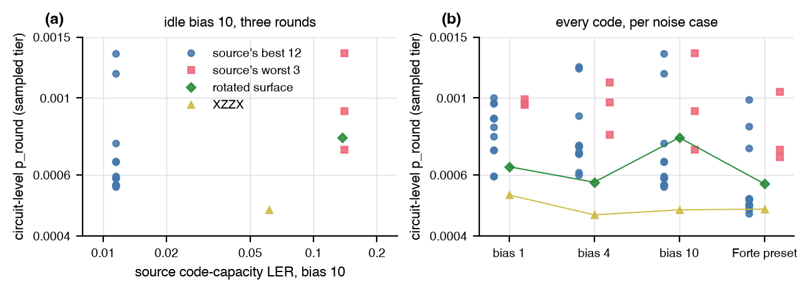

# SAT-designed codes under the memory objective

DalFavero et al. [@dalfavero2026] sampled 100,000 nine-qubit
surface-like codes by SAT and ranked them by exact maximum-likelihood
logical error rate under code-capacity biased noise. Does that ranking
survive circuit-level noise?

## Setup

- Codes: the twelve best distinct codes at bias 10 and three of the worst, Hadamard-conjugated on every qubit so that their X tailoring becomes Z tailoring, against the rotated surface code and its XZZX deformation.
- Noise: three rounds under a depolarizing profile with a biased idle channel (Z rate `eta` times each of the X and Y rates) at source bias 1, 4, and 10, and under the Forte preset with sequential timing, a model assembled from public specifications.
- Tiers: `proxy` and `sampled` (exact maximum likelihood where the detector count allows). Differences below about ten percent are within the sampled tier's noise.

## Result



| source bias | Spearman, source rate against proxy | against sampled |
|---|---|---|
| 1 | 0.52 | 0.43 |
| 4 | 0.17 | 0.08 |
| 10 | 0.25 | 0.26 |

- The twelve best codes share one source rate at each bias (0.0115 at bias 10) but spread over a factor 2.4 at circuit level (0.00056 to 0.00134 at bias 10, sampled tier). The three worst codes, twelve times worse at code capacity, land within that spread.
- XZZX is the best or tied-best code in every case (0.00046 to 0.00053), and the rotated surface code, which the source ranks next to its worst at bias 10, sits in the middle of the pack.
- Two structural reasons. The source's channel is a single biased code-capacity channel with an exact decoder, while here only the idle channel carries the bias and gate, reset, and measurement errors stay unbiased, so a code sees a weaker effective bias over a round. And a circuit-level rate counts the space-time realizations of each logical operator in the extraction circuit, which differ between codes with the same code-capacity rate. The [population experiment](sat_population.md) measures both effects on 2,150 codes.

## Reproduce

```
uv run python -m experiments.sat_codes.run run
uv run python -m experiments.sat_codes.run report
uv run python -m experiments.sat_codes.run figure
```

The selection is `experiments/sat_codes/selection.json`; the write-up is
[`experiments/sat_codes/REPORT.md`](https://github.com/unitaryfoundation/autoqec-sim/blob/main/experiments/sat_codes/REPORT.md).
