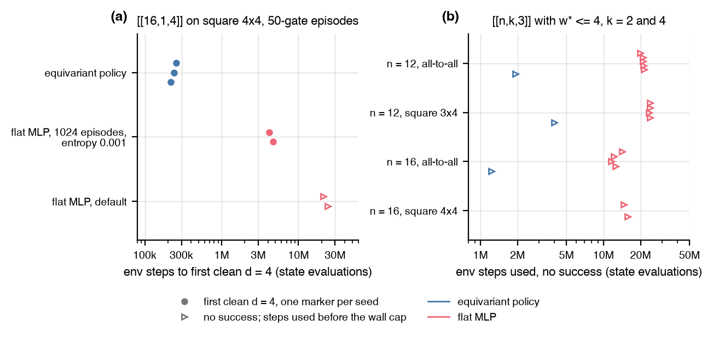

# RL scaling probe

How far does the PPO agent scale in `n`, what is the cheapest change that
reaches a distance-4 code on the 4x4 lattice (the setting the
[noise-aware experiment](noise_aware.md) could not solve), and does the
LDPC penalty of the rediscovery regression carry to `n = 12` to `16`?

## Setup

- 4x4 lattice, H and CNOT on the edges, 50-gate episodes, the level distance reward with the padding penalty. Variants: the default flat MLP policy, the flat MLP with 1024 parallel episodes and entropy coefficient 0.001, a per-qubit permutation-equivariant policy (`PPOConfig(policy="equivariant")`), a distance curriculum, a macro action set, and longer episode caps.
- LDPC targets: `[[n, k, 3]]` with `w* <= 4` in the penalty form of the regression at `n = 12` and `16`, `k = 2` and `4`, on all-to-all and square graphs; 18 runs of 20 minutes each (1.2M to 24M env steps).

## Result



| Variant on the 4x4 lattice | distance 4 reached | env steps to the first d = 4 code |
|---|---|---|
| default flat MLP, 50-gate cap | no, in 21M to 24M steps | |
| flat MLP, 1024 episodes, entropy 0.001 | yes | 4.2M and 4.7M |
| equivariant policy | yes, 3 of 3 seeds | 217k, 242k, 258k |
| default agent with an 80- or 100-gate cap | yes | 3.1M and 5.4M at 80, under 130k at 100 |

- The 4x4 failure is exploration. A distance-4 state within 50 gates exists (a model-free search finds one after 369k circuits), but 0 of 8192 random 50-gate sequences reach one and the default agent never evaluates a single one. Credit assignment and policy capacity are not the block: the same agent passes a distance curriculum to d = 3 at n = 16.
- The equivariant policy is the recommended default from `n = 12`: a clean [[16,1,4]] code at the 50-gate cap in 71 to 110 s at two threads, and 56 to 64 percent of its episodes end at d = 4 after 1M steps.
- The LDPC penalty form does not carry over. No run at `n = 12` to `16` reached a distance-3 code with `w* <= 4`; every policy converges to sparse stabilizer groups of distance 1 (0.5 to 5.7 percent of the weight-1 and weight-2 errors undetected), because the normalized Knill-Laflamme term pays 1/630 to 1/1128 per detected error while one unit of `w*` excess costs 0.25. The penalty is validated at `n = 9` only; the [LDPC constraint](../ldpc.md) page has the forms that replace it.
- These are limits of gate-by-gate encoder search. A SAT formulation designs codes with up to 100 physical qubits in minutes [@dalfavero2026]; the rewards here take such a code as input, which is the direction of the [SAT experiments](sat_codes.md).

## Reproduce

```
uv run --extra rl python -m experiments.scaling.run variant --variant equivariant --seed 0
uv run --extra rl python -m experiments.scaling.run ldpc --n 12 --k 2 --graph all_to_all:12 --seed 0
uv run --extra rl python -m experiments.scaling.run report
uv run --extra rl python -m experiments.scaling.run figure
```

The write-up is
[`experiments/scaling/REPORT.md`](https://github.com/unitaryfoundation/autoqec-sim/blob/main/experiments/scaling/REPORT.md).
