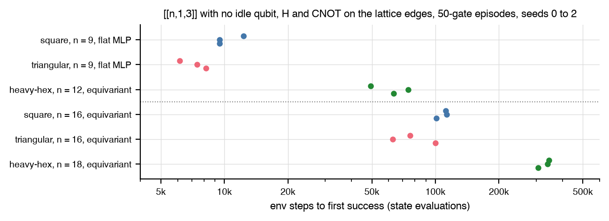

# Three-topology run matrix

Does the PPO agent, by itself, reach a distance-3 code on square,
triangular, and heavy-hex lattices with one objective and one metric
set, and how does the cost grow with the lattice?

## Setup

- Objective on every topology: a `[[n, 1, d >= 3]]` code with no idle qubit, H and CNOT on the lattice edges only, 50-gate episodes, the level distance reward of the [scaling probe](scaling.md) with the padding penalty. `PPOConfig` defaults with `policy="auto"` (flat MLP below 12 qubits, equivariant from 12), 256 parallel episodes, seeds 0, 1, and 2.
- Cells: square and triangular at `3x3` and `4x4` (n = 9 and 16); heavy-hex at the nearest sizes its honeycomb construction allows, `1x1` (n = 12, a 12-cycle) and `2x1` (n = 18). Budget 2M env steps for the small tier and 4M for the large, 12 minutes of wall time; a run stops at its first success.
- Each cell reports env steps and wall time to the first success, the best code (exact d, `w*`, maximum qubit degree, CSS test, weight enumerators), and the undetected fault mass of its encoder under the Heron preset on the cell's graph and under the board preset, beside the rotated surface encoder routed onto the same graph.

## Result



| lattice | n | successes | env steps to the first success |
|---|---|---|---|
| square | 9 | 3 of 3 | 9,472 to 12,288 |
| triangular | 9 | 3 of 3 | 6,144 to 8,192 |
| heavy-hex | 12 | 3 of 3 | 49,408 to 74,240 |
| square | 16 | 3 of 3 | 100,864 to 112,896 |
| triangular | 16 | 3 of 3 | 62,720 to 99,840 |
| heavy-hex | 18 | 3 of 3 | 307,200 to 344,832 |

- On the 9-qubit lattices the first success came within the first three PPO updates, under a policy still close to its random initialization, so those cells measure reachability under near-uniform sampling of lattice gates, not learning.
- Against the routed rotated surface encoder on the same graph, the agent's encoders carry 1.1x to 7.8x the undetected fault mass at n = 9 and 0.3x to 2.3x at n = 16, where the distance-4 surface code protects against more than the objective asks and its routed encoder runs 53 to 74 gates against the agent's 50.
- Total wall time 13 minutes over the 18 runs at two threads each; the longest run took 197 s, so no run reached its step budget or the wall cap.

## Reproduce

```
uv run --extra rl python -m autoqec_sim.experiments.topologies matrix
uv run --extra rl python -m autoqec_sim.experiments.topologies run --topology heavy_hex --target-n 16 --seed 0
uv run --extra rl python -m autoqec_sim.experiments.topologies report
uv run --extra rl python -m autoqec_sim.experiments.topologies figure
```

The write-up is
[`experiments/topologies/REPORT.md`](https://github.com/unitaryfoundation/autoqec-sim/blob/main/experiments/topologies/REPORT.md).
