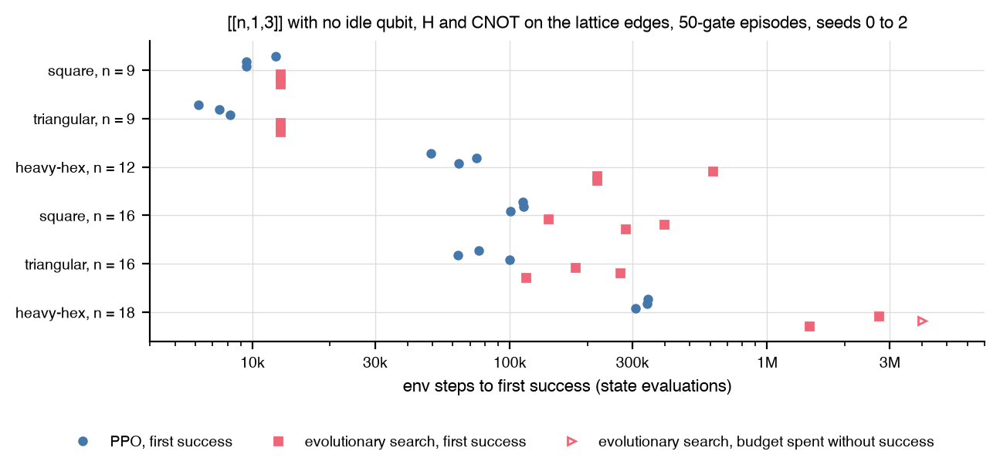

# Evolutionary search against PPO

Does the package's evolutionary search match PPO on the
[three-topology matrix](topologies.md) at the same budget, objective, and
action space?

## Setup

- The same six cells, objective (a `[[n, 1, 3]]` code with no idle qubit), gate set, 50-gate episodes, and environment-step budget per tier (2M for the small tier, 4M for the large). An evolutionary evaluation counts as one whole 50-step episode, and a run stops at its first success.
- The search is autoqec-sim's own (`autoqec_sim.search.EvolutionarySearch`): a population of 256 gate sequences, mutation, one batched rollout per generation. It is not a tuned evolutionary agent; the comparison fixes the budget, objective, and action space, nothing else.

## Result



| lattice | n | PPO | PPO median steps | evolutionary search | evolutionary median steps | evolutionary median wall |
|---|---|---|---|---|---|---|
| square | 9 | 3 of 3 | 9,472 | 3 of 3 | 12,800 | 0.1 s |
| triangular | 9 | 3 of 3 | 7,424 | 3 of 3 | 12,800 | 0.2 s |
| heavy-hex | 12 | 3 of 3 | 63,488 | 3 of 3 | 217,600 | 3.6 s |
| square | 16 | 3 of 3 | 112,128 | 3 of 3 | 281,600 | 6.5 s |
| triangular | 16 | 3 of 3 | 75,776 | 3 of 3 | 179,200 | 3.6 s |
| heavy-hex | 18 | 3 of 3 | 340,480 | 2 of 3 | 2,086,400 | 64 s |

- Both methods solve every cell but one: the evolutionary search misses one heavy-hex seed at n = 18 within the 4M-step budget. On the 9-qubit lattices its first generation of 256 random sequences already contains a solution, which matches the PPO finding that those cells measure reachability, not learning.
- Per environment step PPO is more efficient, median against median, and the gap grows with the lattice: 1.4x and 1.7x at n = 9, 3.4x on the 12-qubit heavy-hex graph, 2.5x and 2.4x at n = 16, 6.1x on the 18-qubit heavy-hex graph.
- Per second of wall time the evolutionary search wins: 0.1 to 64 s per successful run against up to 197 s for PPO, which trains a network at every update. At these sizes a batched rollout is cheap and a learned policy is not needed.
- An earlier version of this comparison reported 0 of 18 successes for the evolutionary search. That was a bookkeeping defect: the experiment built its environment with automatic resets, so the search read the reward of a freshly reset state in place of the successful one and never registered a success. The call site is fixed and the numbers above are the rerun.

## Reproduce

```
uv run --extra rl python -m experiments.topologies_ea.run run --topology square --target-n 9 --seed 0
uv run --extra rl python -m experiments.topologies_ea.run report
uv run --extra rl python -m experiments.topologies_ea.run figure
```

The write-up is
[`experiments/topologies_ea/REPORT.md`](https://github.com/unitaryfoundation/autoqec-sim/blob/main/experiments/topologies_ea/REPORT.md);
the PPO side comes from the runs of the [three-topology matrix](topologies.md).
