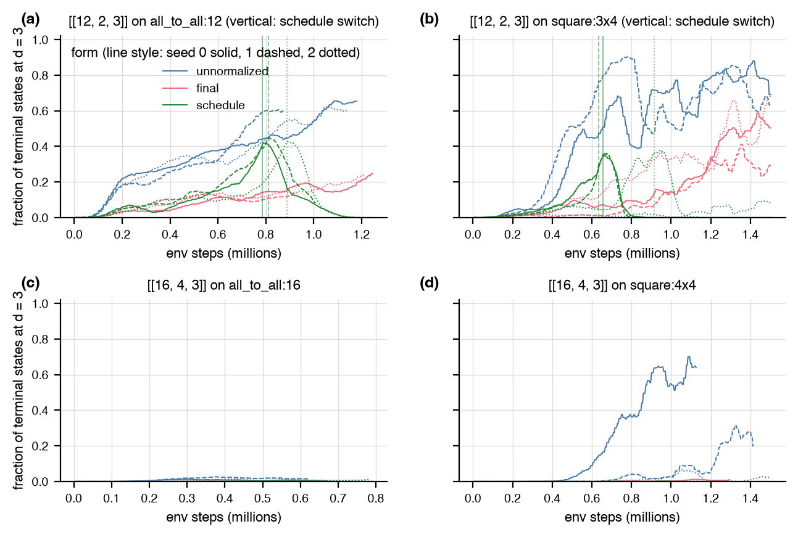

# LDPC constraint forms above n = 9

Status: complete. Every number below comes from a JSON under
`results/ldpc_scaling/` (named in the last column of the run table or in
the text) or from `results/regression_ppo_4x4_seed*.json`; the tables and
figures regenerate with
`uv run --extra rl python -m autoqec_sim.experiments.ldpc_scaling report`
and this file with `uv run --extra rl python experiments/ldpc_scaling/assemble_report.py`.
Code: `src/autoqec_sim/ldpc.py` (`LdpcObjective`),
`src/autoqec_sim/experiments/ldpc_scaling.py`. Logs: `results/ldpc_scaling/logs/`.

## Summary

The penalty form of the regression traps PPO at `n = 12` to `16` in
sparse stabilizer groups of distance 1 (`experiments/scaling/REPORT.md`).
Of the three replacements compared here on `[[12, 2, 3]]` and
`[[16, 4, 3]]` with `w_max = 4`, 36 runs at a fixed budget of 1.5M env
steps or 20 minutes each (0.62 to 1.50M env steps reached on a shared
machine), the `unnormalized` form is the one that keeps a sparsity term
in the reward without the trap and learns distance: its trained policies
end 65, 61, and 61 percent (all-to-all) and 69, 63, and 8 percent (lattice) of
their last 2,560 episodes at distance 3 on `[[12, 2, 3]]` (seeds 0, 1, 2)
and 64, 20, and 2 percent on `[[16, 4, 3]]` on the 4x4 lattice (0.3 to 1.5
percent on 16 qubits all-to-all, where the 272-action space makes
distance 3 itself the obstacle), and it is the only form that
produced a code within the bound: 3 of 12 runs, all on
`[[12, 2, 3]]` (`all_to_all:12` and `square:3x4`), at 303,104 to 950,016 env steps. It does not
solve the sparsity part: those were single episodes, the policies' codes
sit at `w*` 5 to 6 (`n = 12`) and 7 to 8 (`n = 16`), one to four above the
bound, and 0.0 to 0.2 percent of the `[[12, 2, 3]]` terminal states have
`w* <= 4` (none of them at distance 3). The `final` form (hard constraint,
no sparsity signal) ends 14 to 68 percent of its `[[12, 2, 3]]` episodes at
distance 3 with the same `w*` 5 to 6 and never draws a feasible code
(0 of 12 runs). The `schedule` form reaches its switch
on `[[12, 2, 3]]` (6 of 6 runs, at 0.63 to 0.91M env steps, after climbing to
35 to 45 percent at distance 3) and then moves into the penalty
form's trap: by the end of the budget the fraction at distance 3 is down
to 0 to 8 percent and the fraction at distance 1 up to 14 to 100
percent (the run that switched latest, at 0.81M of its
1.01M steps, is the one still on its way down); on
`[[16, 4, 3]]` it never reaches the switch threshold (0 of
12 runs feasible). Pricing the excess higher in the
unnormalized form (0.5 and 1 unit per error instead of 0.25, seed 0,
`n = 12`) leaves the `w*` distribution where it was and costs distance.

`DEFAULT_LDPC_FORM = "unnormalized"` accordingly, with the limitation
stated: it fixes the distance-1 trap and learns distance-3 codes at
`n = 12` to `16` where the penalty form never did, and it reaches the
bound only by sampling. The forms are all in `ldpc.LdpcObjective` and on
regression targets through `regress.LdpcSpec(mode="objective", form=...)`.

## Setup

Targets: `[[12, 2, 3]]` and `[[16, 4, 3]]` with bottleneck bound
`w_max = 4` and no idle qubit, on the all-to-all graph (H, S, CNOT; 156 and
272 actions) and on the square graph (`square:3x4` and `square:4x4`, H and
CNOT; 46 and 64 actions), the cells of the scaling probe's LDPC table that
have both graphs. Episodes of 40 gates, 256 parallel episodes,
`PPOConfig` defaults with `policy="equivariant"` (121,859 to 124,036
parameters, `num_parameters` in the JSONs), three seeds per cell, 1.5M env
steps or 20 minutes per run, whichever comes first, no early stop, 2 BLAS
and torch threads per run, at most three runs at a time
(`results/ldpc_scaling/queue.sh`, `jobs.txt`). The machine was shared with
other sessions at a 1-minute load average of 15 to 150 for the whole
period (`logs/queue.log` records it at every start), so the env-step
totals of wall-capped runs (0.62 to 1.50M) are below what an idle
machine would give; the per-run table reports them.

Base terms of every form: the Knill-Laflamme term over the 630 (`n = 12`)
or 1,128 (`n = 16`) Paulis of weight at most 2 and the padding penalty
(weight-1 Paulis in the stabilizer group). A candidate state detects every
error and has no idle qubit. On ordinary states `w*` is the greedy
pairwise-reduction bound of `ldpc.py`; on candidate states the exact `w*`
replaces it and decides success. The forms (`ldpc.LdpcObjective`):

| form | reward on every state | success |
|---|---|---|
| `penalty` (regression, reference) | fraction of undetected errors, fraction of weight-1 Paulis in `S`, minus `0.25 max(0, w* - 4)` | reward 0 |
| `unnormalized` | number of undetected errors, number of weight-1 stabilizers, minus `0.25 max(0, w* - 4)`, the sum divided by the initial state's undetected count (75 at `[[12, 2]]`, 210 at `[[16, 4]]`) | reward 0 |
| `final` | the normalized base only | candidate with exact `w* <= 4` |
| `schedule` | the normalized base; the penalty term of `penalty` is switched on once the success rate at distance 3 over 10 updates reaches 0.5 | before the switch any candidate; after it reward 0 |

In the `unnormalized` form one undetected error costs 1 unit against
0.25 per unit of `w*` excess, so detecting the last error is worth four
units of excess, where the `penalty` form pays 1/630 or 1/1128 for it.
The division by the initial count is a global constant: it changes
neither the optimum nor the normalized-advantage policy gradient, and it
keeps the reward within about `[-1.3, 0]` so the value head's scale
matches the other forms (a plain count starts near -210 at `[[16, 4]]`,
and with the shared trunk the clipped gradient would be dominated by the
value loss).

Recorded per run: the first feasible success (env steps, wall time,
circuit, exact `d`, `w*`, degree, CSS test), every feasible success and the
number of distinct codes among them, the success rate over the updates
after the first success and over the last 25 updates, the exact `d`
(capped at 3) and exact `w*` of every terminal state of the last 25
updates (2,560 states), a probe of the trained policy (256 sampled
episodes from a fresh reset, distances, `w*`, feasible count), and the
per-update history. For the `schedule` form the env step of the switch.

## Existence of feasible codes

Both targets admit a code within the bound (`results/ldpc_scaling/existence.json`,
each entry verified with the exact distance and exact `w*`):

| code | construction | d | w* | max qubit degree | CSS |
|---|---|---|---|---|---|
| [[12, 2, 3]] | direct sum of the [[5, 1, 3]] code and the Steane code | 3 | 4 | 6 | no |
| [[8, 2, 3]] | evolutionary search on `LdpcObjective(8, 2, 3, 4, "unnormalized")`, seed 0, 28,160 circuits, 11.6 s | 3 | 4 | 3 | no |
| [[16, 4, 3]] | direct sum of two copies of that [[8, 2, 3]] code | 3 | 4 | 3 | no |

So a failure below is a failure of the search, not of the target. The
feasible `[[12, 2, 3]]` codes the PPO runs found (seed 0 on all_to_all:12: 303,104 env steps (294 s), 24 gates, w* 4, degree 4, non-CSS, 1 feasible success in the run; seed 2 on all_to_all:12: 353,792 env steps (357 s), 22 gates, w* 4, degree 4, non-CSS, 1 feasible success in the run; seed 1 on square:3x4: 950,016 env steps (588 s), 31 gates, w* 4, degree 4, non-CSS, 1 feasible success in the run) show the bound is reachable within the 40-gate
episodes on `all_to_all:12` and `square:3x4`, in 22 to 31 gates.

Reachability on the lattice (`results/ldpc_scaling/evo_control_n12_k2_square.json`): the evolutionary search of `autoqec_sim.search` on the `square:3x4` environment with the same objective, 40-gate episodes, and 512 circuits per generation, at most 400,000 circuits per seed. seed 0: none in 400,384 circuits (972 s), best reward -0.003.

## Results

### Summary per form

Terminal-state columns are pooled over the last 25 updates of every seed
(2,560 states per run); "feasible codes" are terminal states at distance
3 with exact `w* <= 4` and no idle qubit.

| target | graph | form | seeds succeeded | env steps to first success (per seed) | success rate over the last 25 updates (per seed) | feasible successes (per seed) | terminal states, last 25 updates of every seed: at d = 3 (percent), w* <= 4 (percent), feasible codes (percent) | terminal w* histogram (w* = 1, 2, ...) | terminal d histogram (d = 1, 2, 3) |
|---|---|---|---|---|---|---|---|---|---|
| [[12, 2, 3]] | all_to_all:12 | unnormalized | 2 of 3 | 303,104, none, 353,792 | 0.000, 0.000, 0.000 | 0 | 62, 0, 0 | [0, 0, 0, 0, 3423, 4231, 26] | [33, 2857, 4790] |
| [[12, 2, 3]] | all_to_all:12 | unnormalized (scale 0.5) | 1 of 1 | 326,144 | 0.000 | 0 | 30, 0, 0 | [0, 0, 0, 3, 1467, 1087, 3] | [27, 1766, 767] |
| [[12, 2, 3]] | all_to_all:12 | unnormalized (scale 1) | 1 of 1 | 558,848 | 0.000 | 0 | 34, 0, 0 | [0, 0, 0, 1, 1202, 1302, 55] | [47, 1651, 862] |
| [[12, 2, 3]] | all_to_all:12 | final | 0 of 3 | none, none, none | 0.000, 0.000, 0.000 | 0 | 21, 0, 0 | [0, 0, 0, 8, 3453, 4063, 154, 2] | [254, 5826, 1600] |
| [[12, 2, 3]] | all_to_all:12 | schedule | 0 of 3 | none, none, none | 0.000, 0.000, 0.000 | 0 | 3, 46, 0 | [0, 0, 1424, 2079, 2716, 1305, 121, 29, 4, 2] | [5120, 2350, 210] |
| [[12, 2, 3]] | square:3x4 | unnormalized | 1 of 3 | none, 950,016, none | 0.000, 0.000, 0.000 | 0 | 47, 0, 0 | [0, 0, 1, 10, 3995, 3627, 47] | [1025, 3053, 3602] |
| [[12, 2, 3]] | square:3x4 | unnormalized (scale 0.5) | 0 of 1 | none | 0.000 | 0 | 68, 0, 0 | [0, 0, 0, 1, 980, 1572, 7] | [153, 678, 1729] |
| [[12, 2, 3]] | square:3x4 | unnormalized (scale 1) | 0 of 1 | none | 0.000 | 0 | 7, 2, 0 | [0, 0, 0, 49, 1577, 907, 27] | [676, 1698, 186] |
| [[12, 2, 3]] | square:3x4 | final | 0 of 3 | none, none, none | 0.000, 0.000, 0.000 | 0 | 49, 0, 0 | [0, 0, 0, 3, 1682, 5128, 859, 8] | [170, 3729, 3781] |
| [[12, 2, 3]] | square:3x4 | schedule | 0 of 3 | none, none, none | 0.000, 0.000, 0.000 | 0 | 0, 98, 0 | [0, 0, 1732, 5773, 171, 4] | [7669, 11, 0] |
| [[16, 4, 3]] | all_to_all:16 | unnormalized | 0 of 3 | none, none, none | 0.000, 0.000, 0.000 | 0 | 1, 0, 0 | [0, 0, 0, 0, 28, 1780, 4576, 1153, 134, 9] | [165, 7441, 74] |
| [[16, 4, 3]] | all_to_all:16 | final | 0 of 3 | none, none, none | 0.000, 0.000, 0.000 | 0 | 0, 0, 0 | [0, 0, 0, 1, 48, 606, 2466, 2584, 1256, 470, 164, 61, 23, 0, 1] | [2965, 4708, 7] |
| [[16, 4, 3]] | all_to_all:16 | schedule | 0 of 3 | none, none, none | 0.001, 0.000, 0.001 | 0 | 0, 0, 0 | [0, 0, 0, 2, 48, 330, 1551, 3009, 1840, 652, 177, 55, 15, 0, 1] | [3270, 4396, 14] |
| [[16, 4, 3]] | square:4x4 | unnormalized | 0 of 3 | none, none, none | 0.000, 0.000, 0.000 | 0 | 29, 0, 0 | [0, 2, 2, 2, 4, 196, 3950, 3366, 154, 4] | [884, 4600, 2196] |
| [[16, 4, 3]] | square:4x4 | final | 0 of 3 | none, none, none | 0.000, 0.000, 0.000 | 0 | 0, 0, 0 | [0, 0, 0, 0, 8, 557, 3970, 2558, 540, 46, 1] | [4141, 3513, 26] |
| [[16, 4, 3]] | square:4x4 | schedule | 0 of 3 | none, none, none | 0.000, 0.000, 0.000 | 0 | 0, 0, 0 | [0, 0, 0, 0, 4, 940, 3240, 2497, 823, 159, 15, 2] | [4899, 2781, 0] |

### Runs

| target | graph | form | seed | success | env steps to first success | wall to first success (s) | env steps in run | success rate after first success | success rate, last 25 updates | feasible successes (distinct codes) | first code: gates, d, w*, degree, CSS | terminal states of the last 25 updates: n, at d = 3 (percent), w* <= 4 (percent), feasible codes (percent), mode of w*, mean idle | switch (env steps) | probe: 256 sampled episodes, at d = 3, feasible codes, mode of w* | file |
|---|---|---|---|---|---|---|---|---|---|---|---|---|---|---|---|
| [[12, 2, 3]] | all_to_all:12 | unnormalized | 0 | yes | 303,104 | 294 | 1,179,648 | 0.000 | 0.000 | 1 (1) | 24, 3, 4, 4, no | 2,560, 65, 0, 0, 6, 0.0 | n/a | 177, 0, 6 | `unnormalized_n12_k2_all_to_all_seed0.json` |
| [[12, 2, 3]] | all_to_all:12 | unnormalized | 1 | no | not reached | n/a | 872,448 | n/a | 0.000 | 0 (0) | n/a | 2,560, 61, 0, 0, 6, 0.0 | n/a | 168, 0, 6 | `unnormalized_n12_k2_all_to_all_seed1.json` |
| [[12, 2, 3]] | all_to_all:12 | unnormalized | 2 | yes | 353,792 | 357 | 1,138,688 | 0.000 | 0.000 | 1 (1) | 22, 3, 4, 4, no | 2,560, 61, 0, 0, 6, 0.0 | n/a | 156, 0, 6 | `unnormalized_n12_k2_all_to_all_seed2.json` |
| [[12, 2, 3]] | all_to_all:12 | unnormalized (scale 0.5) | 0 | yes | 326,144 | 448 | 897,024 | 0.000 | 0.000 | 1 (1) | 34, 3, 4, 4, no | 2,560, 30, 0, 0, 5, 0.0 | n/a | 79, 0, 5 | `unnormalized_scale0.5_n12_k2_all_to_all_seed0.json` |
| [[12, 2, 3]] | all_to_all:12 | unnormalized (scale 1) | 0 | yes | 558,848 | 758 | 901,120 | 0.000 | 0.000 | 1 (1) | 23, 3, 4, 4, yes | 2,560, 34, 0, 0, 6, 0.0 | n/a | 115, 0, 6 | `unnormalized_scale1_n12_k2_all_to_all_seed0.json` |
| [[12, 2, 3]] | all_to_all:12 | final | 0 | no | not reached | n/a | 1,245,184 | n/a | 0.000 | 0 (0) | n/a | 2,560, 25, 0, 0, 6, 0.0 | n/a | 59, 0, 6 | `final_n12_k2_all_to_all_seed0.json` |
| [[12, 2, 3]] | all_to_all:12 | final | 1 | no | not reached | n/a | 929,792 | n/a | 0.000 | 0 (0) | n/a | 2,560, 14, 0, 0, 5, 0.0 | n/a | 33, 0, 5 | `final_n12_k2_all_to_all_seed1.json` |
| [[12, 2, 3]] | all_to_all:12 | final | 2 | no | not reached | n/a | 1,212,416 | n/a | 0.000 | 0 (0) | n/a | 2,560, 24, 0, 0, 6, 0.0 | n/a | 72, 0, 6 | `final_n12_k2_all_to_all_seed2.json` |
| [[12, 2, 3]] | all_to_all:12 | schedule | 0 | no | not reached | n/a | 1,241,088 | n/a | 0.000 | 0 (0) | n/a | 2,560, 0, 98, 0, 4, 0.0 | 786,432 | 0, 0, 3 | `schedule_n12_k2_all_to_all_seed0.json` |
| [[12, 2, 3]] | all_to_all:12 | schedule | 1 | no | not reached | n/a | 1,007,616 | n/a | 0.000 | 0 (0) | n/a | 2,560, 8, 2, 0, 5, 0.0 | 811,008 | 3, 0, 5 | `schedule_n12_k2_all_to_all_seed1.json` |
| [[12, 2, 3]] | all_to_all:12 | schedule | 2 | no | not reached | n/a | 1,208,320 | n/a | 0.000 | 0 (0) | n/a | 2,560, 0, 38, 0, 5, 0.0 | 888,832 | 0, 0, 3 | `schedule_n12_k2_all_to_all_seed2.json` |
| [[12, 2, 3]] | square:3x4 | unnormalized | 0 | no | not reached | n/a | 1,503,232 | n/a | 0.000 | 0 (0) | n/a | 2,560, 69, 0, 0, 6, 0.0 | n/a | 230, 0, 5 | `unnormalized_n12_k2_square_seed0.json` |
| [[12, 2, 3]] | square:3x4 | unnormalized | 1 | yes | 950,016 | 588 | 1,503,232 | 0.000 | 0.000 | 1 (1) | 31, 3, 4, 4, no | 2,560, 63, 0, 0, 5, 0.0 | n/a | 24, 0, 5 | `unnormalized_n12_k2_square_seed1.json` |
| [[12, 2, 3]] | square:3x4 | unnormalized | 2 | no | not reached | n/a | 1,503,232 | n/a | 0.000 | 0 (0) | n/a | 2,560, 8, 0, 0, 6, 0.0 | n/a | 13, 0, 5 | `unnormalized_n12_k2_square_seed2.json` |
| [[12, 2, 3]] | square:3x4 | unnormalized (scale 0.5) | 0 | no | not reached | n/a | 1,503,232 | n/a | 0.000 | 0 (0) | n/a | 2,560, 68, 0, 0, 6, 0.0 | n/a | 233, 0, 6 | `unnormalized_scale0.5_n12_k2_square_seed0.json` |
| [[12, 2, 3]] | square:3x4 | unnormalized (scale 1) | 0 | no | not reached | n/a | 1,503,232 | n/a | 0.000 | 0 (0) | n/a | 2,560, 7, 2, 0, 5, 0.0 | n/a | 26, 0, 5 | `unnormalized_scale1_n12_k2_square_seed0.json` |
| [[12, 2, 3]] | square:3x4 | final | 0 | no | not reached | n/a | 1,503,232 | n/a | 0.000 | 0 (0) | n/a | 2,560, 50, 0, 0, 6, 0.0 | n/a | 147, 0, 6 | `final_n12_k2_square_seed0.json` |
| [[12, 2, 3]] | square:3x4 | final | 1 | no | not reached | n/a | 1,503,232 | n/a | 0.000 | 0 (0) | n/a | 2,560, 29, 0, 0, 6, 0.0 | n/a | 91, 0, 6 | `final_n12_k2_square_seed1.json` |
| [[12, 2, 3]] | square:3x4 | final | 2 | no | not reached | n/a | 1,503,232 | n/a | 0.000 | 0 (0) | n/a | 2,560, 68, 0, 0, 6, 0.0 | n/a | 217, 0, 6 | `final_n12_k2_square_seed2.json` |
| [[12, 2, 3]] | square:3x4 | schedule | 0 | no | not reached | n/a | 1,503,232 | n/a | 0.000 | 0 (0) | n/a | 2,560, 0, 98, 0, 4, 0.0 | 655,360 | 0, 0, 4 | `schedule_n12_k2_square_seed0.json` |
| [[12, 2, 3]] | square:3x4 | schedule | 1 | no | not reached | n/a | 1,503,232 | n/a | 0.000 | 0 (0) | n/a | 2,560, 0, 96, 0, 3, 0.0 | 634,880 | 0, 0, 3 | `schedule_n12_k2_square_seed1.json` |
| [[12, 2, 3]] | square:3x4 | schedule | 2 | no | not reached | n/a | 1,503,232 | n/a | 0.000 | 0 (0) | n/a | 2,560, 0, 98, 0, 4, 0.0 | 913,408 | 0, 0, 4 | `schedule_n12_k2_square_seed2.json` |
| [[16, 4, 3]] | all_to_all:16 | unnormalized | 0 | no | not reached | n/a | 671,744 | n/a | 0.000 | 0 (0) | n/a | 2,560, 0, 0, 0, 7, 0.0 | n/a | 0, 0, 7 | `unnormalized_n16_k4_all_to_all_seed0.json` |
| [[16, 4, 3]] | all_to_all:16 | unnormalized | 1 | no | not reached | n/a | 622,592 | n/a | 0.000 | 0 (0) | n/a | 2,560, 1, 0, 0, 7, 0.0 | n/a | 3, 0, 7 | `unnormalized_n16_k4_all_to_all_seed1.json` |
| [[16, 4, 3]] | all_to_all:16 | unnormalized | 2 | no | not reached | n/a | 782,336 | n/a | 0.000 | 0 (0) | n/a | 2,560, 1, 0, 0, 7, 0.0 | n/a | 8, 0, 7 | `unnormalized_n16_k4_all_to_all_seed2.json` |
| [[16, 4, 3]] | all_to_all:16 | final | 0 | no | not reached | n/a | 667,648 | n/a | 0.000 | 0 (0) | n/a | 2,560, 0, 0, 0, 7, 0.0 | n/a | 0, 0, 7 | `final_n16_k4_all_to_all_seed0.json` |
| [[16, 4, 3]] | all_to_all:16 | final | 1 | no | not reached | n/a | 630,784 | n/a | 0.000 | 0 (0) | n/a | 2,560, 0, 0, 0, 8, 0.0 | n/a | 0, 0, 7 | `final_n16_k4_all_to_all_seed1.json` |
| [[16, 4, 3]] | all_to_all:16 | final | 2 | no | not reached | n/a | 790,528 | n/a | 0.000 | 0 (0) | n/a | 2,560, 0, 0, 0, 8, 0.0 | n/a | 0, 0, 8 | `final_n16_k4_all_to_all_seed2.json` |
| [[16, 4, 3]] | all_to_all:16 | schedule | 0 | no | not reached | n/a | 655,360 | n/a | 0.001 | 0 (0) | n/a | 2,560, 0, 0, 0, 8, 0.0 | never | 2, 0, 8 | `schedule_n16_k4_all_to_all_seed0.json` |
| [[16, 4, 3]] | all_to_all:16 | schedule | 1 | no | not reached | n/a | 622,592 | n/a | 0.000 | 0 (0) | n/a | 2,560, 0, 0, 0, 8, 0.0 | never | 0, 0, 9 | `schedule_n16_k4_all_to_all_seed1.json` |
| [[16, 4, 3]] | all_to_all:16 | schedule | 2 | no | not reached | n/a | 774,144 | n/a | 0.001 | 0 (0) | n/a | 2,560, 0, 0, 0, 8, 0.0 | never | 0, 0, 8 | `schedule_n16_k4_all_to_all_seed2.json` |
| [[16, 4, 3]] | square:4x4 | unnormalized | 0 | no | not reached | n/a | 1,126,400 | n/a | 0.000 | 0 (0) | n/a | 2,560, 64, 0, 0, 7, 0.0 | n/a | 212, 0, 7 | `unnormalized_n16_k4_square_seed0.json` |
| [[16, 4, 3]] | square:4x4 | unnormalized | 1 | no | not reached | n/a | 1,413,120 | n/a | 0.000 | 0 (0) | n/a | 2,560, 20, 0, 0, 7, 0.0 | n/a | 0, 0, 4 | `unnormalized_n16_k4_square_seed1.json` |
| [[16, 4, 3]] | square:4x4 | unnormalized | 2 | no | not reached | n/a | 1,503,232 | n/a | 0.000 | 0 (0) | n/a | 2,560, 2, 0, 0, 7, 0.1 | n/a | 0, 0, 8 | `unnormalized_n16_k4_square_seed2.json` |
| [[16, 4, 3]] | square:4x4 | final | 0 | no | not reached | n/a | 1,294,336 | n/a | 0.000 | 0 (0) | n/a | 2,560, 1, 0, 0, 8, 0.0 | n/a | 10, 0, 8 | `final_n16_k4_square_seed0.json` |
| [[16, 4, 3]] | square:4x4 | final | 1 | no | not reached | n/a | 1,466,368 | n/a | 0.000 | 0 (0) | n/a | 2,560, 0, 0, 0, 7, 0.0 | n/a | 0, 0, 7 | `final_n16_k4_square_seed1.json` |
| [[16, 4, 3]] | square:4x4 | final | 2 | no | not reached | n/a | 1,503,232 | n/a | 0.000 | 0 (0) | n/a | 2,560, 0, 0, 0, 7, 0.0 | n/a | 0, 0, 7 | `final_n16_k4_square_seed2.json` |
| [[16, 4, 3]] | square:4x4 | schedule | 0 | no | not reached | n/a | 1,298,432 | n/a | 0.000 | 0 (0) | n/a | 2,560, 0, 0, 0, 8, 0.0 | never | 0, 0, 8 | `schedule_n16_k4_square_seed0.json` |
| [[16, 4, 3]] | square:4x4 | schedule | 1 | no | not reached | n/a | 1,503,232 | n/a | 0.000 | 0 (0) | n/a | 2,560, 0, 0, 0, 7, 0.0 | never | 0, 0, 7 | `schedule_n16_k4_square_seed1.json` |
| [[16, 4, 3]] | square:4x4 | schedule | 2 | no | not reached | n/a | 1,503,232 | n/a | 0.000 | 0 (0) | n/a | 2,560, 0, 0, 0, 7, 0.0 | never | 0, 0, 7 | `schedule_n16_k4_square_seed2.json` |

### Penalty scale of the unnormalized form

Seed 0 of the two `[[12, 2, 3]]` cells with the `w*` excess priced at 0.5 and 1 unit per error instead of 0.25 (one undetected error then costs 2 or 1 units of excess). Terminal-state columns are over the last 25 updates.

| graph | scale | success | env steps to first success | env steps in run | at d = 3 (percent) | w* <= 4 (percent) | feasible codes (percent) | mode of w* | file |
|---|---|---|---|---|---|---|---|---|---|
| all_to_all:12 | 0.25 | yes | 303104 | 1,179,648 | 65 | 0 | 0 | 6 | `unnormalized_n12_k2_all_to_all_seed0.json` |
| all_to_all:12 | 0.5 | yes | 326144 | 897,024 | 30 | 0 | 0 | 5 | `unnormalized_scale0.5_n12_k2_all_to_all_seed0.json` |
| all_to_all:12 | 1 | yes | 558848 | 901,120 | 34 | 0 | 0 | 6 | `unnormalized_scale1_n12_k2_all_to_all_seed0.json` |
| square:3x4 | 0.25 | no | none | 1,503,232 | 69 | 0 | 0 | 6 | `unnormalized_n12_k2_square_seed0.json` |
| square:3x4 | 0.5 | no | none | 1,503,232 | 68 | 0 | 0 | 6 | `unnormalized_scale0.5_n12_k2_square_seed0.json` |
| square:3x4 | 1 | no | none | 1,503,232 | 7 | 2 | 0 | 5 | `unnormalized_scale1_n12_k2_square_seed0.json` |

### Figures

Fraction of terminal states at distance 3 over a trailing 25-update
window against env steps, one panel per target, one color per form (seed
0 solid, 1 dashed, 2 dotted); vertical lines mark the `schedule` switch.

The corresponding figure for the fraction of terminal states that are feasible codes is not drawn: that fraction is below 1 percent in every run (tables above).

### Reading

- `unnormalized`. The policy learns distance first: on the `[[12, 2, 3]]`
  cells the fraction of terminal states at distance 3 climbs through the
  run to 65, 61, and 61 percent (all-to-all) and 69, 63, and 8 percent (lattice),
  on the 4x4 lattice to 64, 20, and 2 percent (seeds 0, 1, 2; the weak seeds
  end with a quarter to a third of their states at distance 1, so the
  variance across seeds is large); on 16 qubits all-to-all it stays at
  0.3 to 1.5 percent (most terminal states at distance 2), so at that action
  count the base objective itself is not learned within the budget. The `w*` of its codes stays one to two above
  the bound at `n = 12` and three to four at `n = 16`: the 0.25 per unit of
  excess is a weak pull once every error is detected, and the codes it
  concentrates on are the dense ones that the distance term reaches first.
  The feasible codes it found are single episodes (seed 0 on all_to_all:12: 303,104 env steps (294 s), 24 gates, w* 4, degree 4, non-CSS, 1 feasible success in the run; seed 2 on all_to_all:12: 353,792 env steps (357 s), 22 gates, w* 4, degree 4, non-CSS, 1 feasible success in the run; seed 1 on square:3x4: 950,016 env steps (588 s), 31 gates, w* 4, degree 4, non-CSS, 1 feasible success in the run),
  after which the success rate stays at 0 (a lucky sample, not a learned
  policy). Feasible terminal states over all its runs: 0.00 percent.
- `final`. Without a sparsity signal the policy converges on dense
  distance-3 codes (14 to 68 percent of terminal states at `n = 12`,
  `w*` 5 to 6) and never samples one within the bound in
  15,360 terminal states; on `[[16, 4, 3]]` it does not
  reach distance 3 either. The scaling probe's `finalonly` run (penalty on
  candidates only, flat MLP) ended the same way.
- `schedule`. The distance stage works as in `final` (the switch fires at
  0.63 to 0.91M env steps on `[[12, 2, 3]]`); the penalty stage then reproduces
  the penalty form's failure: the terminal states move to sparse groups of
  distance 1 (`w*` 3 to 4, the trap of the scaling probe; 14 to 100
  percent at distance 1 by the end of the budget), because the term
  switched on is the regression's, 0.25 per unit of excess against 1/630
  per error. On `[[16, 4, 3]]` the success rate
  never reaches 0.5, so the penalty never switches on and the runs are
  `final` runs in effect.
- Scale of the unnormalized penalty (seed 0, `n = 12`; scale 0.5 on `all_to_all:12`: 30 percent at distance 3 against 65 at 0.25, 0.1 percent with `w* <= 4`, one feasible code at 326,144 env steps; scale 1 on `all_to_all:12`: 34 percent at distance 3 against 65 at 0.25, 0.0 percent with `w* <= 4`, one feasible code at 558,848 env steps; scale 0.5 on `square:3x4`: 68 percent at distance 3 against 69 at 0.25, 0.0 percent with `w* <= 4`, no feasible code; scale 1 on `square:3x4`: 7 percent at distance 3 against 69 at 0.25, 1.9 percent with `w* <= 4`, no feasible code). A
  higher price on the excess buys no `w*` and costs distance, the
  trade-off that the penalty form takes to its limit; the feasible codes
  are again single episodes.

## Verdict and default

`DEFAULT_LDPC_FORM = "unnormalized"`: of the three forms it learns
distance-3 codes most reliably at `n = 12` to `16` (where the penalty form
never did) while keeping a sparsity term in the reward, and it is the
only one that produced codes within the bound. It is a partial fix. What it does not do is turn
the bound into a property of the trained policy: `w*` of its codes stays
above `w_max`, and its feasible successes are rare samples. The `final`
form is documented as the hard-constraint reference (no trap, no sparsity),
the `schedule` form as a negative result (the penalty form's ratio traps
whether it is on from the start or switched on late), and the `penalty`
form stays the default of the `n <= 9` regression targets, where it works
(`results/regression.json`).

What was not done here: a sparsity signal shaped on the final code rather
than on every state in count units (the scaling probe's candidate-only
penalty was in the normalized form), the qubit-degree bound, longer
budgets at `n = 16` all-to-all (the distance stage alone needs more than
the 0.65M env steps those runs got), and more than one seed of the
scale variants.

## Task A companion: the 4x4 rediscovery target

`agents.ppo_regress` gained the PPO-only target `rotated_surface_16` (`[[16, 1, 4]]`, `square:4x4`, H and CNOT, 50-gate episodes, the regression's reward and enumerator match, 1,000,000 env steps in one attempt); two seeds at 2 threads with `policy="auto"`, which resolves to the equivariant network (123,907 parameters). Files `results/regression_ppo_4x4_seed0.json` and `results/regression_ppo_4x4_seed1.json`.

| seed | env steps | episodes | wall (s) | first verified [[16, 1, 4]] | distinct [[16, 1, 4]] codes verified | enumerators match | success rate, last 25 updates |
|---|---|---|---|---|---|---|---|
| 0 | 1,003,520 | 19,968 | 1203 | 88,576 env steps (93 s), 46 gates, w* 5, degree 6, non-CSS | 66 | no | 0.006 |
| 1 | 1,003,520 | 19,968 | 1237 | 268,288 env steps (312 s), 48 gates, w* 6, degree 5, non-CSS | 2 | no | 0.000 |

Both seeds reach distance 4 (the scaling probe's range for this policy on the level distance reward was 217k to 258k env steps); neither matches the rotated surface enumerators in 1M steps, and every verified code is non-CSS, so the target is not rediscovered under the regression's criterion at this budget.

## Sources

| file | contents |
|---|---|
| `results/ldpc_scaling/final_n12_k2_all_to_all_seed0.json` | final form, [[12, 2, 3]] w_max 4 on all_to_all:12, seed 0, 1,245,184 env steps, 1200 s, no success |
| `results/ldpc_scaling/final_n12_k2_all_to_all_seed1.json` | final form, [[12, 2, 3]] w_max 4 on all_to_all:12, seed 1, 929,792 env steps, 1202 s, no success |
| `results/ldpc_scaling/final_n12_k2_all_to_all_seed2.json` | final form, [[12, 2, 3]] w_max 4 on all_to_all:12, seed 2, 1,212,416 env steps, 1203 s, no success |
| `results/ldpc_scaling/final_n12_k2_square_seed0.json` | final form, [[12, 2, 3]] w_max 4 on square:3x4, seed 0, 1,503,232 env steps, 598 s, no success |
| `results/ldpc_scaling/final_n12_k2_square_seed1.json` | final form, [[12, 2, 3]] w_max 4 on square:3x4, seed 1, 1,503,232 env steps, 812 s, no success |
| `results/ldpc_scaling/final_n12_k2_square_seed2.json` | final form, [[12, 2, 3]] w_max 4 on square:3x4, seed 2, 1,503,232 env steps, 710 s, no success |
| `results/ldpc_scaling/final_n16_k4_all_to_all_seed0.json` | final form, [[16, 4, 3]] w_max 4 on all_to_all:16, seed 0, 667,648 env steps, 1205 s, no success |
| `results/ldpc_scaling/final_n16_k4_all_to_all_seed1.json` | final form, [[16, 4, 3]] w_max 4 on all_to_all:16, seed 1, 630,784 env steps, 1206 s, no success |
| `results/ldpc_scaling/final_n16_k4_all_to_all_seed2.json` | final form, [[16, 4, 3]] w_max 4 on all_to_all:16, seed 2, 790,528 env steps, 1207 s, no success |
| `results/ldpc_scaling/final_n16_k4_square_seed0.json` | final form, [[16, 4, 3]] w_max 4 on square:4x4, seed 0, 1,294,336 env steps, 1201 s, no success |
| `results/ldpc_scaling/final_n16_k4_square_seed1.json` | final form, [[16, 4, 3]] w_max 4 on square:4x4, seed 1, 1,466,368 env steps, 1202 s, no success |
| `results/ldpc_scaling/final_n16_k4_square_seed2.json` | final form, [[16, 4, 3]] w_max 4 on square:4x4, seed 2, 1,503,232 env steps, 998 s, no success |
| `results/ldpc_scaling/schedule_n12_k2_all_to_all_seed0.json` | schedule form, [[12, 2, 3]] w_max 4 on all_to_all:12, seed 0, 1,241,088 env steps, 1204 s, no success |
| `results/ldpc_scaling/schedule_n12_k2_all_to_all_seed1.json` | schedule form, [[12, 2, 3]] w_max 4 on all_to_all:12, seed 1, 1,007,616 env steps, 1202 s, no success |
| `results/ldpc_scaling/schedule_n12_k2_all_to_all_seed2.json` | schedule form, [[12, 2, 3]] w_max 4 on all_to_all:12, seed 2, 1,208,320 env steps, 1200 s, no success |
| `results/ldpc_scaling/schedule_n12_k2_square_seed0.json` | schedule form, [[12, 2, 3]] w_max 4 on square:3x4, seed 0, 1,503,232 env steps, 585 s, no success |
| `results/ldpc_scaling/schedule_n12_k2_square_seed1.json` | schedule form, [[12, 2, 3]] w_max 4 on square:3x4, seed 1, 1,503,232 env steps, 782 s, no success |
| `results/ldpc_scaling/schedule_n12_k2_square_seed2.json` | schedule form, [[12, 2, 3]] w_max 4 on square:3x4, seed 2, 1,503,232 env steps, 663 s, no success |
| `results/ldpc_scaling/schedule_n16_k4_all_to_all_seed0.json` | schedule form, [[16, 4, 3]] w_max 4 on all_to_all:16, seed 0, 655,360 env steps, 1206 s, no success |
| `results/ldpc_scaling/schedule_n16_k4_all_to_all_seed1.json` | schedule form, [[16, 4, 3]] w_max 4 on all_to_all:16, seed 1, 622,592 env steps, 1205 s, no success |
| `results/ldpc_scaling/schedule_n16_k4_all_to_all_seed2.json` | schedule form, [[16, 4, 3]] w_max 4 on all_to_all:16, seed 2, 774,144 env steps, 1204 s, no success |
| `results/ldpc_scaling/schedule_n16_k4_square_seed0.json` | schedule form, [[16, 4, 3]] w_max 4 on square:4x4, seed 0, 1,298,432 env steps, 1202 s, no success |
| `results/ldpc_scaling/schedule_n16_k4_square_seed1.json` | schedule form, [[16, 4, 3]] w_max 4 on square:4x4, seed 1, 1,503,232 env steps, 1095 s, no success |
| `results/ldpc_scaling/schedule_n16_k4_square_seed2.json` | schedule form, [[16, 4, 3]] w_max 4 on square:4x4, seed 2, 1,503,232 env steps, 882 s, no success |
| `results/ldpc_scaling/unnormalized_n12_k2_all_to_all_seed0.json` | unnormalized form, [[12, 2, 3]] w_max 4 on all_to_all:12, seed 0, 1,179,648 env steps, 1203 s, success |
| `results/ldpc_scaling/unnormalized_n12_k2_all_to_all_seed1.json` | unnormalized form, [[12, 2, 3]] w_max 4 on all_to_all:12, seed 1, 872,448 env steps, 1201 s, no success |
| `results/ldpc_scaling/unnormalized_n12_k2_all_to_all_seed2.json` | unnormalized form, [[12, 2, 3]] w_max 4 on all_to_all:12, seed 2, 1,138,688 env steps, 1203 s, success |
| `results/ldpc_scaling/unnormalized_n12_k2_square_seed0.json` | unnormalized form, [[12, 2, 3]] w_max 4 on square:3x4, seed 0, 1,503,232 env steps, 659 s, no success |
| `results/ldpc_scaling/unnormalized_n12_k2_square_seed1.json` | unnormalized form, [[12, 2, 3]] w_max 4 on square:3x4, seed 1, 1,503,232 env steps, 897 s, success |
| `results/ldpc_scaling/unnormalized_n12_k2_square_seed2.json` | unnormalized form, [[12, 2, 3]] w_max 4 on square:3x4, seed 2, 1,503,232 env steps, 695 s, no success |
| `results/ldpc_scaling/unnormalized_n16_k4_all_to_all_seed0.json` | unnormalized form, [[16, 4, 3]] w_max 4 on all_to_all:16, seed 0, 671,744 env steps, 1201 s, no success |
| `results/ldpc_scaling/unnormalized_n16_k4_all_to_all_seed1.json` | unnormalized form, [[16, 4, 3]] w_max 4 on all_to_all:16, seed 1, 622,592 env steps, 1200 s, no success |
| `results/ldpc_scaling/unnormalized_n16_k4_all_to_all_seed2.json` | unnormalized form, [[16, 4, 3]] w_max 4 on all_to_all:16, seed 2, 782,336 env steps, 1203 s, no success |
| `results/ldpc_scaling/unnormalized_n16_k4_square_seed0.json` | unnormalized form, [[16, 4, 3]] w_max 4 on square:4x4, seed 0, 1,126,400 env steps, 1204 s, no success |
| `results/ldpc_scaling/unnormalized_n16_k4_square_seed1.json` | unnormalized form, [[16, 4, 3]] w_max 4 on square:4x4, seed 1, 1,413,120 env steps, 1204 s, no success |
| `results/ldpc_scaling/unnormalized_n16_k4_square_seed2.json` | unnormalized form, [[16, 4, 3]] w_max 4 on square:4x4, seed 2, 1,503,232 env steps, 1020 s, no success |
| `results/ldpc_scaling/unnormalized_scale0.5_n12_k2_all_to_all_seed0.json` | unnormalized (scale 0.5) form, [[12, 2, 3]] w_max 4 on all_to_all:12, seed 0, 897,024 env steps, 1201 s, success |
| `results/ldpc_scaling/unnormalized_scale0.5_n12_k2_square_seed0.json` | unnormalized (scale 0.5) form, [[12, 2, 3]] w_max 4 on square:3x4, seed 0, 1,503,232 env steps, 998 s, no success |
| `results/ldpc_scaling/unnormalized_scale1_n12_k2_all_to_all_seed0.json` | unnormalized (scale 1) form, [[12, 2, 3]] w_max 4 on all_to_all:12, seed 0, 901,120 env steps, 1202 s, success |
| `results/ldpc_scaling/unnormalized_scale1_n12_k2_square_seed0.json` | unnormalized (scale 1) form, [[12, 2, 3]] w_max 4 on square:3x4, seed 0, 1,503,232 env steps, 975 s, no success |
| `results/ldpc_scaling/existence.json` | the three codes of the existence table, with their stabilizers and verified parameters |
| `results/ldpc_scaling/evo_control_n12_k2_square.json` | evolutionary-search reachability control on `square:3x4` |
| `results/ldpc_scaling/superseded/` | the first `unnormalized` run of `[[12, 2, 3]]` all-to-all under the early-stop protocol (25 updates past the first success), replaced by the fixed-budget rerun |
| `results/ldpc_scaling/logs/*.log`, `queue.log` | per-update logs of every run, queue log with the load at every start |
| `results/ldpc_scaling/queue.sh`, `jobs.txt`, `jobs_ldpc2.txt` | the 3-slot runner and the job lists |
| `results/regression_ppo_4x4_seed{0,1}.json` | the 4x4 rediscovery target of Task A |
| `experiments/ldpc_scaling/figures/` | the two figures, drawn by `report` with `experiments.figstyle` |
| `src/autoqec_sim/ldpc.py`, `src/autoqec_sim/experiments/ldpc_scaling.py`, `experiments/ldpc_scaling/assemble_report.py` | the objective, the experiment, and this report's assembly |
