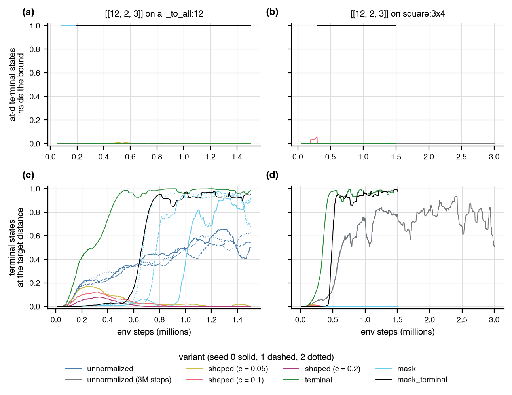
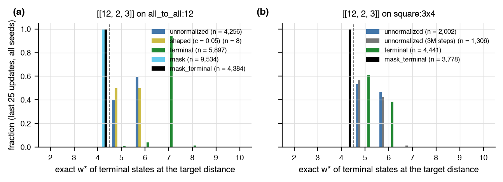
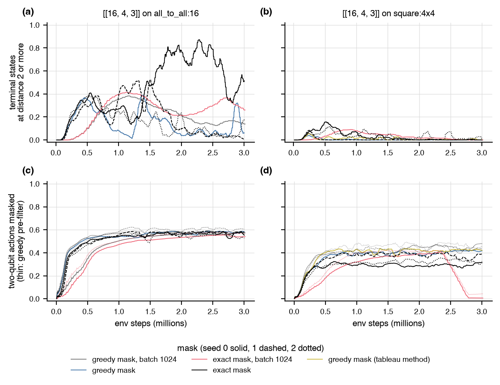
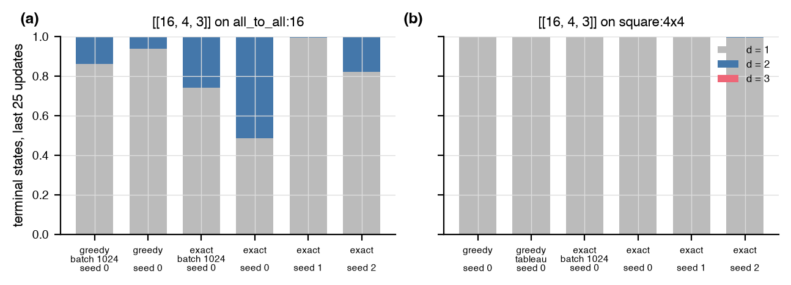

# Sparsity as a property of the trained policy

Status: partial (32 of 60 planned runs; the pending cells are listed at the end). Every number below comes from a JSON under
`experiments/ldpc_sparsity/runs/` (named in the last column of the run table);
the tables and figures regenerate with
`uv run --extra rl python -m experiments.ldpc_sparsity.run report`
and this file with `uv run --extra rl python -m experiments.ldpc_sparsity.assemble_report`.
Code: `src/autoqec_sim/ldpc.py` (`LdpcObjective` forms `shaped` and `terminal`,
`heavy_generator_count`, `greedy_action_mask`),
`experiments/ldpc_sparsity/run.py`. Logs: `experiments/ldpc_sparsity/runs/logs/`;
compute records: `experiments/ldpc_sparsity/runs/compute_pod.jsonl`, imported into
`genesis/ledger/compute.jsonl`.

## Question

`experiments/ldpc_scaling/REPORT.md` left the sparsity half of the LDPC
constraint open: the `unnormalized` form learns distance-3 codes at
`n = 12` to `16` but its policies produce codes at `w*` one to four above
`w_max = 4`, and the three codes within the bound were single episodes.
Measured here: the fraction of terminal states at the target distance
whose exact `w*` is within the bound, over the last 25 updates of every
run (2,560 terminal states) and along the run, for three ways of pricing
or enforcing the bound against `unnormalized` at equal budget in env
steps. The success criterion set in advance: a variant works if a
majority of its at-distance terminal states are inside the bound on
both 12-qubit cells, on every seed.

## Setup

Cells: `[[12, 2, 3]]` on `all_to_all:12` (H, S, CNOT; 156 actions) and on
`square:3x4` (H, CNOT; 46 actions), `[[16, 4, 3]]` on `square:4x4` (H,
CNOT; 64 actions), `w_max = 4`, no idle qubit. Episodes of 40 gates, 256
parallel episodes, `PPOConfig` defaults with `policy="equivariant"`,
seeds 0, 1, and 2 planned per cell, 1.5M env steps per run
(1,503,232 to 3,014,656 reached; the wall cap of 240 minutes never bound). Runs on the
RunPod pod's CPU (Xeon Gold 6342, no CUDA device visible, 2, 6, and 8 BLAS and torch
threads per run, three runs at a time (four at 6 threads for the
exact-mask section, on a host at load 10 to 190 from other tenants),
1-minute load 7 to 22 on 96
logical cores; 8 threads instead of the 4 first planned because the
PPO update of the equivariant network took 9.0 s at 4 threads and 5.9 s
at 8 on this CPU, single run). Env-step throughput per run is in the run
table (`env steps/s`).

Variants (`ldpc.LdpcObjective` forms unless noted; the base terms of every
one are the per-error Knill-Laflamme count and the padding count of the
`unnormalized` form, divided by the initial state's undetected count
`r0 = 75` at `[[12, 2]]` and `210` at `[[16, 4]]`):

| variant | sparsity signal | episode ends |
|---|---|---|
| `unnormalized` (reference, `DEFAULT_LDPC_FORM`) | `-0.25 max(0, w* - 4) / r0` on every state (greedy bound, exact on candidates) | reward 0: candidate with exact `w* <= 4` |
| `shaped (c)` | `-c max(0, w* - 4)` in reward units on every state (greedy bound, exact on candidates); one unit of excess costs `c r0` = 3.75, 7.5, and 15 undetected errors at `c` = 0.05, 0.1, and 0.2 (0.25 in `unnormalized`) | reward 0 |
| `terminal` | none on the path; a candidate (every error detected, no idle qubit) scores `1 - h / (n - k)`, `h` the number of generators of the sparsest basis with weight above 4 (`m - rank` of the light elements, exact) | any candidate, feasible or not |
| `mask` | `unnormalized` reward; a two-qubit gate whose resulting state has greedy `w*` above 4 is masked out of the logits (`ldpc.greedy_action_mask`, all CNOT trials in one batched call, 0.13 s per step on `all_to_all:12`) | reward 0 |
| `mask_terminal` (added after the first results) | the mask of `mask` on top of the `terminal` reward: every admitted candidate has `h = 0`, so the terminal bonus is 1 for every feasible code and the path reward has no sparsity term | any candidate (all feasible under the mask) |

The degree-bounded environment of the plan's item (iv) was not built:
the environment is a Clifford-circuit environment whose checks are the
rows of the tableau, not objects the circuit can bound per qubit by
construction, so a degree bound is a reward or mask term
(`LdpcObjective(deg_max=...)`, `greedy_action_mask` on the degree) and
not a natural extension of `env.py`.

## Results

### Summary per variant

Terminal-state columns are over the last 25 updates of every seed (2,560
terminal states per run). "Inside the bound" is exact `w* <= 4` among the
terminal states at distance 3 (the quantity of the success criterion);
"heavy generators" is `h` of the `terminal` form, computed for every
variant.

| target | graph | variant | seeds | env steps per run | at-d terminal states inside the bound, percent (per seed; pooled) | terminal states at d = 3, percent (per seed) | first feasible code, env steps (per seed) | feasible successes (per seed) | w* histogram of at-d terminal states (w* = 1, 2, ...) | heavy-generator histogram of at-d terminal states (h = 0, 1, ...) | wall (s, per seed) |
|---|---|---|---|---|---|---|---|---|---|---|---|
| [[12, 2, 3]] | all_to_all:12 | unnormalized | 3 | 1,503,232, 1,503,232, 1,503,232 | 0, 0, 0; 0 | 50, 54, 62 | none, none, 373,248 | 0, 0, 2 | [0, 0, 0, 0, 1706, 2537, 13] | [0, 0, 2, 40, 191, 505, 906, 1132, 891, 472, 117] | 6699, 4908, 5276 |
| [[12, 2, 3]] | all_to_all:12 | shaped (c = 0.05) | 1 | 1,503,232 | 0; 0 | 0 | 346,880 | 3 | [0, 0, 0, 0, 4, 4] | [0, 0, 0, 1, 2, 0, 4, 1] | 4156 |
| [[12, 2, 3]] | all_to_all:12 | shaped (c = 0.1) | 1 | 1,503,232 | n/a; n/a | 0 | none | 0 | n/a | n/a | 5999 |
| [[12, 2, 3]] | all_to_all:12 | shaped (c = 0.2) | 1 | 1,503,232 | n/a; n/a | 0 | none | 0 | n/a | n/a | 3567 |
| [[12, 2, 3]] | all_to_all:12 | terminal | 1 | 1,503,232 | 0; 0 | 98 | 250,880 | 2 | [0, 0, 0, 0, 44, 225, 5558, 68, 2] | [0, 1, 5520, 199, 107, 39, 22, 7, 2] | 6684 |
| [[12, 2, 3]] | all_to_all:12 | mask | 3 | 1,503,232, 1,503,232, 1,503,232 | 100, 100, 100; 100 | 91, 68, 89 | 92,160, 81,152, 120,576 | 15764, 27274, 35589 | [0, 0, 0, 9534] | [9534] | 8434, 9447, 9678 |
| [[12, 2, 3]] | all_to_all:12 | mask_terminal | 1 | 1,503,232 | 100; 100 | 95 | 192,512 | 35841 | [0, 0, 0, 4384] | [4384] | 9216 |
| [[12, 2, 3]] | square:3x4 | unnormalized | 1 | 1,503,232 | 0; 0 | 78 | none | 0 | [0, 0, 0, 0, 1065, 935, 2] | [0, 1, 13, 82, 248, 582, 663, 321, 76, 15, 1] | 1844 |
| [[12, 2, 3]] | square:3x4 | unnormalized (3M steps) | 1 | 3,002,368 | 0; 0 | 51 | none | 0 | [0, 0, 0, 0, 738, 552, 16] | [0, 0, 1, 23, 81, 195, 494, 454, 55, 3] | 4260 |
| [[12, 2, 3]] | square:3x4 | shaped (c = 0.05) | 1 | 1,503,232 | n/a; n/a | 0 | none | 0 | n/a | n/a | 1478 |
| [[12, 2, 3]] | square:3x4 | shaped (c = 0.1) | 1 | 1,503,232 | n/a; n/a | 0 | 194,304 | 1 | n/a | n/a | 1383 |
| [[12, 2, 3]] | square:3x4 | shaped (c = 0.2) | 1 | 1,503,232 | n/a; n/a | 0 | none | 0 | n/a | n/a | 1188 |
| [[12, 2, 3]] | square:3x4 | terminal | 1 | 1,503,232 | 0; 0 | 99 | none | 0 | [0, 0, 0, 0, 2713, 1713, 14, 1] | [0, 0, 5, 3940, 457, 34, 4, 1] | 1774 |
| [[12, 2, 3]] | square:3x4 | mask | 1 | 1,503,232 | n/a; n/a | 0 | 296,448 | 2 | n/a | n/a | 2502 |
| [[12, 2, 3]] | square:3x4 | mask_terminal | 1 | 1,503,232 | 100; 100 | 98 | 296,448 | 37213 | [0, 0, 0, 3778] | [3778] | 3490 |
| [[16, 4, 3]] | square:4x4 | mask_terminal (3M steps) | 1 | 3,002,368 | n/a; n/a | 0 | none | 0 | n/a | n/a | 10971 |
| [[16, 4, 3]] | square:4x4 | mask_terminal (3M steps, tableau mask) | 1 | 3,002,368 | n/a; n/a | 0 | none | 0 | n/a | n/a | 2840 |
| [[16, 4, 3]] | square:4x4 | mask_terminal (exact mask) (3M steps, batch 1024) | 1 | 3,014,656 | n/a; n/a | 0 | none | 0 | n/a | n/a | 4736 |
| [[16, 4, 3]] | square:4x4 | mask_terminal (exact mask) (3M steps) | 3 | 3,002,368, 3,002,368, 3,002,368 | n/a, n/a, n/a; n/a | 0, 0, 0 | none, none, none | 0, 0, 0 | n/a | n/a | 12088, 9502, 10568 |
| [[16, 4, 3]] | all_to_all:16 | mask_terminal (3M steps, batch 1024) | 1 | 3,014,656 | n/a; n/a | 0 | none | 0 | n/a | n/a | 3665 |
| [[16, 4, 3]] | all_to_all:16 | mask_terminal (3M steps) | 1 | 3,002,368 | n/a; n/a | 0 | none | 0 | n/a | n/a | 22212 |
| [[16, 4, 3]] | all_to_all:16 | mask_terminal (exact mask) (3M steps, batch 1024) | 1 | 3,014,656 | n/a; n/a | 0 | none | 0 | n/a | n/a | 17949 |
| [[16, 4, 3]] | all_to_all:16 | mask_terminal (exact mask) (3M steps) | 3 | 3,002,368, 3,002,368, 3,002,368 | n/a, n/a, n/a; n/a | 0, 0, 0 | 1,565,696, none, none | 1, 0, 0 | n/a | n/a | 27719, 28135, 27972 |
| [[20, 4, 3]] | all_to_all:20 | mask_terminal (3M steps, batch 1024) | 1 | 3,014,656 | n/a; n/a | 0 | none | 0 | n/a | n/a | 5797 |

### Runs

| target | graph | variant | seed | env steps | updates | wall (s) | env steps/s | first feasible code: env steps, gates, d, w*, degree, CSS | feasible successes (distinct) | terminal states, last 25 updates: n, at d = 3, inside the bound, inside percent of at-d, mode of w* at d | whole run: at d = 3, inside, percent | mask: fraction of two-qubit actions masked (last 25 updates), mask time (s) | probe (256 sampled episodes): at d = 3, feasible, mode of w* | file |
|---|---|---|---|---|---|---|---|---|---|---|---|---|---|---|
| [[12, 2, 3]] | all_to_all:12 | unnormalized | 0 | 1,503,232 | 367 | 6699 | 224 | none | 0 (0) | 2,560, 1,279, 0, 0, 6 | 14,894, 0, 0 | n/a | 181, 0, 6 | `unnormalized_n12_k2_all_to_all_seed0.json` |
| [[12, 2, 3]] | all_to_all:12 | unnormalized | 1 | 1,503,232 | 367 | 4908 | 306 | none | 0 (0) | 2,560, 1,383, 0, 0, 6 | 13,570, 0, 0 | n/a | 126, 0, 6 | `unnormalized_n12_k2_all_to_all_seed1.json` |
| [[12, 2, 3]] | all_to_all:12 | unnormalized | 2 | 1,503,232 | 367 | 5276 | 285 | 373,248, 18, 3, 4, 3, no | 2 (2) | 2,560, 1,594, 0, 0, 6 | 14,707, 2, 0 | n/a | 175, 0, 6 | `unnormalized_n12_k2_all_to_all_seed2.json` |
| [[12, 2, 3]] | all_to_all:12 | shaped (c = 0.05) | 0 | 1,503,232 | 367 | 4156 | 362 | 346,880, 35, 3, 4, 4, yes | 3 (3) | 2,560, 8, 0, 0, 5 | 1,687, 3, 0 | n/a | 0, 0, 4 | `shaped_c0.05_n12_k2_all_to_all_seed0.json` |
| [[12, 2, 3]] | all_to_all:12 | shaped (c = 0.1) | 0 | 1,503,232 | 367 | 5999 | 251 | none | 0 (0) | 2,560, 0, 0, n/a, n/a | 1,188, 0, 0 | n/a | 0, 0, 4 | `shaped_c0.1_n12_k2_all_to_all_seed0.json` |
| [[12, 2, 3]] | all_to_all:12 | shaped (c = 0.2) | 0 | 1,503,232 | 367 | 3567 | 421 | none | 0 (0) | 2,560, 0, 0, n/a, n/a | 608, 0, 0 | n/a | 0, 0, 4 | `shaped_c0.2_n12_k2_all_to_all_seed0.json` |
| [[12, 2, 3]] | all_to_all:12 | terminal | 0 | 1,503,232 | 367 | 6684 | 225 | 250,880, 27, 3, 4, 4, no | 2 (2) | 6,004, 5,897, 0, 0, 7 | 68,653, 2, 0 | n/a | 98, 0, 6 | `terminal_n12_k2_all_to_all_seed0.json` |
| [[12, 2, 3]] | all_to_all:12 | mask | 0 | 1,503,232 | 367 | 8434 | 178 | 92,160, 40, 3, 4, 4, no | 15764 (769) | 3,643, 3,325, 3,325, 100, 4 | 15,775, 15,775, 100 | 51.7 percent, 2947 | 48, 0, 6 | `mask_n12_k2_all_to_all_seed0.json` |
| [[12, 2, 3]] | all_to_all:12 | mask | 1 | 1,503,232 | 367 | 9447 | 159 | 81,152, 37, 3, 4, 4, no | 27274 (1523) | 3,578, 2,422, 2,422, 100, 4 | 27,296, 27,296, 100 | 49.9 percent, 3221 | 24, 0, 6 | `mask_n12_k2_all_to_all_seed1.json` |
| [[12, 2, 3]] | all_to_all:12 | mask | 2 | 1,503,232 | 367 | 9678 | 155 | 120,576, 31, 3, 4, 4, no | 35589 (2248) | 4,241, 3,787, 3,787, 100, 4 | 35,597, 35,597, 100 | 45.3 percent, 3329 | 40, 0, 6 | `mask_n12_k2_all_to_all_seed2.json` |
| [[12, 2, 3]] | all_to_all:12 | mask_terminal | 0 | 1,503,232 | 367 | 9216 | 163 | 192,512, 32, 3, 4, 4, no | 35841 (2151) | 4,625, 4,384, 4,384, 100, 4 | 35,856, 35,856, 100 | 39.6 percent, 3158 | 91, 0, 6 | `mask_terminal_n12_k2_all_to_all_seed0.json` |
| [[12, 2, 3]] | square:3x4 | unnormalized | 0 | 1,503,232 | 367 | 1844 | 815 | none | 0 (0) | 2,560, 2,002, 0, 0, 5 | 17,629, 0, 0 | n/a | 119, 0, 6 | `unnormalized_n12_k2_square_seed0.json` |
| [[12, 2, 3]] | square:3x4 | unnormalized (3M steps) | 0 | 3,002,368 | 733 | 4260 | 705 | none | 0 (0) | 2,560, 1,306, 0, 0, 5 | 46,029, 0, 0 | n/a | 247, 0, 5 | `unnormalized_3M_n12_k2_square_seed0.json` |
| [[12, 2, 3]] | square:3x4 | shaped (c = 0.05) | 0 | 1,503,232 | 367 | 1478 | 1,017 | none | 0 (0) | 2,560, 0, 0, n/a, n/a | 59, 0, 0 | n/a | 0, 0, 4 | `shaped_c0.05_n12_k2_square_seed0.json` |
| [[12, 2, 3]] | square:3x4 | shaped (c = 0.1) | 0 | 1,503,232 | 367 | 1383 | 1,087 | 194,304, 39, 3, 4, 3, no | 1 (1) | 2,560, 0, 0, n/a, n/a | 61, 1, 2 | n/a | 0, 0, 4 | `shaped_c0.1_n12_k2_square_seed0.json` |
| [[12, 2, 3]] | square:3x4 | shaped (c = 0.2) | 0 | 1,503,232 | 367 | 1188 | 1,266 | none | 0 (0) | 2,560, 0, 0, n/a, n/a | 5, 0, 0 | n/a | 0, 0, 4 | `shaped_c0.2_n12_k2_square_seed0.json` |
| [[12, 2, 3]] | square:3x4 | terminal | 0 | 1,503,232 | 367 | 1774 | 847 | none | 0 (0) | 4,499, 4,441, 0, 0, 5 | 51,322, 0, 0 | n/a | 53, 0, 6 | `terminal_n12_k2_square_seed0.json` |
| [[12, 2, 3]] | square:3x4 | mask | 0 | 1,503,232 | 367 | 2502 | 601 | 296,448, 38, 3, 4, 5, no | 2 (2) | 2,560, 0, 0, n/a, n/a | 2, 2, 100 | 45.5 percent, 497 | 2, 0, 5 | `mask_n12_k2_square_seed0.json` |
| [[12, 2, 3]] | square:3x4 | mask_terminal | 0 | 1,503,232 | 367 | 3490 | 431 | 296,448, 38, 3, 4, 5, no | 37213 (166) | 3,866, 3,778, 3,778, 100, 4 | 37,213, 37,213, 100 | 26.2 percent, 601 | 98, 0, 5 | `mask_terminal_n12_k2_square_seed0.json` |
| [[16, 4, 3]] | square:4x4 | mask_terminal (3M steps) | 0 | 3,002,368 | 733 | 10971 | 274 | none | 0 (0) | 2,560, 0, 0, n/a, n/a | 0, 0, n/a | 41.7 percent, 376 | 0, 0, 7 | `mask_terminal_3M_n16_k4_square_seed0.json` |
| [[16, 4, 3]] | square:4x4 | mask_terminal (3M steps, tableau mask) | 0 | 3,002,368 | 733 | 2840 | 1,057 | none | 0 (0) | 2,560, 0, 0, n/a, n/a | 0, 0, n/a | 42.1 percent, 1097 | 0, 0, 7 | `mask_terminal_3M_tableau_n16_k4_square_seed0.json` |
| [[16, 4, 3]] | square:4x4 | mask_terminal (exact mask) (3M steps, batch 1024) | 0 | 3,014,656 | 184 | 4736 | 637 | none | 0 (0) | 10,240, 0, 0, n/a, n/a | 0, 0, n/a | 0.6 percent, 756 | 0, 0, 3 | `mask_terminal_exact_3M_b1024_n16_k4_square_seed0.json` |
| [[16, 4, 3]] | square:4x4 | mask_terminal (exact mask) (3M steps) | 0 | 3,002,368 | 733 | 12088 | 248 | none | 0 (0) | 2,560, 0, 0, n/a, n/a | 0, 0, n/a | 31.4 percent, 1089 | 0, 0, 6 | `mask_terminal_exact_3M_n16_k4_square_seed0.json` |
| [[16, 4, 3]] | square:4x4 | mask_terminal (exact mask) (3M steps) | 1 | 3,002,368 | 733 | 9502 | 316 | none | 0 (0) | 2,560, 0, 0, n/a, n/a | 0, 0, n/a | 39.0 percent, 978 | 0, 0, 7 | `mask_terminal_exact_3M_n16_k4_square_seed1.json` |
| [[16, 4, 3]] | square:4x4 | mask_terminal (exact mask) (3M steps) | 2 | 3,002,368 | 733 | 10568 | 284 | none | 0 (0) | 2,560, 0, 0, n/a, n/a | 0, 0, n/a | 32.4 percent, 1016 | 0, 0, 5 | `mask_terminal_exact_3M_n16_k4_square_seed2.json` |
| [[16, 4, 3]] | all_to_all:16 | mask_terminal (3M steps, batch 1024) | 0 | 3,014,656 | 184 | 3665 | 823 | none | 0 (0) | 10,240, 0, 0, n/a, n/a | 0, 0, n/a | 57.3 percent, 1510 | 0, 0, 8 | `mask_terminal_3M_b1024_n16_k4_all_to_all_seed0.json` |
| [[16, 4, 3]] | all_to_all:16 | mask_terminal (3M steps) | 0 | 3,002,368 | 733 | 22212 | 135 | none | 0 (0) | 2,560, 0, 0, n/a, n/a | 0, 0, n/a | 58.2 percent, 1966 | 0, 0, 7 | `mask_terminal_3M_n16_k4_all_to_all_seed0.json` |
| [[16, 4, 3]] | all_to_all:16 | mask_terminal (exact mask) (3M steps, batch 1024) | 0 | 3,014,656 | 184 | 17949 | 168 | none | 0 (0) | 10,240, 0, 0, n/a, n/a | 0, 0, n/a | 54.0 percent, 5182 | 1, 0, 8 | `mask_terminal_exact_3M_b1024_n16_k4_all_to_all_seed0.json` |
| [[16, 4, 3]] | all_to_all:16 | mask_terminal (exact mask) (3M steps) | 0 | 3,002,368 | 733 | 27719 | 108 | 1,565,696, 36, 3, 4, 3, no | 1 (1) | 2,560, 0, 0, n/a, n/a | 1, 1, 100 | 55.3 percent, 7471 | 6, 0, 7 | `mask_terminal_exact_3M_n16_k4_all_to_all_seed0.json` |
| [[16, 4, 3]] | all_to_all:16 | mask_terminal (exact mask) (3M steps) | 1 | 3,002,368 | 733 | 28135 | 107 | none | 0 (0) | 2,560, 0, 0, n/a, n/a | 0, 0, n/a | 58.0 percent, 7502 | 0, 0, 7 | `mask_terminal_exact_3M_n16_k4_all_to_all_seed1.json` |
| [[16, 4, 3]] | all_to_all:16 | mask_terminal (exact mask) (3M steps) | 2 | 3,002,368 | 733 | 27972 | 107 | none | 0 (0) | 2,560, 0, 0, n/a, n/a | 0, 0, n/a | 52.8 percent, 7480 | 1, 0, 7 | `mask_terminal_exact_3M_n16_k4_all_to_all_seed2.json` |
| [[20, 4, 3]] | all_to_all:20 | mask_terminal (3M steps, batch 1024) | 0 | 3,014,656 | 184 | 5797 | 520 | none | 0 (0) | 8,192, 0, 0, n/a, n/a | 0, 0, n/a | 59.4 percent, 3793 | 8, 0, 10 | `mask_terminal_3M_b1024_n20_k4_all_to_all_seed0.json` |

### Figures

Top row: fraction of the terminal states at distance 3 that are inside
the bound, over a trailing 25-update window, against env steps; bottom
row: fraction of all terminal states at the target distance. One column
per comparison cell (cells run with a single variant, the scaling cells,
are in the tables only), one color per variant, seed 0 solid, 1 dashed,
2 dotted. A gap in a top-row line is a window without any state at the
target distance.

Distribution of the exact `w*` of the terminal states at distance 3 over
the last 25 updates, pooled over seeds; the dashed line is `w_max = 4`.

### Reading

- `[[12, 2, 3]]` on `all_to_all:12`.
  - unnormalized (seeds 0, 1, and 2): 0, 0, and 0 percent of the at-distance terminal states inside the bound (pooled 0 percent), 50, 54, and 62 percent of all terminal states at distance 3, first feasible code at 373,248 env steps, 0, 0, and 2 feasible successes, mode of `w*` at distance 3: 6, 6, and 6; 4908 to 6699 s wall at 224 to 306 env steps/s.
  - shaped (c = 0.05) (seed 0): 0 percent of the at-distance terminal states inside the bound (pooled 0 percent), 0 percent of all terminal states at distance 3, first feasible code at 346,880 env steps, 3 feasible successes, mode of `w*` at distance 3: 5; 4156 s wall at 362 env steps/s.
  - shaped (c = 0.1) (seed 0): no terminal state at distance 3 in the last 25 updates (the inside-the-bound fraction is undefined), 0 percent of all terminal states at distance 3, no feasible code, 0 feasible successes, no state at distance 3; 5999 s wall at 251 env steps/s.
  - shaped (c = 0.2) (seed 0): no terminal state at distance 3 in the last 25 updates (the inside-the-bound fraction is undefined), 0 percent of all terminal states at distance 3, no feasible code, 0 feasible successes, no state at distance 3; 3567 s wall at 421 env steps/s.
  - terminal (seed 0): 0 percent of the at-distance terminal states inside the bound (pooled 0 percent), 98 percent of all terminal states at distance 3, first feasible code at 250,880 env steps, 2 feasible successes, mode of `w*` at distance 3: 7; 6684 s wall at 225 env steps/s.
  - mask (seeds 0, 1, and 2): 100, 100, and 100 percent of the at-distance terminal states inside the bound (pooled 100 percent), 91, 68, and 89 percent of all terminal states at distance 3, first feasible code at 92,160, 81,152, and 120,576 env steps, 15764, 27274, and 35589 feasible successes, mode of `w*` at distance 3: 4, 4, and 4; 45 to 52 percent of the two-qubit actions masked over the last 25 updates; 8434 to 9678 s wall at 155 to 178 env steps/s.
  - mask_terminal (seed 0): 100 percent of the at-distance terminal states inside the bound (pooled 100 percent), 95 percent of all terminal states at distance 3, first feasible code at 192,512 env steps, 35841 feasible successes, mode of `w*` at distance 3: 4; 40 percent of the two-qubit actions masked over the last 25 updates; 9216 s wall at 163 env steps/s.
- `[[12, 2, 3]]` on `square:3x4`.
  - unnormalized (seed 0): 0 percent of the at-distance terminal states inside the bound (pooled 0 percent), 78 percent of all terminal states at distance 3, no feasible code, 0 feasible successes, mode of `w*` at distance 3: 5; 1844 s wall at 815 env steps/s.
  - shaped (c = 0.05) (seed 0): no terminal state at distance 3 in the last 25 updates (the inside-the-bound fraction is undefined), 0 percent of all terminal states at distance 3, no feasible code, 0 feasible successes, no state at distance 3; 1478 s wall at 1,017 env steps/s.
  - shaped (c = 0.1) (seed 0): no terminal state at distance 3 in the last 25 updates (the inside-the-bound fraction is undefined), 0 percent of all terminal states at distance 3, first feasible code at 194,304 env steps, 1 feasible success, no state at distance 3; 1383 s wall at 1,087 env steps/s.
  - shaped (c = 0.2) (seed 0): no terminal state at distance 3 in the last 25 updates (the inside-the-bound fraction is undefined), 0 percent of all terminal states at distance 3, no feasible code, 0 feasible successes, no state at distance 3; 1188 s wall at 1,266 env steps/s.
  - terminal (seed 0): 0 percent of the at-distance terminal states inside the bound (pooled 0 percent), 99 percent of all terminal states at distance 3, no feasible code, 0 feasible successes, mode of `w*` at distance 3: 5; 1774 s wall at 847 env steps/s.
  - mask (seed 0): no terminal state at distance 3 in the last 25 updates (the inside-the-bound fraction is undefined), 0 percent of all terminal states at distance 3, first feasible code at 296,448 env steps, 2 feasible successes, no state at distance 3; 46 percent of the two-qubit actions masked over the last 25 updates; 2502 s wall at 601 env steps/s.
  - mask_terminal (seed 0): 100 percent of the at-distance terminal states inside the bound (pooled 100 percent), 98 percent of all terminal states at distance 3, first feasible code at 296,448 env steps, 37213 feasible successes, mode of `w*` at distance 3: 4; 26 percent of the two-qubit actions masked over the last 25 updates; 3490 s wall at 431 env steps/s.

### Longer budget for the unnormalized form

- `[[12, 2, 3]]` on `square:3x4`, seed 0, 3,002,368 env steps: 0 percent of the at-distance terminal states inside the bound, 51 percent of terminal states at distance 3, mode of `w*` at distance 3: 5, 0 feasible successes (the 1.5M run of the same seed: 0 percent inside, 78 percent at distance 3); `unnormalized_3M_n12_k2_square_seed0.json`.

## Exact feasibility mask

The greedy bound of `greedy_action_mask` is an upper bound on `w*`, so it
can forbid a two-qubit gate whose resulting group is feasible. The exact
method (`method="exact"`) keeps the greedy bound as a pre-filter and runs
the exact feasibility test on every (state, action) pair the bound rejects:
a CNOT changes the weight of a Pauli by at most one, so the elements light
after the gate are among the elements of weight `<= w_max + 1` before it,
enumerated once per state from the `2^(n - k)` group elements and shared by
all of the state's actions; the gate is admitted iff the elements it leaves
at weight `<= w_max` have rank `n - k` (elimination over the `n - k`
coefficient bits). A cache keyed by the state's greedy basis keeps the
enumeration across steps for states seen again. Exact for `n - k <= 15`;
above that the method falls back to the greedy basis bound and records it.
Tests: the exact mask equals `ldpc_feasible` on every trial action, admits
everything the greedy bound admits, and admits some moves it forbids
(`tests/test_ldpc.py`).

Cost of the mask per env step, random policy under the exact mask, the
cell's episode length, pod CPU at 6 threads (`ldpc_sparsity bench-mask`):

| cell | batch | two-qubit actions | greedy: mean, max (s per call) | exact: mean, max (s per call) | greedy-rejected pairs per call, of which exact admits (percent) | microseconds per exact test | two-qubit actions masked, mean (greedy; exact) | cache hit rate |
|---|---|---|---|---|---|---|---|---|
| n16_k4_all_to_all | 1024 | 240 | 0.783, 1.313 | 2.252, 6.423 | 15,482, 65 | 95 | 6.3; 2.2 percent | 44 percent |
| n16_k4_all_to_all | 256 | 240 | 0.126, 0.214 | 0.530, 1.711 | 3,896, 61 | 104 | 6.3; 2.5 percent | 42 percent |
| n16_k4_square | 1024 | 48 | 0.123, 0.197 | 0.503, 1.113 | 889, 26 | 428 | 1.8; 1.3 percent | 48 percent |
| n16_k4_square | 256 | 48 | 0.057, 0.180 | 0.170, 0.307 | 252, 24 | 450 | 2.1; 1.6 percent | 43 percent |

Runs: `mask_terminal` on the two `[[16, 4, 3]]` cells, 3M env steps, exact
mask at batch 256 (three seeds) and 1024 (seed 0), the greedy mask at batch
256 (seed 0) as the control at equal update count, and the earlier greedy
runs (batch 1024 on the pod's GPU on `all_to_all:16`; the tableau-method run
at batch 256 on `square:4x4`).

| target | graph | mask | batch | seed | env steps | updates | wall (s) | env steps/s | terminal states, last 25 updates: n, at d = 1, 2, 3 | at-d inside the bound | feasible successes (distinct codes) | first feasible code, env steps | two-qubit actions masked, last 25 updates (greedy pre-filter; final) | exact tests per call, admitted (percent) | time split: mask, reward, update, rest (percent) | file |
|---|---|---|---|---|---|---|---|---|---|---|---|---|---|---|---|---|
| [[16, 4, 3]] | square:4x4 | greedy (basis) | 256 | 0 | 3,002,368 | 733 | 10971 | 274 | 2,560: 2,560, 0, 0 | no state at d = 3 | 0 (0) | none | n/a; 42 | n/a | 3, 21, 67, 8 | `mask_terminal_3M_n16_k4_square_seed0.json` |
| [[16, 4, 3]] | square:4x4 | greedy (tableau) | 256 | 0 | 3,002,368 | 733 | 2840 | 1,057 | 2,560: 2,556, 4, 0 | no state at d = 3 | 0 (0) | none | n/a; 42 | n/a | 39, 0, 0, 61 | `mask_terminal_3M_tableau_n16_k4_square_seed0.json` |
| [[16, 4, 3]] | square:4x4 | exact | 1024 | 0 | 3,014,656 | 184 | 4736 | 637 | 10,240: 10,240, 0, 0 | no state at d = 3 | 0 (0) | none | 4; 1 | 14,375, 14 | 16, 25, 46, 13 | `mask_terminal_exact_3M_b1024_n16_k4_square_seed0.json` |
| [[16, 4, 3]] | square:4x4 | exact | 256 | 0 | 3,002,368 | 733 | 12088 | 248 | 2,560: 2,560, 0, 0 | no state at d = 3 | 0 (0) | none | 48; 31 | 4,963, 30 | 9, 20, 63, 8 | `mask_terminal_exact_3M_n16_k4_square_seed0.json` |
| [[16, 4, 3]] | square:4x4 | exact | 256 | 1 | 3,002,368 | 733 | 9502 | 316 | 2,560: 2,560, 0, 0 | no state at d = 3 | 0 (0) | none | 43; 39 | 4,954, 12 | 10, 19, 61, 10 | `mask_terminal_exact_3M_n16_k4_square_seed1.json` |
| [[16, 4, 3]] | square:4x4 | exact | 256 | 2 | 3,002,368 | 733 | 10568 | 284 | 2,560: 2,545, 15, 0 | no state at d = 3 | 0 (0) | none | 45; 32 | 5,254, 29 | 10, 21, 62, 7 | `mask_terminal_exact_3M_n16_k4_square_seed2.json` |
| [[16, 4, 3]] | all_to_all:16 | greedy (basis) | 1024 | 0 | 3,014,656 | 184 | 3665 | 823 | 10,240: 8,821, 1,419, 0 | no state at d = 3 | 0 (0) | none | n/a; 57 | n/a | 41, 1, 44, 14 | `mask_terminal_3M_b1024_n16_k4_all_to_all_seed0.json` |
| [[16, 4, 3]] | all_to_all:16 | greedy (basis) | 256 | 0 | 3,002,368 | 733 | 22212 | 135 | 2,560: 2,405, 155, 0 | no state at d = 3 | 0 (0) | none | n/a; 58 | n/a | 9, 9, 71, 11 | `mask_terminal_3M_n16_k4_all_to_all_seed0.json` |
| [[16, 4, 3]] | all_to_all:16 | exact | 1024 | 0 | 3,014,656 | 184 | 17949 | 168 | 10,240: 7,574, 2,666, 0 | no state at d = 3 | 0 (0) | none | 57; 54 | 126,040, 7 | 29, 6, 56, 9 | `mask_terminal_exact_3M_b1024_n16_k4_all_to_all_seed0.json` |
| [[16, 4, 3]] | all_to_all:16 | exact | 256 | 0 | 3,002,368 | 733 | 27719 | 108 | 2,560: 1,244, 1,316, 0 | no state at d = 3 | 1 (1) | 1,565,696 | 57; 55 | 33,748, 4 | 27, 6, 59, 8 | `mask_terminal_exact_3M_n16_k4_all_to_all_seed0.json` |
| [[16, 4, 3]] | all_to_all:16 | exact | 256 | 1 | 3,002,368 | 733 | 28135 | 107 | 2,560: 2,545, 15, 0 | no state at d = 3 | 0 (0) | none | 61; 58 | 34,723, 7 | 27, 11, 54, 8 | `mask_terminal_exact_3M_n16_k4_all_to_all_seed1.json` |
| [[16, 4, 3]] | all_to_all:16 | exact | 256 | 2 | 3,002,368 | 733 | 27972 | 107 | 2,560: 2,101, 459, 0 | no state at d = 3 | 0 (0) | none | 56; 53 | 33,574, 6 | 27, 7, 58, 9 | `mask_terminal_exact_3M_n16_k4_all_to_all_seed2.json` |

Top row: fraction of terminal states at distance 3 over a trailing
25-update window; bottom row: fraction of two-qubit actions masked per
update (for the exact runs the thin line of the same color is the fraction
the greedy pre-filter rejected before the exact test admitted some back).
Color by mask method and batch, seed 0 solid, 1 dashed, 2 dotted.

Distance distribution of the terminal states of the last 25 updates, one
bar per run.

Reading. The exact mask does not make `[[16, 4, 3]]` learnable on either
graph in 3M env steps: of the eight exact-mask runs (three seeds per graph at batch 256, one per graph at batch 1024), one produced a distance-3 terminal state, once, and every run ends with all or nearly all of its terminal states below distance 3. What it changes is the
distance distribution below the target and, on the lattice, the size of the
constrained set.

- `all_to_all:16`. The greedy bound is nearly exact here: the exact test
  admits 4 to 7 percent of the pairs the bound rejects (17.6M of 421M,
  28.4M of 433M, and 26.7M of 418M over seeds 0, 1, and 2), so the masked
  fraction of two-qubit actions ends at 55, 58, and 53 percent against 57,
  61, and 56 percent for the greedy pre-filter and 58 percent for the greedy
  control at the same batch. The constrained set itself is what
  the policy cannot traverse to distance 3 in 40 gates, not the bound's
  slack. Inside it the exact-mask policy gets further than the greedy one:
  on seed 0, 51 percent of the terminal states of the last 25 updates at
  distance 2 (1,316 of 2,560; greedy control at batch 256: 155 of 2,560;
  greedy at batch 1024: 1,419 of 10,240), a trailing-window fraction at
  distance 2 or more of 0.6 to 0.85 between 1.5M and 2.6M env steps
  (greedy: at most 0.4), and one distance-3 terminal state in the whole
  run, at 1.57M env steps, a feasible `[[16, 4, 3]]` code (the greedy
  runs: none). Seeds 1 and 2 end lower, 15 and 459 of 2,560 at distance 2
  (1 and 18 percent) and no distance-3 state in either run, with 14,784
  and 11,730 distance-2 terminal states over the run against 10,692 for
  the greedy control; the three seeds share the same masked fraction and
  differ in where the policy settles. The unmasked probe of the final
  seed-0 policy (256 sampled episodes, no mask) ends 6 at distance 3, none
  feasible.
- `square:4x4`. The exact test admits 30, 12, and 29 percent of the
  rejected pairs (seeds 0, 1, and 2; 18.7M of 61.8M on seed 0), so the
  final masked fraction is 31, 39, and 32 percent against 48, 43, and 45
  percent for the pre-filter and 42 percent for both greedy controls; the
  peak over the run drops from 84 to 53 percent (seed 0; seed 2 peaks at 92
  percent for the pre-filter and 63 for the mask). The wider set does not
  reach distance 3 either: 2,285, 395, and 2,633 distance-2 terminal states
  over the run (the greedy basis control: 255, the tableau control: 753),
  at most 51, 29, and 88 in one update (greedy: 16), and the last 25
  updates at distance 1 on every state (seeds 0 and 1) or all but 15 (seed
  2). The policy collapses (entropy 0.55, 0.44, and 0.75 at the end) onto
  sparse distance-1 groups, as the greedy runs do.
- Batch. The greedy control at batch 256 (733 updates, the update count of
  the 12-qubit runs) is as negative as the batch-1024 run (184 updates):
  the update-count confound of the scaling section is closed. The exact
  mask at batch 1024 (184 updates) is negative on both graphs as well. On
  `all_to_all:16` it ends with 26 percent of the last-window terminal
  states at distance 2 (2,666 of 10,240; the greedy batch-1024 run: 14
  percent), 54 percent of two-qubit actions masked against 57 for the
  pre-filter, and no distance-3 state at any update. On `square:4x4` the
  policy drifts into a region where almost nothing is masked (0.6 percent
  of two-qubit actions at the end, 4 percent for the pre-filter, after a
  peak of 54 percent at update 50), with all 10,240 last-window terminal
  states at distance 1 and entropy 1.69: the plain distance-1 trap, without
  the sparse-boundary behavior of the batch-256 runs.

Cost. On the pod's CPU at 6 threads with four runs concurrent and a host
load of 30 to 190 from other tenants, the exact mask took 0.60 s per env
step on `all_to_all:16` (0.20 to 0.22 s greedy pre-filter, 0.38 to 0.40 s
exact test, 33,600 to 34,700 tests per call, 78 to 82 percent of them
distinct after merging identical states, cache hit rate 9 to 21 percent),
27 percent of the wall time against 54 to 59 percent for the PPO update;
the runs took 1.25 to 1.27 times the wall of the greedy control (27,719 to
28,135 against 22,212 s). On `square:4x4` it took 0.08 s per env step
(5,000 to 5,300 tests per call, 33 to 42 percent distinct, cache hit rate
49 to 61 percent), 9 to 10 percent of the wall time, 0.9 to 1.1 times the
greedy control's wall (9,502 to 12,088 against 10,971 s). The benchmark table above (random
policy under the exact mask, so fewer rejected pairs than a trained policy
produces) puts the mean at 0.53 s per call at batch 256 and 2.25 s at
batch 1024 on the all-to-all cell; the two reductions the plan named for a
cost above 2 s per step are both in the implementation already (all
actions of all states go through one batched elimination, and only the
pairs the greedy bound rejects are tested, which are exactly the CNOTs
that leave a heavy generator), so the batch-1024 runs were made as they
are. In the runs the exact mask took 1.66 s per env step on `all_to_all:16`
at batch 1024 (0.69 s pre-filter, 0.96 s exact test, 126,000 tests per
call, 99 percent distinct, cache hit rate 7 percent), 29 percent of the
wall time (17,949 s against 3,665 s for the greedy batch-1024 run on the
GPU-hosted policy of the scaling section, so the two are not comparable in
wall), and 0.24 s per env step on `square:4x4` (14,400 tests per call),
16 percent of the wall time. The wall-time comparisons
between runs are confounded by the pod's load: the same greedy
configuration on `square:4x4` took 2,840 s alone at 8 threads on
2026-09-22 and 10,971 s here.

Probe column. The probe of the final policy samples without the mask, so
for the masked variants it describes the unmasked policy, not the
constrained one; its distance-3 states need not be feasible.

What this says for `n = 20`. The exact test is available up to `n - k =
15`; `[[20, 4, 3]]` has 16 generators and would need either a smaller `k`
or a different test. But the all-to-all result makes the range question
secondary: at `n = 16` the greedy bound is already within 2 percentage
points of the exact mask, so the exact test would not change the `n = 20`
outcome either. What blocks distance 3 at `n >= 16` is the constrained set
under a 40-gate episode with H, S, and CNOT, not the bound's slack. The
routes left are a wider gate set inside the set (CZ, SWAP, so that a step
can move weight without passing through a heavy generator), a longer
episode, and a curriculum from the distance-2 groups the exact-mask policy
does reach on all-to-all (half its terminal states at the end).

## Verdict

The criterion (a majority of the at-distance terminal states inside the bound on the 12-qubit cells, every seed run) is met by mask_terminal:
- mask_terminal on `[[12, 2, 3]]` on `all_to_all:12`: 100 percent (seeds 0), pooled 100 percent.
- mask_terminal on `[[12, 2, 3]]` on `square:3x4`: 100 percent (seeds 0), pooled 100 percent.
- unnormalized on `[[12, 2, 3]]` on `all_to_all:12`: 0, 0, and 0 percent inside the bound (seeds 0, 1, and 2).
- unnormalized on `[[12, 2, 3]]` on `square:3x4`: 0 percent inside the bound (seeds 0).

Two variants make the bound a property of the trained policy, and they are the
two that enforce it in the action space rather than price it in the reward;
the one that does it on both 12-qubit cells is the greedy action mask on top
of the `terminal` reward (`mask_terminal`).

The action mask alone (`mask`) does it on `all_to_all:12` on all three seeds:
with the greedy `w*` bound enforced at every step every terminal state has `w*
<= 4` by construction (100 percent of the at-distance terminal states inside
the bound on every seed, all 10,864 terminal states of the three
last-25-update windows at `w* = 4` exactly), and the policy still learns
distance 3 inside the constrained set as its typical output: 91, 68, and 89
percent of the terminal states of the last 25 updates at distance 3 (seeds 0,
1, 2; the `unnormalized` reference on the same cell: 50, 54, and 62 percent,
none inside), 769, 1,523, and 2,248 distinct feasible `[[12, 2, 3]]` codes per
run (the reference: 0, 0, and 2 feasible episodes, single samples), the first
feasible code at 81k to 121k env steps, and the at-distance fraction over a
25-update window first passing one half at 0.68M to 1.02M env steps (the
reference: 0.97M to 1.04M). The seed-1 run dips in its last updates (episode
success 0.63 over the last 25 updates against 0.91 and 0.96; entropy back up
to 0.4 from 0.15), so the interval is wide; the median is 89 percent. On
`square:3x4` the same mask traps: every terminal state of the last 25 updates
sits exactly at `w* = 4` with distance 1, 45 percent of the two-qubit actions
masked, two feasible codes in the whole run.

The mask on top of the `terminal` reward (`mask_terminal`, added after the
first results, seed 0) removes the lattice trap: on `square:3x4` 98 percent of
the terminal states of the last 25 updates are at distance 3, every one at `w*
= 4`, 166 distinct feasible codes, 37,213 feasible episodes, the at-distance
fraction passing one half at 0.49M env steps (the `unnormalized` reference on
this cell: 0.63M; the plain mask never passes 1 percent), 26 percent of the
two-qubit actions masked at the end (the plain mask: 45 percent, the policy
sitting on the boundary of the feasible set). The two runs share the
constrained set, so the difference is the reward: a dense negative per-step
count that is small on the sparse distance-1 groups inside the set, against an
episode-ending bonus of 1 that only a candidate earns (and under the mask
every candidate is feasible, `h = 0`). On `all_to_all:12` the combination also
does at least as well as the plain mask: 95 percent of the terminal states of
the last 25 updates at distance 3, every one at `w* = 4`, 2,151 distinct
feasible codes, the at-distance fraction passing one half at 0.67M env steps
(the plain mask, seeds 0 to 2: 0.68M to 1.02M), 40 percent of the two-qubit
actions masked at the end. So on seed 0 `mask_terminal` meets the pre-set
criterion on both 12-qubit cells (a majority of the at-distance terminal
states inside the bound, here all of them, with 95 and 98 percent of all
terminal states at distance 3); its seeds 1 and 2 and the `[[16, 4, 3]]` cell
are pending.

The two reward-only variants fail, each in an identifiable way:

- `shaped`. Pricing the excess in reward units reproduces the penalty form's
  trap at every `c` run: the policy leaves the distance-3 states it had begun
  to find (the at-distance fraction peaks in the first third of the run and
  falls to zero) and settles in sparse groups of distance 1, where the shaping
  term is zero and the Knill-Laflamme count is small. The ratio that traps is
  `c r0` undetected errors per unit of excess (3.75 at `c = 0.05`), between
  the unnormalized form's 0.25 (no trap, no sparsity) and the penalty form's
  157 (trap); the earlier scale sweep (0.5 and 1 error per unit) had already
  cost distance without buying `w*`. On `all_to_all:12` the trap is the same
  at `c` = 0.05 and 0.2 (peak at-distance fraction 17 and 8 percent at 0.24M
  and 0.34M env steps, then 2,362 and 2,519 of the last 2,560 terminal states
  at distance 1).
- `terminal` without the mask. The count-unit signal is learned, and fast: the
  policy ends nearly every episode at a candidate within 0.5M env steps, the
  entropy collapses below 0.2, and the terminal states concentrate on one
  code. But the signal it optimizes is `h`, the number of heavy generators,
  not `w*`: on `all_to_all:12` the code it collapses onto has `h = 2` and `w*
  = 7` (reward 0.8), a code the `unnormalized` form never produces (its codes
  have `w*` 5 to 6 and `h` 3 to 10); on `square:3x4` it collapses onto `h =
  3`, `w*` 5 to 6. The step from `h = 2` or `3` to `h = 0` is one or two
  feasible codes in some 50,000 to 70,000 candidates, too rare against a
  collapsed policy. A count-unit signal is not a substitute for a bottleneck
  signal, but it is the right terminal signal once the mask has made every
  candidate feasible.

Against these the `unnormalized` reference behaves as in the earlier report
(half to three quarters of the terminal states at distance 3, `w*` 5 to 6, no
state inside the bound in the last 25 updates), and doubling its budget to 3M
env steps on `square:3x4` does not move the `w*` distribution (the at-distance
fraction peaks at 94 percent mid-run and the codes stay at `w*` 5 to 6).

Cost of the mask: 155 to 178 env steps per second against 224 to 306 for the
reference on `all_to_all:12` (1.3 to 2.0 times the wall time per env step; the
132 CNOT trials cost about 2,900 s of a run, the rest of the gap is contention
with three or four concurrent runs on the pod), and 431 to 601 against 815 on
`square:3x4` (1.4 to 1.9 times), for a policy that reaches the bound where the
reference reaches it only by sampling.

`DEFAULT_LDPC_FORM` stays `unnormalized`: the mask is an environment
constraint, not a reward form, and on its own it fails on the lattice cell.
The mask is exposed as `ldpc.greedy_action_mask`, the combination as the
`mask_terminal` variant of the experiment; the regression's
`LdpcSpec(mode="mask")` remains the exact per-step constraint of the `n <= 9`
targets. A 5x5 rediscovery under `w* <= 4` on the GPU is not yet justified:
`mask_terminal` has one seed per cell, the `[[16, 4, 3]]` cell (24 generators
at `n = 25` are above the exact range, so the greedy bound would be the
success test too) has not been run, and the mask costs one greedy evaluation
per CNOT direction (80 on the 5x5 lattice) per step, which `gpu_scale` does
not implement (`--ldpc-mode mask` there is the exact per-step feasibility test
in the environment, a different mechanism). The order is: seeds 1 and 2 of
`mask_terminal` on both 12-qubit cells and seed 0 on `square:4x4` (on the
pod's CPU, about 1 h and 2.5 h per run at three concurrent), then the wiring
of `greedy_action_mask` and the `terminal` form into `gpu_scale`, then the 5x5
run.

What it would take to get `w* <= 4` learned on a lattice, from these runs: a
hard constraint in the action space plus a reward whose only gradient is
toward distance. The evidence is the pair of lattice runs with the same
constrained set and different rewards: under the `unnormalized` reward the
masked policy settles on the sparse distance-1 groups inside the set (all
2,560 terminal states at `w* = 4`, distance 1), because the dense per-step
count is already small there and the mask removes the dense codes that the
reward's gradient led to on the free cell; under the `terminal` reward the
same masked policy reaches distance 3 in 98 percent of its episodes, because
the only reward above the per-step negatives is the bonus at a candidate and
every candidate the mask admits is feasible. Pricing sparsity in the reward
fails in both directions (the penalty and `shaped` forms trap at distance 1;
the `unnormalized` and `terminal` forms learn dense codes), and the reward-
only `terminal` form shows the bonus alone finds the dense codes first. What
remains open for larger lattices is whether the constrained set stays
connected enough for exploration: on `square:3x4` 26 percent of the CNOT
directions are masked at the end and the policy still finds 166 distinct
feasible codes; at `[[16, 4, 3]]` and beyond the greedy bound also masks
feasible moves (it is an upper bound on `w*`), so the exact feasibility test
(`n - k <= 14`) or a wider gate set (CZ, SWAP) may be needed to keep the set
traversable.

Scaling in n on the all-to-all graph (the connectivity of a trapped-ion
chain), `mask_terminal`, seed 0, batch 1024, 3M env steps, on the pod's A40
shared with another agent's GPU stream: negative at `n = 16` and `n = 20`.
`[[16, 4, 3]]` on `all_to_all:16` (240 CNOT directions, exact `w*`) ends with
8,821 of 10,240 terminal states at distance 1 and 1,419 at distance 2, none at
distance 3 at any update of the run, 57 percent of the two-qubit actions
masked at the end; `[[20, 4, 3]]` on `all_to_all:20` (380 CNOT directions,
greedy bound as the success test) ends with 4,270 at distance 1 and 3,922 at
distance 2, none at distance 3, 59 percent masked. Every terminal state is
inside the mask's bound by construction; at `n = 20` the terminal statistic's
own greedy bound (from the tableau generators, without the mask's extra
reduction step) places 37 percent of them at `w*` 5 to 6, which is the looser
of two valid upper bounds, so the true `w*` of those states is at most 4. The
same variant on `square:4x4` (`[[16, 4, 3]]`, run by another session on the
pod's CPU at batch 256 with the tableau-copy mask, 3M steps) is negative too:
no distance-3 state, 42 percent masked. Two confounds against the `n = 12`
runs: at batch 1024 a 3M-step run is 293 (`n = 16`) or 183 (`n = 20`) PPO
updates against 367 for the 1.5M-step runs at batch 256, and the masked
fraction of two-qubit actions grows with `n` (26 and 40 percent at `n = 12`,
57 to 59 at `n = 16` to `20`), so the constrained set the policy can explore
shrinks as the action space grows. Cost on the shared A40: 823 and 520 env
steps per second, the mask (numpy, on the host) 41 and 65 percent of the wall
time and the PPO update 44 and 30 percent, the reward under 1 percent. The two
`[[25, 1]]` cells are queued on the pod behind the RIS stream (they start one
at a time once no `ris_gpu` process remains) and are not reported here.

For the lattice hypothesis above this adds the size condition: the mask plus
the terminal bonus works where the constrained set is still rich in distance-3
codes reachable in the episode length (`n = 12`, both graphs) and fails where
the mask removes most two-qubit moves before the policy has found any (`n =
16` to `20`, both graphs). Next: the exact feasibility test in the mask at `n
= 16` (12 generators are within the exact range, so the mask can stop
forbidding feasible moves), a longer episode, and batch 256 at the same env-
step budget to separate the update count from the size effect.

Exact feasibility mask at `n = 16` (the "Exact feasibility mask" section):
negative on both graphs, and it closes the over-masking hypothesis on the
all-to-all graph. With `greedy_action_mask(method="exact")` every two-qubit
action the greedy bound rejects gets the exact rank test, so the mask
forbids exactly the moves that leave the feasible set. On `all_to_all:16`
that admits 4 to 7 percent of the rejected pairs and moves the masked
fraction from 57 to 61 percent down to 53 to 58: the greedy bound was
already nearly exact there, and the policy still never reaches distance 3
as a typical outcome (one feasible `[[16, 4, 3]]` in 3M env steps on seed
0, none on seeds 1 and 2), though it gets closer than the greedy runs (51,
1, and 18 percent of its terminal states at distance 2 at the end against
6 percent for the greedy control at the same batch). On `square:4x4` the
exact test admits 12 to 30 percent of the rejected pairs and the masked
fraction drops from 42 to 31 to 39 percent, but every run ends with all or
all but 15 of its 2,560 last-window terminal states at distance 1 and no
distance-3 state at any update. The greedy control
at batch 256 is as negative as the earlier batch-1024 run, so the update
count was not the confound. The mask costs 0.6 s per env step on
`all_to_all:16` (27 percent of the wall time) and 0.09 s on `square:4x4` (9
percent), 1.1 to 1.25 times the greedy runs' wall. Conclusion for the
lattice hypothesis: at `n = 16` the bound's slack is not what blocks
distance 3, the constrained set under a 40-gate H, S, CNOT episode is; `n =
20` (`n - k = 16`, beyond the exact range) would need a different route
regardless of the test: a gate set that can move weight inside the set (CZ,
SWAP), a longer episode, or a curriculum from the distance-2 groups the
exact-mask policy does reach.

## Pending

Planned runs without a result JSON at the time of writing:

- `[[12, 2, 3]]` on `all_to_all:12`, shaped (c = 0.05): seeds 1 and 2
- `[[12, 2, 3]]` on `all_to_all:12`, shaped (c = 0.1): seeds 1 and 2
- `[[12, 2, 3]]` on `all_to_all:12`, shaped (c = 0.2): seeds 1 and 2
- `[[12, 2, 3]]` on `all_to_all:12`, terminal: seeds 1 and 2
- `[[12, 2, 3]]` on `square:3x4`, unnormalized: seeds 1 and 2
- `[[12, 2, 3]]` on `square:3x4`, shaped (c = 0.05): seeds 1 and 2
- `[[12, 2, 3]]` on `square:3x4`, shaped (c = 0.1): seeds 1 and 2
- `[[12, 2, 3]]` on `square:3x4`, shaped (c = 0.2): seeds 1 and 2
- `[[12, 2, 3]]` on `square:3x4`, terminal: seeds 1 and 2
- `[[12, 2, 3]]` on `square:3x4`, mask: seeds 1 and 2
- `[[16, 4, 3]]` on `square:4x4`, unnormalized: seeds 0, 1, and 2
- `[[16, 4, 3]]` on `square:4x4`, shaped (c = 0.05): seeds 0, 1, and 2
- `[[16, 4, 3]]` on `square:4x4`, shaped (c = 0.1): seeds 0, 1, and 2
- `[[16, 4, 3]]` on `square:4x4`, shaped (c = 0.2): seeds 0, 1, and 2
- `[[16, 4, 3]]` on `square:4x4`, terminal: seeds 0, 1, and 2
- `[[16, 4, 3]]` on `square:4x4`, mask: seeds 0, 1, and 2
- `[[25, 1, 4]]` on `all_to_all:25`, mask_terminal: seed 0
- `[[25, 1, 5]]` on `all_to_all:25`, mask_terminal: seed 0

## Sources

| file | contents |
|---|---|
| `experiments/ldpc_sparsity/runs/mask_n12_k2_all_to_all_seed0.json` | mask, [[12, 2, 3]] w_max 4 on all_to_all:12, seed 0, 1,503,232 env steps, 8434 s, first feasible code at 92,160 |
| `experiments/ldpc_sparsity/runs/mask_n12_k2_all_to_all_seed1.json` | mask, [[12, 2, 3]] w_max 4 on all_to_all:12, seed 1, 1,503,232 env steps, 9447 s, first feasible code at 81,152 |
| `experiments/ldpc_sparsity/runs/mask_n12_k2_all_to_all_seed2.json` | mask, [[12, 2, 3]] w_max 4 on all_to_all:12, seed 2, 1,503,232 env steps, 9678 s, first feasible code at 120,576 |
| `experiments/ldpc_sparsity/runs/mask_n12_k2_square_seed0.json` | mask, [[12, 2, 3]] w_max 4 on square:3x4, seed 0, 1,503,232 env steps, 2502 s, first feasible code at 296,448 |
| `experiments/ldpc_sparsity/runs/mask_terminal_3M_b1024_n16_k4_all_to_all_seed0.json` | mask_terminal (3M steps, batch 1024), [[16, 4, 3]] w_max 4 on all_to_all:16, seed 0, 3,014,656 env steps, 3665 s, no feasible code |
| `experiments/ldpc_sparsity/runs/mask_terminal_3M_b1024_n20_k4_all_to_all_seed0.json` | mask_terminal (3M steps, batch 1024), [[20, 4, 3]] w_max 4 on all_to_all:20, seed 0, 3,014,656 env steps, 5797 s, no feasible code |
| `experiments/ldpc_sparsity/runs/mask_terminal_3M_n16_k4_all_to_all_seed0.json` | mask_terminal (3M steps), [[16, 4, 3]] w_max 4 on all_to_all:16, seed 0, 3,002,368 env steps, 22212 s, no feasible code |
| `experiments/ldpc_sparsity/runs/mask_terminal_3M_n16_k4_square_seed0.json` | mask_terminal (3M steps), [[16, 4, 3]] w_max 4 on square:4x4, seed 0, 3,002,368 env steps, 10971 s, no feasible code |
| `experiments/ldpc_sparsity/runs/mask_terminal_3M_tableau_n16_k4_square_seed0.json` | mask_terminal (3M steps, tableau mask), [[16, 4, 3]] w_max 4 on square:4x4, seed 0, 3,002,368 env steps, 2840 s, no feasible code |
| `experiments/ldpc_sparsity/runs/mask_terminal_exact_3M_b1024_n16_k4_all_to_all_seed0.json` | mask_terminal (exact mask) (3M steps, batch 1024), [[16, 4, 3]] w_max 4 on all_to_all:16, seed 0, 3,014,656 env steps, 17949 s, no feasible code |
| `experiments/ldpc_sparsity/runs/mask_terminal_exact_3M_b1024_n16_k4_square_seed0.json` | mask_terminal (exact mask) (3M steps, batch 1024), [[16, 4, 3]] w_max 4 on square:4x4, seed 0, 3,014,656 env steps, 4736 s, no feasible code |
| `experiments/ldpc_sparsity/runs/mask_terminal_exact_3M_n16_k4_all_to_all_seed0.json` | mask_terminal (exact mask) (3M steps), [[16, 4, 3]] w_max 4 on all_to_all:16, seed 0, 3,002,368 env steps, 27719 s, first feasible code at 1,565,696 |
| `experiments/ldpc_sparsity/runs/mask_terminal_exact_3M_n16_k4_all_to_all_seed1.json` | mask_terminal (exact mask) (3M steps), [[16, 4, 3]] w_max 4 on all_to_all:16, seed 1, 3,002,368 env steps, 28135 s, no feasible code |
| `experiments/ldpc_sparsity/runs/mask_terminal_exact_3M_n16_k4_all_to_all_seed2.json` | mask_terminal (exact mask) (3M steps), [[16, 4, 3]] w_max 4 on all_to_all:16, seed 2, 3,002,368 env steps, 27972 s, no feasible code |
| `experiments/ldpc_sparsity/runs/mask_terminal_exact_3M_n16_k4_square_seed0.json` | mask_terminal (exact mask) (3M steps), [[16, 4, 3]] w_max 4 on square:4x4, seed 0, 3,002,368 env steps, 12088 s, no feasible code |
| `experiments/ldpc_sparsity/runs/mask_terminal_exact_3M_n16_k4_square_seed1.json` | mask_terminal (exact mask) (3M steps), [[16, 4, 3]] w_max 4 on square:4x4, seed 1, 3,002,368 env steps, 9502 s, no feasible code |
| `experiments/ldpc_sparsity/runs/mask_terminal_exact_3M_n16_k4_square_seed2.json` | mask_terminal (exact mask) (3M steps), [[16, 4, 3]] w_max 4 on square:4x4, seed 2, 3,002,368 env steps, 10568 s, no feasible code |
| `experiments/ldpc_sparsity/runs/mask_terminal_n12_k2_all_to_all_seed0.json` | mask_terminal, [[12, 2, 3]] w_max 4 on all_to_all:12, seed 0, 1,503,232 env steps, 9216 s, first feasible code at 192,512 |
| `experiments/ldpc_sparsity/runs/mask_terminal_n12_k2_square_seed0.json` | mask_terminal, [[12, 2, 3]] w_max 4 on square:3x4, seed 0, 1,503,232 env steps, 3490 s, first feasible code at 296,448 |
| `experiments/ldpc_sparsity/runs/shaped_c0.05_n12_k2_all_to_all_seed0.json` | shaped (c = 0.05), [[12, 2, 3]] w_max 4 on all_to_all:12, seed 0, 1,503,232 env steps, 4156 s, first feasible code at 346,880 |
| `experiments/ldpc_sparsity/runs/shaped_c0.05_n12_k2_square_seed0.json` | shaped (c = 0.05), [[12, 2, 3]] w_max 4 on square:3x4, seed 0, 1,503,232 env steps, 1478 s, no feasible code |
| `experiments/ldpc_sparsity/runs/shaped_c0.1_n12_k2_all_to_all_seed0.json` | shaped (c = 0.1), [[12, 2, 3]] w_max 4 on all_to_all:12, seed 0, 1,503,232 env steps, 5999 s, no feasible code |
| `experiments/ldpc_sparsity/runs/shaped_c0.1_n12_k2_square_seed0.json` | shaped (c = 0.1), [[12, 2, 3]] w_max 4 on square:3x4, seed 0, 1,503,232 env steps, 1383 s, first feasible code at 194,304 |
| `experiments/ldpc_sparsity/runs/shaped_c0.2_n12_k2_all_to_all_seed0.json` | shaped (c = 0.2), [[12, 2, 3]] w_max 4 on all_to_all:12, seed 0, 1,503,232 env steps, 3567 s, no feasible code |
| `experiments/ldpc_sparsity/runs/shaped_c0.2_n12_k2_square_seed0.json` | shaped (c = 0.2), [[12, 2, 3]] w_max 4 on square:3x4, seed 0, 1,503,232 env steps, 1188 s, no feasible code |
| `experiments/ldpc_sparsity/runs/terminal_n12_k2_all_to_all_seed0.json` | terminal, [[12, 2, 3]] w_max 4 on all_to_all:12, seed 0, 1,503,232 env steps, 6684 s, first feasible code at 250,880 |
| `experiments/ldpc_sparsity/runs/terminal_n12_k2_square_seed0.json` | terminal, [[12, 2, 3]] w_max 4 on square:3x4, seed 0, 1,503,232 env steps, 1774 s, no feasible code |
| `experiments/ldpc_sparsity/runs/unnormalized_3M_n12_k2_square_seed0.json` | unnormalized (3M steps), [[12, 2, 3]] w_max 4 on square:3x4, seed 0, 3,002,368 env steps, 4260 s, no feasible code |
| `experiments/ldpc_sparsity/runs/unnormalized_n12_k2_all_to_all_seed0.json` | unnormalized, [[12, 2, 3]] w_max 4 on all_to_all:12, seed 0, 1,503,232 env steps, 6699 s, no feasible code |
| `experiments/ldpc_sparsity/runs/unnormalized_n12_k2_all_to_all_seed1.json` | unnormalized, [[12, 2, 3]] w_max 4 on all_to_all:12, seed 1, 1,503,232 env steps, 4908 s, no feasible code |
| `experiments/ldpc_sparsity/runs/unnormalized_n12_k2_all_to_all_seed2.json` | unnormalized, [[12, 2, 3]] w_max 4 on all_to_all:12, seed 2, 1,503,232 env steps, 5276 s, first feasible code at 373,248 |
| `experiments/ldpc_sparsity/runs/unnormalized_n12_k2_square_seed0.json` | unnormalized, [[12, 2, 3]] w_max 4 on square:3x4, seed 0, 1,503,232 env steps, 1844 s, no feasible code |

| file | contents |
|---|---|
| `experiments/ldpc_sparsity/runs/logs/*.log`, `logs/queue.log` | per-update logs of every run, queue log with the load at every start |
| `experiments/ldpc_sparsity/runs/queue.sh`, `make_job.sh`, `jobs/` | the 3-slot pod runner and the job scripts (each run under the compute ledger's `wrap`) |
| `experiments/ldpc_sparsity/runs/compute_pod.jsonl`, `import_pod_ledger.py` | the pod's ledger records and their import into `genesis/ledger/compute.jsonl` |
| `experiments/ldpc_sparsity/figures/` | the figures, drawn by `report` with `experiments.figstyle` |
| `experiments/ldpc_sparsity/runs/bench/` | `bench-mask` measurements of the mask cost per env step on the pod CPU |
| `experiments/ldpc_sparsity/exact_mask.md`, `verdict.md` | the hand-written reading of the exact-mask section and the verdict, inserted by the assembly |
| `src/autoqec_sim/ldpc.py`, `experiments/ldpc_sparsity/run.py`, `experiments/ldpc_sparsity/assemble_report.py` | the objective forms and mask, the experiment, and this report's assembly |
