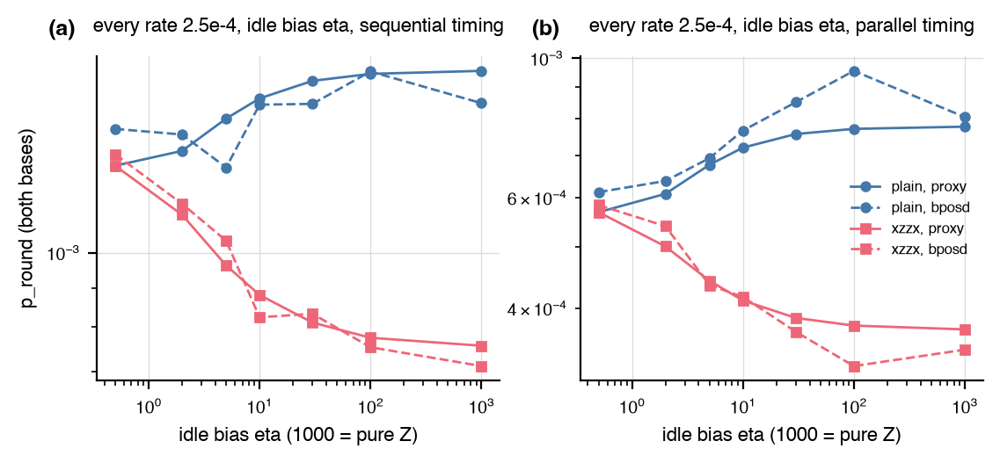

# Memory objective: tiers, benchmark, bias sensitivity, PPO smoke run

Every number below is read from the JSON files under `experiments/memory_objective/runs/` (regenerate with `python -m autoqec_sim.experiments.memory_objective <subcommand>`; this file with `report`). Module `src/autoqec_sim/memory_objective.py`, design note `docs/memory_objective.md`.

## Verdict

Status: complete at smoke scale on the laptop (one to two threads).
Profiles: `ion` is the chain preset
(arXiv:2606.06455 rates, sequential gates) at scale 0.25, `board` the
qldpc-challenge recipe at `p = 1e-3`, `heron` the Heron r2 rates at scale
0.1; every tier is a leading-order or sampled estimate that needs the
expected number of faults per shot below about one, and the presets at
scale 1 exceed that on these circuits (chain 0.6 to 3.4, Heron 2.8 to
8.8, board 0.5 to 2.1).

1. Tiers and cost. `proxy` (closed form, weight-2 maximum-likelihood
   failure from the DEM plus exact `d_circ`) costs 0.08 to 0.22 s per code
   at `n <= 9` and 1.7 to 2.3 s for the [[16,4,4]] code, both bases,
   `R = d`, one thread; `sampled` (exact ML when `D + O <= 20`, else the
   weight-2 lookup decoder) 0.16 to 0.31 s and 5 s; `bposd` 0.2 to 1.5 s
   and 37 to 42 s at 200 failures per basis. Inside PPO the proxy
   evaluated 92 distinct target-distance codes at 0.47 s each.
2. Rank agreement. Proxy against the sampled ML tier: within 25 percent
   on every benchmark code below one expected fault per shot and Spearman
   0.9 on every profile over the five codes. Proxy against bposd: 0.9
   (ion), 0.8 (board), 0.3 (heron) on the five codes, the Heron outlier
   being Steane, for which bposd is 1.7 to 3.2 times worse than both ML
   tiers on every profile. On 32 random `[[9,1,3]]` codes (generator
   weights 3 to 9, per-round rates within a factor 2.5 of each other)
   proxy against bposd is 0.79 (ion), 0.90 (board), 0.78 (heron) at 100
   failures per basis; on the same codes two bposd seeds agree with each
   other only to 0.53 (ion), 0.95 (board), 0.88 (heron), so on the ion
   profile the proxy is closer to a single bposd sample than two bposd
   samples are to each other (at 400 failures per basis on ion: proxy
   against the sampled ML tier 0.93, bposd seed against seed 0.58), and
   the residual disagreement on board and heron (proxy against the
   two-seed mean 0.90 and 0.74) is within what the shot noise and bposd's
   own suboptimality allow. The proxy was not
   iterated beyond the hook-aware order and the leading-order weights;
   the one failure mode found is outside its regime (the routed non-CSS
   code under Heron at scale 1: proxy 1.8e-4, bposd 0.49).
3. Bias sensitivity. Under a Z-biased idle channel (every rate 2.5e-4,
   idle bias `eta`) the objective prefers XZZX over the plain rotated
   surface code at `n = 9`: ratio 1.00 at `eta = 0.5` (exact tie), 1.21 at
   2, 1.80 at 10, 2.27 at pure Z under sequential timing, bposd 1.08,
   1.23, 1.89, 2.19; parallel timing 1.00 to 2.10 (bposd to 2.35). Under
   the Forte set (`eta = 10` duration idle) the proxy and the near-ML
   lookup decoder prefer XZZX by 1.22 and 1.21; bposd does not (0.78).
   Under the chain set the two tie (0.99): its readout flips dominate.
   The encoder objective tied the two codes exactly under every profile.
4. Hooks and flags. The sorted gate order gives the Shor code `d_circ = 1`
   in the Z basis and the rotated surface code 2 in the X basis; the
   hook-aware order (default) gives 3 and 3. With bare ancillas every
   other benchmark code has `d_circ = 2`; one flag per generator lifts
   all of them to 3 and lowers the ion `p_round` 2.6 to 4.4 times, while
   under the board recipe the extra gates cost more than the flags gain.
5. Lattice. The `square:3x3` layout embeds the surface code and XZZX
   without routing; the non-CSS 3x3 code needs 63 extra two-qubit gates
   per round and 7 sequential batches, the Shor code 45 and 4, and both
   lose one unit of `d_circ` to the ladders' hooks.
6. Regression. PPO on the 3x3 lattice under the ion profile with the
   memory reward reaches distance 3 at 83k env steps (400k-step run, 62 s
   at one thread); the test-suite version (`R = 2`, 300k steps) passes.

## Benchmark: five codes, three profiles, three tiers

Rounds `R = d`, scales ion 0.25, board 1, heron 0.1, all-to-all layout, bare ancillas, hook-aware gate order. Sampled tiers: 5000 shots per basis, grown to at least 200 failures or 100000 shots. `p_round` is the per-round failure probability summed over the Z and X memory bases; `E` is the expected number of faults per shot (Z basis). Times are wall seconds per code for both bases on arm64, one thread, one process.

| code | profile | E | mechanisms (Z/X) | detectors | 2q gates per round | d_circ (Z/X) | proxy p_round | proxy s | proxy w<=3 p_round | sampled p_round | sampled decoder | sampled s | bposd p_round | bposd shots | bposd s |
|---|---|---|---|---|---|---|---|---|---|---|---|---|---|---|---|
| [[5,1,3]] | ion | 0.16 | 225/255 | 16 | 16 | 2/2 | 0.00987 | 0.142 | 0.00996 | 0.00858 | exact_ml | 0.226 | 0.0112 | 15000 | 0.455 |
| [[5,1,3]] | board | 0.5 | 225/255 | 16 | 16 | 2/2 | 0.0255 | 0.0774 | 0.0288 | 0.0201 | exact_ml | 0.163 | 0.0293 | 10000 | 0.234 |
| [[5,1,3]] | heron | 0.34 | 225/255 | 16 | 16 | 2/2 | 0.00999 | 0.0901 | 0.0109 | 0.00863 | exact_ml | 0.167 | 0.00916 | 15000 | 0.263 |
| Steane [[7,1,3]] | ion | 0.22 | 405/405 | 24 | 24 | 2/2 | 0.00398 | 0.155 | n/a | 0.0031 | lookup | 0.249 | 0.00667 | 30000 | 0.687 |
| Steane [[7,1,3]] | board | 0.45 | 405/405 | 24 | 24 | 2/2 | 0.00973 | 0.0833 | n/a | 0.00879 | lookup | 0.168 | 0.0173 | 10000 | 0.639 |
| Steane [[7,1,3]] | heron | 0.28 | 405/405 | 24 | 24 | 2/2 | 0.00311 | 0.0922 | n/a | 0.0028 | lookup | 0.181 | 0.01 | 30000 | 0.523 |
| rotated surface [[9,1,3]] | ion | 0.24 | 359/359 | 32 | 24 | 3/3 | 7.70e-04 | 0.188 | n/a | 7.90e-04 | lookup | 0.275 | 8.84e-04 | 100000 | 1.34 |
| rotated surface [[9,1,3]] | board | 0.64 | 359/359 | 32 | 24 | 3/3 | 0.00772 | 0.103 | n/a | 0.00743 | lookup | 0.171 | 0.00739 | 20000 | 1.31 |
| rotated surface [[9,1,3]] | heron | 0.36 | 359/359 | 32 | 24 | 3/3 | 0.00223 | 0.126 | n/a | 0.00205 | lookup | 0.216 | 0.00215 | 100000 | 1.5 |
| board [[16,4,4]] (SAT t3 w6 a) | ion | 0.85 | 1988/1992 | 60 | 72 | 2/2 | 0.00742 | 2.25 | n/a | 0.00906 | lookup | 5.14 | 0.0148 | 10000 | 36.7 |
| board [[16,4,4]] (SAT t3 w6 a) | board | 2.1 | 1988/1992 | 60 | 72 | 2/2 | 0.0239 | 1.72 | n/a | 0.0748 | lookup | 5.6 | 0.0559 | 5000 | 35.7 |
| board [[16,4,4]] (SAT t3 w6 a) | heron | 0.9 | 1988/1992 | 60 | 72 | 2/2 | 0.0054 | 1.77 | n/a | 0.00795 | lookup | 4.77 | 0.00847 | 30000 | 41.6 |
| non-CSS [[9,1,3]], noise-aware 3x3 ion seed 0 | ion | 0.27 | 370/363 | 32 | 27 | 2/2 | 0.0024 | 0.218 | n/a | 0.00219 | lookup | 0.308 | 0.0028 | 40000 | 1.1 |
| non-CSS [[9,1,3]], noise-aware 3x3 ion seed 0 | board | 0.8 | 370/363 | 32 | 27 | 2/2 | 0.018 | 0.101 | n/a | 0.0161 | lookup | 0.18 | 0.0161 | 10000 | 1.08 |
| non-CSS [[9,1,3]], noise-aware 3x3 ion seed 0 | heron | 0.49 | 370/363 | 32 | 27 | 2/2 | 0.00626 | 0.129 | n/a | 0.00625 | lookup | 0.218 | 0.00648 | 20000 | 1.07 |

Spearman rank correlation of the tiers across the benchmark codes, per profile:

| profile | codes | proxy vs bposd | sampled vs bposd | proxy vs sampled |
|---|---|---|---|---|
| ion | 5 | 0.9 | 1 | 0.9 |
| board | 5 | 0.8 | 0.9 | 0.9 |
| heron | 5 | 0.3 | 0.4 | 0.9 |

### One-flag variant

Same codes and profiles with one flag qubit per generator of weight at least three (`flags="one"`), proxy tier: d_circ and p_round against the bare-ancilla circuit.

| code | profile | bare d_circ (Z/X) | flag d_circ (Z/X) | bare proxy p_round | flag proxy p_round | flag/bare | bare 2q per round | flag 2q per round |
|---|---|---|---|---|---|---|---|---|
| [[5,1,3]] | ion | 2/2 | 3/3 | 0.00987 | 0.00224 | 0.227 | 16 | 24 |
| [[5,1,3]] | board | 2/2 | 3/3 | 0.0255 | 0.0334 | 1.31 | 16 | 24 |
| [[5,1,3]] | heron | 2/2 | 3/3 | 0.00999 | 0.00937 | 0.938 | 16 | 24 |
| Steane [[7,1,3]] | ion | 2/2 | 3/3 | 0.00398 | 0.0015 | 0.377 | 24 | 36 |
| Steane [[7,1,3]] | board | 2/2 | 3/3 | 0.00973 | 0.0113 | 1.16 | 24 | 36 |
| Steane [[7,1,3]] | heron | 2/2 | 3/3 | 0.00311 | 0.00263 | 0.845 | 24 | 36 |
| rotated surface [[9,1,3]] | ion | 3/3 | 3/3 | 7.70e-04 | 7.85e-04 | 1.02 | 24 | 32 |
| rotated surface [[9,1,3]] | board | 3/3 | 3/3 | 0.00772 | 0.0119 | 1.54 | 24 | 32 |
| rotated surface [[9,1,3]] | heron | 3/3 | 3/3 | 0.00223 | 0.00233 | 1.05 | 24 | 32 |
| board [[16,4,4]] (SAT t3 w6 a) | ion | 2/2 | 3/3 | 0.00742 | 0.00201 | 0.27 | 72 | 96 |
| board [[16,4,4]] (SAT t3 w6 a) | board | 2/2 | 3/3 | 0.0239 | 0.0231 | 0.966 | 72 | 96 |
| board [[16,4,4]] (SAT t3 w6 a) | heron | 2/2 | 3/3 | 0.0054 | 0.00447 | 0.828 | 72 | 96 |
| non-CSS [[9,1,3]], noise-aware 3x3 ion seed 0 | ion | 2/2 | 3/3 | 0.0024 | 0.00161 | 0.673 | 27 | 39 |
| non-CSS [[9,1,3]], noise-aware 3x3 ion seed 0 | board | 2/2 | 3/3 | 0.018 | 0.0263 | 1.46 | 27 | 39 |
| non-CSS [[9,1,3]], noise-aware 3x3 ion seed 0 | heron | 2/2 | 3/3 | 0.00626 | 0.00623 | 0.994 | 27 | 39 |

## Random distance-3 codes at n = 9

32 distinct `[[9,1,3]]` codes with no weight-1 stabilizer from random 150-gate H, S, CNOT circuits on 9 qubits (512 circuits drawn, seed 0); 0 of them CSS. `R = 3`, all-to-all, proxy against bposd (5000 shots per basis grown to 100 failures or 50000 shots).

| profile | codes | Spearman proxy vs bposd | Spearman proxy (w<=3) vs bposd | Spearman -d_circ vs bposd | proxy/bposd ratio, median [min, max] | proxy s per code, mean | bposd s per code, mean |
|---|---|---|---|---|---|---|---|
| ion | 32 | 0.787 | n/a | nan | 0.768 [0.588, 0.936] | 0.729 | 7.56 |
| board | 32 | 0.901 | n/a | nan | 0.73 [0.676, 0.827] | 0.499 | 23.4 |
| heron | 32 | 0.776 | n/a | nan | 0.528 [0.404, 0.64] | 0.624 | 11 |

Where the disagreement comes from (`random-check`, the same codes under the sampled tier with the lookup decoder and under bposd with a second sampling seed, 5000 shots grown to 100 failures or 50000):

| profile | Spearman proxy vs sampled (lookup) | sampled vs bposd | bposd seed vs seed | proxy vs bposd (mean of two seeds) | sampled vs bposd (mean of two seeds) |
|---|---|---|---|---|---|
| ion | 0.897 | 0.669 | 0.533 | 0.694 | 0.664 |
| board | 0.813 | 0.831 | 0.946 | 0.904 | 0.889 |
| heron | 0.698 | 0.696 | 0.875 | 0.743 | 0.796 |

Same check on the ion profile at higher statistics (20000 shots grown to 400 failures or 150000): proxy vs sampled 0.929, sampled vs bposd 0.699, bposd seed vs seed 0.585, proxy vs bposd (mean of two seeds) 0.694, over 32 codes.

Circuit-level distance (minimum over bases) of the random codes with bare ancillas: ion: d_circ = 2: 32; board: d_circ = 2: 32; heron: d_circ = 2: 32.

Proxy against bposd per-round failure probability, log axes, one panel per profile: random `[[9,1,3]]` codes (grey) and the benchmark codes (colored squares); the line is equality; the corner text is the Spearman correlation over the random set.

## Bias sensitivity: XZZX against the plain rotated surface code at n = 9

`R = 3`, all-to-all, bare ancillas. `ratio` is `p_round(plain) / p_round(xzzx)`; above 1 the objective prefers the XZZX deformation. The depolarizing profile has rate 1e-3 on every gate, reset, and measurement and a slot idle channel of rate 1e-3 per layer with bias `eta = pZ / (pX + pY)` (0.5 is depolarizing; inf is pure Z).

| profile | timing | eta | plain proxy | xzzx proxy | ratio proxy | plain bposd | xzzx bposd | ratio bposd |
|---|---|---|---|---|---|---|---|---|
| forte-2308.05071 | sequential | native | 5.89e-04 | 4.81e-04 | 1.23 | 6.98e-04 | 8.94e-04 | 0.781 |
| chain-2606.06455 | sequential | native | 7.70e-04 | 7.77e-04 | 0.991 | 9.18e-04 | 9.36e-04 | 0.981 |
| depolarizing-0.001 | sequential | 0.5 | 0.0013 | 0.0013 | 1 | 0.00145 | 0.00134 | 1.08 |
| depolarizing-0.001 | sequential | 2 | 0.00136 | 0.00112 | 1.21 | 0.00142 | 0.00116 | 1.23 |
| depolarizing-0.001 | sequential | 5 | 0.00149 | 9.62e-04 | 1.55 | 0.00129 | 0.00104 | 1.24 |
| depolarizing-0.001 | sequential | 10 | 0.00159 | 8.81e-04 | 1.8 | 0.00156 | 8.24e-04 | 1.89 |
| depolarizing-0.001 | sequential | 30 | 0.00167 | 8.11e-04 | 2.06 | 0.00156 | 8.33e-04 | 1.87 |
| depolarizing-0.001 | sequential | 100 | 0.00171 | 7.75e-04 | 2.2 | 0.00172 | 7.54e-04 | 2.28 |
| depolarizing-0.001 | sequential | inf | 0.00172 | 7.57e-04 | 2.27 | 0.00156 | 7.12e-04 | 2.19 |
| depolarizing-0.001 | parallel | 0.5 | 5.68e-04 | 5.68e-04 | 1 | 6.12e-04 | 5.84e-04 | 1.05 |
| depolarizing-0.001 | parallel | 2 | 6.08e-04 | 5.01e-04 | 1.21 | 6.37e-04 | 5.40e-04 | 1.18 |
| depolarizing-0.001 | parallel | 5 | 6.76e-04 | 4.42e-04 | 1.53 | 6.93e-04 | 4.35e-04 | 1.59 |
| depolarizing-0.001 | parallel | 10 | 7.20e-04 | 4.11e-04 | 1.75 | 7.67e-04 | 4.17e-04 | 1.84 |
| depolarizing-0.001 | parallel | 30 | 7.57e-04 | 3.86e-04 | 1.96 | 8.51e-04 | 3.67e-04 | 2.32 |
| depolarizing-0.001 | parallel | 100 | 7.72e-04 | 3.75e-04 | 2.06 | 9.54e-04 | 3.23e-04 | 2.95 |
| depolarizing-0.001 | parallel | inf | 7.78e-04 | 3.70e-04 | 2.1 | 8.06e-04 | 3.43e-04 | 2.35 |

Sampled tier (lookup decoder, near maximum likelihood) on the two cases where the proxy and bposd disagree or are the primary target, `R = 3`, scale 0.25:

| case | plain p_round | xzzx p_round | ratio | shots Z / X (plain) | failures Z / X (plain) |
|---|---|---|---|---|---|
| forte | 5.67e-04 | 4.67e-04 | 1.22 | 300000 / 220000 | 63 / 328 |
| depol_eta_inf_seq | 0.00164 | 7.86e-04 | 2.09 | 300000 / 80000 | 4 / 392 |

Per-round failure probability of the plain (circles) and XZZX (squares) codes against the idle bias, proxy (solid) and bposd (dashed), sequential (a) and parallel (b) timing.

## Lattice layout with routing

`square:3x3`: data qubits on the lattice, 16 ancilla sites at the plaquette centers including the boundary ring, site-to-corner edges only; generators whose site is not adjacent to a support qubit are routed with nearest-neighbour CNOT ladders and run in their own batch. Proxy tier, `R = 3`, Z basis circuit statistics.

| code | layout | 2q gates (3 rounds) | routed extra 2q | layers | batches | board p_round | heron p_round | ion p_round | d_circ board (Z/X) |
|---|---|---|---|---|---|---|---|---|---|
| rotated_surface_9 | all_to_all | 72 | 0 | 66 | 2 | 0.00772 | 0.00223 | 7.70e-04 | 3/3 |
| rotated_surface_9 | square:3x3 | 72 | 0 | 66 | 2 | 0.00772 | 0.00223 | 7.70e-04 | 3/3 |
| xzzx_9 | all_to_all | 72 | 0 | 66 | 2 | 0.00772 | 0.00188 | 7.77e-04 | 3/3 |
| xzzx_9 | square:3x3 | 72 | 0 | 66 | 2 | 0.00772 | 0.00188 | 7.77e-04 | 3/3 |
| noncss_9_ion | all_to_all | 81 | 0 | 84 | 3 | 0.018 | 0.00626 | 0.0024 | 2/2 |
| noncss_9_ion | square:3x3 | 270 | 63 | 315 | 7 | 0.263 | 0.0397 | 0.028 | 2/2 |
| shor_9 | all_to_all | 72 | 0 | 60 | 2 | 0.00607 | 0.00246 | 7.66e-04 | 3/3 |
| shor_9 | square:3x3 | 207 | 45 | 204 | 4 | 0.0721 | 0.0125 | 0.0105 | 2/2 |

## PPO smoke run: 3x3 lattice, ion profile, memory reward

`CodeDiscoveryEnv(n=9, k=1, square:3x3, H and CNOT, 30 gates, batch 256)` with `MemoryReward(MemoryObjective(chain, rounds=R, tier=proxy), d*=3, weight 0.1, p_ref 1e-2)`, `PPOConfig` defaults, dense reward, no early stop.

| seed | rounds | env steps | episodes | wall s | reached d = 3 | first d = 3 (env steps) | successes | distinct codes | memory evaluations | memory s per code | memory s total | final success rate | best p_round | rotated surface p_round |
|---|---|---|---|---|---|---|---|---|---|---|---|---|---|---|
| 0 | 3 | 401408 | 13313 | 62.4 | True | 83200 | 92 | 92 | 93 | 0.468 | 43.5 | 0.0728 | 0.00159 | 7.70e-04 |
