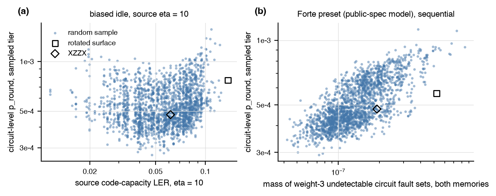

# A population of SAT-designed codes under the memory objective

Status: complete.
Every number comes from `experiments/sat_population/runs/records.jsonl`;
this file regenerates with `python -m autoqec_sim.experiments.sat_population report`.
Code: `src/autoqec_sim/experiments/sat_population.py`; population:
`experiments/sat_population/population.json`.

Source: DalFavero et al., arXiv:2608.23460, `experiments/surface/` of
github.com/bdalfavero/satisfying-codes: 100,000 SAT-sampled 9-qubit codes
on the stabilizer footprint of the rotated surface code, each scored by
the exact maximum-likelihood logical error rate under code-capacity
biased noise (`p_X = eta P`, `p_Y = p_Z = P`) in the Z basis. The
reference codes are the rotated surface code and its XZZX deformation,
with the source's rates for both.

Here each code is Hadamard-conjugated on every qubit so its X tailoring
becomes Z tailoring, and scored by the circuit-level memory objective,
3 rounds, under four cases: a depolarizing profile with a
biased idle channel at source eta 4 and 10 (bias parameter eta / 2, so the
Z rate is eta times each of the X and Y rates), the same profile with
every channel biased at source eta 10, and the package's Forte preset
with sequential timing at a quarter of its rates. That preset is a noise
model assembled from public specifications (arXiv:2308.05071 and the
product page, with the assumptions listed in the noise-presets page); its
numbers describe the model, not measurements on any device. Tiers: proxy
(maximum-likelihood failure over fault
sets of weight at most two, closed form) and sampled (Monte Carlo from the
detector error model with a lookup decoder built from the same fault
sets, 20,000 shots and at least 50 failures
up to 200,000 shots). Every code, the references included, uses the hook-aware gate
order, whose random tie-breaking left the proxy rate unchanged over five
seeds on this footprint. Distances are recomputed exactly.
Sampled-tier differences below about ten percent are within shot noise.

Figure: (a) the random sample's source rate at eta = 10 against its circuit-level rate under the biased idle case at the same eta; (b) under Forte, where the source rate at eta = 1 takes only two values across the sample, the circuit-level rate against the probability mass of the weight-3 undetectable fault sets of the two memory circuits. The reference codes are the open markers (square: rotated surface, diamond: XZZX).

Scored 2145 codes: 2000 uniform random distinct codes, the 100 best and the 50 worst distinct codes by the source's rate at eta = 10 (overlaps counted once), and the two reference codes. The source holds 100,000 codes, 62,876 distinct generator lists, and 43,563 distinct stabilizer groups.

## Rank agreement with the source

Over the random sample. Spearman is between the source's code-capacity rate at the matching eta (eta = 1 for Forte) and the circuit-level p_round; the overlap counts how many of the 20 best codes by one score are among the 20 best by the other.

| case | tier | Spearman | top-20 overlap |
|---|---|---|---|
| biased idle, source eta = 4 | proxy | 0.13 | 0 / 20 |
| biased idle, source eta = 4 | sampled | 0.09 | 0 / 20 |
| biased idle, source eta = 10 | proxy | 0.19 | 0 / 20 |
| biased idle, source eta = 10 | sampled | 0.18 | 0 / 20 |
| every channel biased, source eta = 10 | proxy | 0.21 | 0 / 20 |
| every channel biased, source eta = 10 | sampled | 0.18 | 0 / 20 |
| Forte preset (public-spec model), sequential | proxy | -0.01 | 0 / 20 |
| Forte preset (public-spec model), sequential | sampled | 0.00 | 0 / 20 |

## Do the source's best codes score better than random ones?

Median p_round (interquartile range) per group, and the fraction of each group below the random sample's median.

| case | tier | random | best by source | worst by source | best below random median | worst below random median |
|---|---|---|---|---|---|---|
| biased idle, source eta = 4 | proxy | 0.00059 (0.00055, 0.00082) | 0.00065 (0.00062, 0.00067) | 0.00071 (0.00070, 0.00086) | 0% | 0% |
| biased idle, source eta = 4 | sampled | 0.00062 (0.00054, 0.00079) | 0.00065 (0.00060, 0.00076) | 0.00071 (0.00065, 0.00089) | 34% | 18% |
| biased idle, source eta = 10 | proxy | 0.00050 (0.00043, 0.00065) | 0.00062 (0.00060, 0.00067) | 0.00076 (0.00074, 0.00082) | 0% | 0% |
| biased idle, source eta = 10 | sampled | 0.00051 (0.00044, 0.00065) | 0.00063 (0.00059, 0.00068) | 0.00074 (0.00069, 0.00092) | 2% | 0% |
| every channel biased, source eta = 10 | proxy | 0.00045 (0.00038, 0.00058) | 0.00059 (0.00056, 0.00066) | 0.00076 (0.00075, 0.00082) | 0% | 0% |
| every channel biased, source eta = 10 | sampled | 0.00046 (0.00039, 0.00059) | 0.00064 (0.00055, 0.00068) | 0.00078 (0.00070, 0.00096) | 0% | 0% |
| Forte preset (public-spec model), sequential | proxy | 0.00046 (0.00042, 0.00061) | 0.00051 (0.00049, 0.00054) | 0.00058 (0.00056, 0.00067) | 0% | 0% |
| Forte preset (public-spec model), sequential | sampled | 0.00047 (0.00042, 0.00061) | 0.00048 (0.00046, 0.00054) | 0.00060 (0.00055, 0.00071) | 44% | 2% |

## What predicts the circuit-level rate

Over the random sample at the sampled tier. Spearman of p_round with each feature: cc_mass, the code-capacity mass of the weight-3 logical operators under the case's bias (letter weight 1 for X and Y, eta for Z), computed from the stabilizers alone; batches, groups of generators whose controlled gates cannot interleave; layers, the circuit depth of one round; d_circ, the exact circuit distance; d_circ_mass, the probability mass of the minimum-weight undetectable circuit fault sets summed over the two memory bases; num_y, Y letters among the generators; css. Then the R^2 of a least-squares fit of log10 p_round on log10 source rate alone, on the non-constant features alone, and on both.

Constant across the random sample, so carrying no information here: batches = 2, layers = 72, d_circ = 3, css = 0.

| case | cc_mass | d_circ_mass | num_y | R^2 source | R^2 structure | R^2 both |
|---|---|---|---|---|---|---|
| biased idle, source eta = 4 | 0.28 | 0.72 | -0.00 | 0.01 | 0.61 | 0.61 |
| biased idle, source eta = 10 | 0.43 | 0.71 | -0.09 | 0.02 | 0.53 | 0.53 |
| every channel biased, source eta = 10 | 0.50 | 0.73 | -0.12 | 0.02 | 0.54 | 0.54 |
| Forte preset (public-spec model), sequential | n/a | 0.70 | -0.07 | 0.00 | 0.47 | 0.47 |

## Best codes of the population

Sampled tier. The source rank is among the distinct stabilizer groups (1 = best at eta = 10). The last two columns count population codes with a lower p_round than each reference code.

### biased idle, source eta = 4

rotated surface p_round 0.00057, XZZX p_round 0.00046; codes below rotated surface: 739 of 2143, below XZZX: 44 of 2143.

| code | p_round | source rank | CSS | batches | Y letters |
|---|---|---|---|---|---|
| D19938 | 0.00040 | 12834 | no | 2 | 12 |
| D36303 | 0.00040 | 17544 | no | 2 | 12 |
| D19301 | 0.00040 | 7012 | no | 2 | 13 |
| D11638 | 0.00041 | 8288 | no | 2 | 13 |
| D21454 | 0.00041 | 8064 | no | 2 | 12 |
| D69983 | 0.00041 | 3372 | no | 2 | 11 |
| D34984 | 0.00042 | 29606 | no | 2 | 10 |
| D1490 | 0.00042 | 21331 | no | 2 | 12 |

### biased idle, source eta = 10

rotated surface p_round 0.00077, XZZX p_round 0.00048; codes below rotated surface: 1870 of 2143, below XZZX: 758 of 2143.

| code | p_round | source rank | CSS | batches | Y letters |
|---|---|---|---|---|---|
| D68810 | 0.00027 | 14323 | no | 2 | 12 |
| D2917 | 0.00028 | 18728 | no | 2 | 14 |
| D10622 | 0.00028 | 8377 | no | 2 | 13 |
| D34314 | 0.00029 | 17606 | no | 2 | 14 |
| D11501 | 0.00029 | 21724 | no | 2 | 11 |
| D49696 | 0.00029 | 10146 | no | 2 | 12 |
| D1802 | 0.00030 | 8724 | no | 2 | 9 |
| D59348 | 0.00030 | 21454 | no | 2 | 13 |

### every channel biased, source eta = 10

rotated surface p_round 0.00063, XZZX p_round 0.00051; codes below rotated surface: 1659 of 2143, below XZZX: 1269 of 2143.

| code | p_round | source rank | CSS | batches | Y letters |
|---|---|---|---|---|---|
| D60403 | 0.00023 | 18755 | no | 2 | 10 |
| D35143 | 0.00024 | 12667 | no | 2 | 12 |
| D87371 | 0.00025 | 17574 | no | 2 | 11 |
| D9881 | 0.00025 | 24123 | no | 2 | 13 |
| D36303 | 0.00025 | 17544 | no | 2 | 12 |
| D7895 | 0.00025 | 15451 | no | 2 | 14 |
| D60277 | 0.00025 | 12408 | no | 2 | 13 |
| D44624 | 0.00025 | 18750 | no | 2 | 12 |

### Forte preset (public-spec model), sequential

rotated surface p_round 0.00057, XZZX p_round 0.00048; codes below rotated surface: 1454 of 2143, below XZZX: 1060 of 2143.

| code | p_round | source rank | CSS | batches | Y letters |
|---|---|---|---|---|---|
| D41938 | 0.00029 | 13110 | no | 2 | 14 |
| D67136 | 0.00030 | 10177 | no | 2 | 13 |
| D54306 | 0.00030 | 17616 | no | 2 | 12 |
| D16571 | 0.00032 | 9235 | no | 2 | 12 |
| D25297 | 0.00032 | 12987 | no | 2 | 13 |
| D78885 | 0.00032 | 10214 | no | 2 | 10 |
| D44624 | 0.00032 | 18750 | no | 2 | 12 |
| D71307 | 0.00032 | 6096 | no | 2 | 13 |

## Confirmation of the best codes

The 8 best codes of each case at the sampled tier, and the references, re-scored with at least 500 failures per basis (up to 4,000,000 shots) on the same circuit as the first pass. The relative standard error of each rate is about 1 / sqrt(failures). Codes are sorted by the confirmed rate; the first-pass rate is the one the ranking used.

### biased idle, source eta = 4

| code | confirmed p_round | rel. std. err. | first pass | source rank |
|---|---|---|---|---|
| D36303 | 0.00047 | 3% | 0.00040 | 17544 |
| D87371 | 0.00047 | 3% | 0.00053 | 17574 |
| D35143 | 0.00047 | 3% | 0.00043 | 12667 |
| D68810 | 0.00048 | 3% | 0.00047 | 14323 |
| D67136 | 0.00048 | 3% | 0.00047 | 10177 |
| D7895 | 0.00048 | 3% | 0.00053 | 15451 |
| D19301 | 0.00048 | 3% | 0.00040 | 7012 |
| D41938 | 0.00048 | 3% | 0.00042 | 13110 |
| D11501 | 0.00048 | 3% | 0.00046 | 21724 |
| D60403 | 0.00049 | 3% | 0.00053 | 18755 |
| D34314 | 0.00049 | 3% | 0.00054 | 17606 |
| D54306 | 0.00049 | 3% | 0.00047 | 17616 |
| D19938 | 0.00049 | 3% | 0.00040 | 12834 |
| D60277 | 0.00050 | 3% | 0.00044 | 12408 |
| D2917 | 0.00050 | 3% | 0.00051 | 18728 |
| D69983 | 0.00050 | 3% | 0.00041 | 3372 |
| D44624 | 0.00050 | 3% | 0.00051 | 18750 |
| xzzx | 0.00050 | 3% | 0.00046 | reference |
| D59348 | 0.00051 | 3% | 0.00051 | 21454 |
| D9881 | 0.00051 | 3% | 0.00051 | 24123 |
| D1490 | 0.00051 | 3% | 0.00042 | 21331 |
| D49696 | 0.00051 | 3% | 0.00047 | 10146 |
| D1802 | 0.00051 | 3% | 0.00050 | 8724 |
| D10622 | 0.00052 | 3% | 0.00050 | 8377 |
| D11638 | 0.00052 | 3% | 0.00041 | 8288 |
| D71307 | 0.00053 | 3% | 0.00043 | 6096 |
| D34984 | 0.00054 | 3% | 0.00042 | 29606 |
| rotated_surface | 0.00055 | 3% | 0.00057 | reference |
| D16571 | 0.00055 | 3% | 0.00051 | 9235 |
| D78885 | 0.00056 | 3% | 0.00050 | 10214 |
| D25297 | 0.00057 | 3% | 0.00058 | 12987 |
| D21454 | 0.00058 | 3% | 0.00041 | 8064 |

### biased idle, source eta = 10

| code | confirmed p_round | rel. std. err. | first pass | source rank |
|---|---|---|---|---|
| D54306 | 0.00032 | 3% | 0.00038 | 17616 |
| D36303 | 0.00032 | 3% | 0.00033 | 17544 |
| D2917 | 0.00032 | 3% | 0.00028 | 18728 |
| D9881 | 0.00033 | 3% | 0.00040 | 24123 |
| D11501 | 0.00033 | 3% | 0.00029 | 21724 |
| D60277 | 0.00034 | 3% | 0.00035 | 12408 |
| D7895 | 0.00034 | 3% | 0.00036 | 15451 |
| D19938 | 0.00034 | 3% | 0.00032 | 12834 |
| D41938 | 0.00034 | 3% | 0.00036 | 13110 |
| D35143 | 0.00034 | 3% | 0.00034 | 12667 |
| D44624 | 0.00034 | 3% | 0.00031 | 18750 |
| D60403 | 0.00034 | 3% | 0.00031 | 18755 |
| D67136 | 0.00035 | 3% | 0.00031 | 10177 |
| D87371 | 0.00035 | 3% | 0.00037 | 17574 |
| D59348 | 0.00035 | 3% | 0.00030 | 21454 |
| D19301 | 0.00035 | 3% | 0.00037 | 7012 |
| D34314 | 0.00035 | 3% | 0.00029 | 17606 |
| D11638 | 0.00036 | 3% | 0.00034 | 8288 |
| D49696 | 0.00037 | 3% | 0.00029 | 10146 |
| D68810 | 0.00037 | 3% | 0.00027 | 14323 |
| D10622 | 0.00037 | 3% | 0.00028 | 8377 |
| D1490 | 0.00037 | 3% | 0.00040 | 21331 |
| D1802 | 0.00037 | 3% | 0.00030 | 8724 |
| D16571 | 0.00039 | 3% | 0.00041 | 9235 |
| D69983 | 0.00040 | 3% | 0.00041 | 3372 |
| D71307 | 0.00041 | 3% | 0.00035 | 6096 |
| D78885 | 0.00042 | 3% | 0.00045 | 10214 |
| D34984 | 0.00043 | 3% | 0.00041 | 29606 |
| D25297 | 0.00043 | 3% | 0.00045 | 12987 |
| D21454 | 0.00045 | 3% | 0.00051 | 8064 |
| xzzx | 0.00047 | 3% | 0.00048 | reference |
| rotated_surface | 0.00065 | 3% | 0.00077 | reference |

### every channel biased, source eta = 10

| code | confirmed p_round | rel. std. err. | first pass | source rank |
|---|---|---|---|---|
| D36303 | 0.00025 | 3% | 0.00025 | 17544 |
| D87371 | 0.00026 | 3% | 0.00025 | 17574 |
| D35143 | 0.00026 | 3% | 0.00024 | 12667 |
| D7895 | 0.00027 | 3% | 0.00025 | 15451 |
| D59348 | 0.00027 | 3% | 0.00030 | 21454 |
| D11501 | 0.00027 | 3% | 0.00029 | 21724 |
| D19938 | 0.00027 | 3% | 0.00030 | 12834 |
| D41938 | 0.00028 | 3% | 0.00028 | 13110 |
| D34314 | 0.00028 | 3% | 0.00029 | 17606 |
| D44624 | 0.00028 | 3% | 0.00025 | 18750 |
| D2917 | 0.00029 | 3% | 0.00029 | 18728 |
| D60403 | 0.00029 | 3% | 0.00023 | 18755 |
| D54306 | 0.00029 | 3% | 0.00029 | 17616 |
| D60277 | 0.00029 | 3% | 0.00025 | 12408 |
| D9881 | 0.00030 | 3% | 0.00025 | 24123 |
| D49696 | 0.00030 | 3% | 0.00033 | 10146 |
| D67136 | 0.00030 | 3% | 0.00029 | 10177 |
| D19301 | 0.00031 | 3% | 0.00029 | 7012 |
| D10622 | 0.00032 | 3% | 0.00031 | 8377 |
| D71307 | 0.00032 | 3% | 0.00037 | 6096 |
| D11638 | 0.00033 | 3% | 0.00031 | 8288 |
| D68810 | 0.00033 | 3% | 0.00034 | 14323 |
| D1490 | 0.00034 | 3% | 0.00032 | 21331 |
| D1802 | 0.00034 | 3% | 0.00037 | 8724 |
| D16571 | 0.00035 | 3% | 0.00039 | 9235 |
| D69983 | 0.00036 | 3% | 0.00035 | 3372 |
| D25297 | 0.00038 | 3% | 0.00034 | 12987 |
| D78885 | 0.00039 | 3% | 0.00043 | 10214 |
| D34984 | 0.00040 | 3% | 0.00036 | 29606 |
| D21454 | 0.00041 | 3% | 0.00043 | 8064 |
| xzzx | 0.00042 | 3% | 0.00051 | reference |
| rotated_surface | 0.00065 | 3% | 0.00063 | reference |

### Forte preset (public-spec model), sequential

| code | confirmed p_round | rel. std. err. | first pass | source rank |
|---|---|---|---|---|
| D41938 | 0.00034 | 3% | 0.00029 | 13110 |
| D35143 | 0.00035 | 3% | 0.00034 | 12667 |
| D2917 | 0.00035 | 3% | 0.00033 | 18728 |
| D11638 | 0.00035 | 3% | 0.00042 | 8288 |
| D44624 | 0.00035 | 3% | 0.00032 | 18750 |
| D7895 | 0.00036 | 3% | 0.00041 | 15451 |
| D49696 | 0.00036 | 3% | 0.00039 | 10146 |
| D36303 | 0.00036 | 3% | 0.00032 | 17544 |
| D60277 | 0.00036 | 3% | 0.00040 | 12408 |
| D67136 | 0.00037 | 3% | 0.00030 | 10177 |
| D59348 | 0.00037 | 3% | 0.00042 | 21454 |
| D19938 | 0.00037 | 3% | 0.00036 | 12834 |
| D54306 | 0.00037 | 3% | 0.00030 | 17616 |
| D60403 | 0.00037 | 3% | 0.00034 | 18755 |
| D1802 | 0.00037 | 3% | 0.00039 | 8724 |
| D71307 | 0.00038 | 3% | 0.00032 | 6096 |
| D69983 | 0.00038 | 3% | 0.00035 | 3372 |
| D68810 | 0.00038 | 3% | 0.00038 | 14323 |
| D11501 | 0.00038 | 3% | 0.00033 | 21724 |
| D10622 | 0.00038 | 3% | 0.00036 | 8377 |
| D87371 | 0.00038 | 3% | 0.00036 | 17574 |
| D34314 | 0.00038 | 3% | 0.00036 | 17606 |
| D78885 | 0.00039 | 3% | 0.00032 | 10214 |
| D19301 | 0.00039 | 3% | 0.00038 | 7012 |
| D16571 | 0.00040 | 3% | 0.00032 | 9235 |
| D9881 | 0.00040 | 3% | 0.00035 | 24123 |
| D1490 | 0.00041 | 3% | 0.00037 | 21331 |
| D25297 | 0.00042 | 3% | 0.00032 | 12987 |
| D21454 | 0.00043 | 3% | 0.00052 | 8064 |
| D34984 | 0.00043 | 3% | 0.00036 | 29606 |
| xzzx | 0.00049 | 3% | 0.00048 | reference |
| rotated_surface | 0.00057 | 3% | 0.00057 | reference |
