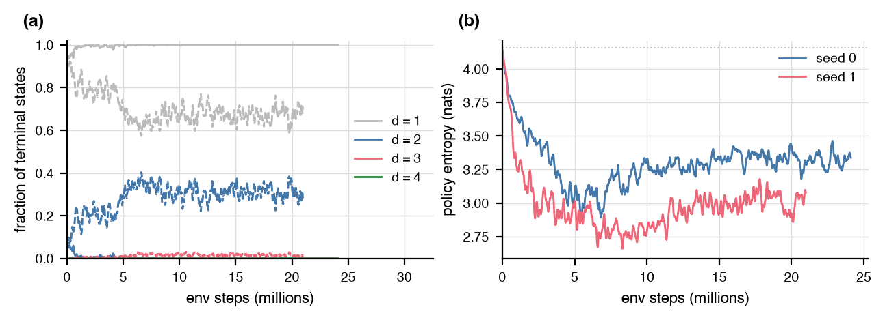

# RL scaling probe: PPO at n = 16 and LDPC targets at n = 12 to 16

Status: complete. Every number below comes from a JSON under
`experiments/scaling/runs/` (named in the last column of each table or in the text)
and the tables regenerate with
`uv run --extra rl python -m experiments.scaling.run report`.
Code: `experiments/scaling/run.py`. Logs: `experiments/scaling/runs/logs/`.

## Summary

The 4x4 failure is an exploration failure. A distance-4 state within 50
gates on the lattice exists (a model-free search finds one after 369k
circuits) but under anything close to the initial policy it is a rare
event (0 of 8192 random 50-gate sequences; 2 reach d = 3), the default
agent never evaluates a single one in 21M to 24M env steps, and the dense
part of the reward it can follow (the padding penalty) leaves it no better
than random on idle qubits. Credit assignment over 50 steps and the
capacity of the flat MLP are not the block: the same agent passes a
distance curriculum to d = 3 at n = 16 and, with a 4x larger batch,
reaches d = 4.

The cheapest change that reaches `[[16, 1, 4]]` at the 50-gate cap is a
per-qubit permutation-equivariant policy (shared MLP over each qubit's
tableau columns, pooled context, per-gate heads): a clean d = 4 at 217k,
242k, and 258k env steps on 3 of 3 seeds (71 to 110 s at 2 threads), and
a policy that keeps producing d = 4 codes in 56 to 64 percent of episodes
after 1M steps. A configuration-only alternative also works with the flat
MLP: 1024 parallel episodes and entropy coefficient 0.001 reach d = 4 at
4.2M and 4.7M steps (about 4 min). Raising the episode cap to 80 or 100
lets even the default agent find d = 4 (3.1M and 5.4M steps at 80, under
130k at 100), which is the same reachability effect from the other side;
the curriculum reaches d = 3 but not d = 4; the macro action set reaches
d = 4 only because it multiplies the gate budget.

The LDPC-constrained target in the penalty form does not scale past the
regression's n = 9: at n = 12 and 16, k = 2 and 4, on all-to-all and on the
square graph, no run reached a distance-3 code with `w* <= 4` in 20 minutes (18
runs, 1.2M to 24M env steps each). Every trained policy converges to the same
trap, sparse stabilizer groups with `w* <= 4` and no idle qubit that are not
codes (d = 1, 0.5 to 5.7 percent of the weight-1 and weight-2 errors
undetected), because the normalized Knill-Laflamme term pays 1/630 to 1/1128 per
detected error while one unit of `w*` excess costs 0.25 (or 0.05 in the
reduced-scale variant). The regression's penalty form should not be the default
beyond n = 9.

## Setup

Agent: `agents.ppo.PPOAgent` with the `PPOConfig` defaults (2x256 tanh MLP
over the 1024-bit tableau observation, 256 parallel episodes, 16-step
rollouts, 4 epochs, minibatch 512, learning rate 3e-4, gamma 0.98, entropy
coefficient 0.01, undo mask). Target: `[[16, 1, 4]]` on `square:4x4` with H
and CNOT along lattice edges (64 actions), 50-gate episodes, the 4x4
setting of `experiments/noise_aware/runs/REPORT.md`. Reward: the level distance term
`min(d, 4)/4 - 1` plus the padding penalty (minus the fraction of weight-1
Paulis in the stabilizer group, `reward.low_weight_stabilizer_penalty`),
dense; the episode ends at the first state with `d >= 4` and no idle
qubit. No noise term. Every variant changes one thing relative to this.

Compute: every run 2 BLAS and torch threads, at most 3 runs at a time,
wall-time capped (15 min diagnosis, 30 min variants, 20 min LDPC cells),
so env-step totals differ between runs of different per-step cost.
`env steps` counts state evaluations (batch elements times steps), the
unit of the noise-aware report and the PPO regression.

## Diagnosis of the 4x4 failure

Verdict: (a) exploration. A distance-4 state within 50 gates on the 4x4
lattice is reachable but rare, the default agent never sees one, and the
only dense part of the reward it can follow (the padding penalty) does not
lead toward one. Evidence, in order:

Reachability under the uniform policy (`random_4x4_seed0.json`, 8192
random gate sequences per length):

| episode length | circuits | d = 1 | d = 2 | d = 3 | d = 4 | d = 4 with no idle qubit | mean idle qubits | file |
|---|---|---|---|---|---|---|---|---|
| 50 | 8,192 | 7,687 | 503 | 2 | 0 | 0 | 7.2 | `random_4x4_seed0.json` |
| 60 | 8,192 | 7,281 | 898 | 13 | 0 | 0 | 6.0 | `random_4x4_seed0.json` |
| 70 | 8,192 | 6,842 | 1,308 | 42 | 0 | 0 | 4.9 | `random_4x4_seed0.json` |
| 80 | 8,192 | 6,333 | 1,760 | 99 | 0 | 0 | 4.1 | `random_4x4_seed0.json` |
| 100 | 8,192 | 5,249 | 2,567 | 371 | 5 | 2 | 2.7 | `random_4x4_seed0.json` |

At 50 gates no random sequence reaches d = 4 and 2 of 8192 reach d = 3. The
rate rises steeply with length: at 100 gates 371 sequences reach d = 3 and
5 reach d = 4 (2 with no idle qubit). The standard-form encoder of the
rotated surface code needs 31 gates all-to-all and 124 after routing onto
the lattice (`noise_aware.css_standard_encoder`, `route_gates`; the
polished baseline of the noise-aware report is 64). A model-free control
shows d = 4 is nonetheless reachable at 50 gates: the evolutionary search
of `autoqec_sim.search` on the same environment and reward found a
distance-4 state with no idle qubit at generation 721, after 369,152
circuits (about 18M state evaluations, 262 s), a 46-gate non-CSS
`[[16, 1, 4]]` with `w* = 7` (`evo_4x4_steps50_seed0.json`).

| episode cap | seed | evaluations (circuits) | generations | wall (s) | best d | reached d = 4 | file |
|---|---|---|---|---|---|---|---|
| 50 | 0 | 369,152 | 721 | 262 | 4 | yes | `evo_4x4_steps50_seed0.json` |

What the default agent does in 15 minutes (`variant_4x4_baseline_seed*.json`;
the first 1.5 minutes of both runs overlapped a load spike from a queue
error, so their step totals are a few percent low). The curriculum rows
are included for the comparison two paragraphs below:

| run | seed | episodes | terminal d counts (1, 2, 3, 4) | d >= 2 fraction, first decile | d >= 2 fraction, last decile | entropy start, min, end | idle qubits at termination, first, last decile | CNOT fraction of actions, last decile | mean step reward, first, last decile | w* of sampled terminal states (d, mean w*, mean row weight) | file |
|---|---|---|---|---|---|---|---|---|---|---|---|
| baseline | 0 | 482,048 | [480872, 1167, 9, 0] | 0.0172 | 0.0000 | 4.14, 2.64, 3.41 | 8.3, 8.0 | 0.91 | -0.987, -0.981 | n/a | `variant_4x4_baseline_seed0.json` |
| baseline | 1 | 419,584 | [293341, 120481, 5762, 0] | 0.1758 | 0.3196 | 4.14, 2.44, 3.01 | 7.8, 7.5 | 0.87 | -0.965, -0.943 | n/a | `variant_4x4_baseline_seed1.json` |
| baseline (w* rerun, 5 min) | 0 | 126,720 | [125561, 1150, 9, 0] | 0.0484 | 0.0004 | 4.14, 2.65, 2.88 | 7.4, 9.9 | 0.95 | -0.979, -0.998 | d = 2, 3.8, 3.2 (248 states) | `variant_4x4_baseline_wstar_seed0.json` |
| curriculum | 0 | 513,364 | [38264, 474694, 406, 0] | 0.3191 | 0.9985 | 4.14, 0.30, 0.50 | 7.2, 0.3 | 0.79 | -0.629, -0.421 | n/a | `variant_4x4_curriculum_seed0.json` |
| curriculum | 1 | 140,250 | [25632, 45298, 69319, 1] | 0.1934 | 0.9991 | 4.14, 0.89, 1.25 | 7.4, 0.2 | 0.74 | -0.697, -0.386 | n/a | `variant_4x4_curriculum_seed1.json` |

(a) Fraction of terminal states at each distance over a 25-update window
(solid seed 0, dashed seed 1); (b) policy entropy, trailing mean over 25
updates, dotted line at ln 64.

- Terminal distances. Seed 0 ends 480,872 of 482,048 episodes at d = 1, 1,167 at
  d = 2, 9 at d = 3, none at d = 4, and its d >= 2 fraction falls from 1.7
  percent in the first decile to 0 from the sixth decile on. Seed 1 climbs to 32
  percent d = 2 and 1.4 percent d = 3 (5,762 episodes) and also never produces d
  = 4 in 419,584 episodes. Neither run ever evaluates a d = 4 state, terminal or
  intermediate (`first_d_max_any` is null), so there is nothing for the policy
  gradient to reinforce. - Gate use. Every episode runs to the 50-gate cap (no
  success, no early termination). The agent ends with 7.5 to 8.3 idle qubits of
  16, the same as a random 50-gate sequence (7.2), and 87 to 91 percent of its
  actions are CNOTs (48 of 64 actions, 75 percent under the uniform policy). A
  CNOT between two qubits still in |0> is the identity on the tableau, so most
  of what the policy does is a no-op; the entangling pattern H then CNOT is what
  lowers the padding term, and the agent learns it only partially. - Entropy.
  From ln 64 = 4.16 the entropy falls to 2.4 to 2.6 nats within 5M steps and
  then drifts back to 3.0 to 3.4, the signature of an entropy bonus pulling a
  policy back once the advantage signal has vanished, not of a policy converging
  on a solution. - Mean step reward stays at -0.94 to -0.99 (the initial state
  scores -1.06, a clean d = 4 state 0). - Stabilizer weights of terminal states
  (`variant_4x4_baseline_wstar_seed0.json`, a 5-minute rerun with the w* sampler
  fixed): the sampled terminal states of largest distance (d = 2 by the last
  quarter; 248 states) have exact `w*` 3.7 on average, maximum qubit degree 3.0,
  and mean generator-row weight 3.2 (maximum 11): sparse groups of
  Bell-pair-like structure with 8 to 10 idle qubits, not the dense entangled
  groups of a code. The rotated surface `[[16, 1, 4]]` has `w* = 4` and degree
  4; every d = 4 code found in this report is non-CSS with `w*` 6 to 8.

Against (b), credit assignment over 50 steps: the same agent, episode
length, and gamma learn the intermediate levels when a terminal signal
exists. In the curriculum runs below the d = 2 stage is passed at 2.9M and
3.4M steps and (seed 1) the d = 3 stage at 3.5M steps with 87 of 89
terminal states at d = 3 and no idle qubit; the bigbatch variant learns
d = 3 in 6 to 7 percent of episodes at the same 50-step horizon. The 3x3
target with 30-step episodes is solved in 86k steps
(`variant_3x3_baseline_seed0.json`).

Against (c), representation: the flat MLP does represent d = 3 codes at
n = 9 and, given a 4x larger batch, learns toward d = 4 at n = 16
(bigbatch). Representation is nonetheless the lever with the largest
effect (equivariant policy, 20x fewer steps than bigbatch), because a
policy that shares parameters across qubits generalizes the H-then-CNOT
entangling pattern from one qubit to all sixteen instead of learning it
64 times, so the padding term is fixed early and the search concentrates
on states where d >= 3 is common. Rarity of d = 4 states, not a
representational impossibility, is the block; the fix is anything that
makes the agent sample from a distribution in which d = 4 is not rare.

## Variants on the 4x4 target

One change at a time from the baseline, two seeds each (a third for the
equivariant policy), stop at the first clean d = 4 state, 30-minute cap.
"First d = 4 state" counts states with idle qubits, "first clean d = 4"
is the success criterion. The rows with 33 actions and cap 30 are the
3x3 sanity check of both policies (target `[[9, 1, 3]]`, stop at d = 3);
the 987k-step equivariant row is the run continued past its first success.

| variant | seed | actions | episode cap | parameters | env steps | wall (s) | max terminal d | first d = 4 state (env steps) | first clean d = 4 (env steps) | final entropy | terminal d fractions over the last 50 updates (1, 2, 3, 4) | file |
|---|---|---|---|---|---|---|---|---|---|---|---|---|
| baseline | 0 | 33 | 30 | 157,730 | 86,016 | 3 | 3 | 15,104 | 83,200 | 3.41 | [0.8842, 0.1151, 0.0007] | `variant_3x3_baseline_seed0.json` |
| baseline | 1 | 33 | 30 | 157,730 | 139,264 | 4 | 3 | 45,056 | 137,728 | 3.38 | [0.8713, 0.128, 0.0007] | `variant_3x3_baseline_seed1.json` |
| equivariant | 0 | 33 | 30 | 120,323 | 49,152 | 12 | 3 | 14,336 | 45,824 | 3.30 | [0.8698, 0.1296, 0.0007] | `variant_3x3_equivariant_seed0.json` |
| equivariant | 1 | 33 | 30 | 120,323 | 49,152 | 11 | 3 | 30,464 | 45,568 | 3.31 | [0.8561, 0.1426, 0.0013] | `variant_3x3_equivariant_seed1.json` |
| actions | 0 | 106 | 50 | 355,691 | 40,960 | 2 | 4 | 12,544 | 37,632 | 4.30 | [0.6224, 0.276, 0.0911, 0.0104] | `variant_4x4_actions_seed0.json` |
| actions | 1 | 106 | 50 | 355,691 | 24,576 | 1 | 4 | 23,040 | 23,296 | 4.59 | [0.7043, 0.2374, 0.0545, 0.0039] | `variant_4x4_actions_seed1.json` |
| baseline | 0 | 64 | 100 | 344,897 | 126,976 | 6 | 4 | 25,344 | 125,696 | 3.99 | [0.6059, 0.3434, 0.0488, 0.002] | `variant_4x4_baseline_cap100_seed0.json` |
| baseline | 1 | 64 | 100 | 344,897 | 28,672 | 1 | 4 | 25,344 | 25,344 | 4.10 | [0.6172, 0.3047, 0.0742, 0.0039] | `variant_4x4_baseline_cap100_seed1.json` |
| baseline | 0 | 64 | 60 | 344,897 | 44,769,280 | 1800 | 3 | n/a | n/a | 3.24 | [1.0, 0.0, 0.0, 0.0] | `variant_4x4_baseline_cap60_seed0.json` |
| baseline | 1 | 64 | 60 | 344,897 | 41,553,920 | 1800 | 4 | 2,241,280 | n/a | 3.15 | [0.8242, 0.1737, 0.0021, 0.0] | `variant_4x4_baseline_cap60_seed1.json` |
| baseline | 0 | 64 | 70 | 344,897 | 41,455,616 | 1800 | 4 | 340,480 | n/a | 3.15 | [0.859, 0.1406, 0.0003, 0.0] | `variant_4x4_baseline_cap70_seed0.json` |
| baseline | 1 | 64 | 70 | 344,897 | 37,326,848 | 1800 | 4 | 3,834,368 | n/a | 3.02 | [0.6509, 0.31, 0.0391, 0.0] | `variant_4x4_baseline_cap70_seed1.json` |
| baseline | 0 | 64 | 80 | 344,897 | 3,112,960 | 191 | 4 | 263,936 | 3,112,704 | 3.42 | [0.173, 0.5789, 0.2449, 0.0031] | `variant_4x4_baseline_cap80_seed0.json` |
| baseline | 1 | 64 | 80 | 344,897 | 5,406,720 | 795 | 4 | 468,736 | 5,404,928 | 2.73 | [0.0016, 0.1414, 0.8055, 0.0516] | `variant_4x4_baseline_cap80_seed1.json` |
| baseline | 0 | 64 | 50 | 344,897 | 24,104,960 | 900 | 3 | n/a | n/a | 3.41 | [1.0, 0.0, 0.0, 0.0] | `variant_4x4_baseline_seed0.json` |
| baseline | 1 | 64 | 50 | 344,897 | 20,987,904 | 900 | 3 | n/a | n/a | 3.01 | [0.7063, 0.2793, 0.0144, 0.0] | `variant_4x4_baseline_seed1.json` |
| baseline | 0 | 64 | 50 | 344,897 | 6,336,512 | 300 | 3 | n/a | n/a | 2.88 | [1.0, 0.0, 0.0, 0.0] | `variant_4x4_baseline_wstar_seed0.json` |
| bigbatch | 0 | 64 | 50 | 344,897 | 4,653,056 | 249 | 4 | 4,645,888 | 4,649,984 | 2.59 | [0.1363, 0.7926, 0.071, 0.0001] | `variant_4x4_bigbatch_seed0.json` |
| bigbatch | 1 | 64 | 50 | 344,897 | 4,194,304 | 224 | 4 | 3,018,752 | 4,192,256 | 2.58 | [0.167, 0.7733, 0.0596, 0.0001] | `variant_4x4_bigbatch_seed1.json` |
| curriculum | 0 | 64 | 50 | 344,897 | 25,661,440 | 1800 | 3 | n/a | n/a | 0.50 | [0.0012, 0.9988, 0.0, 0.0] | `variant_4x4_curriculum_seed0.json` |
| curriculum | 1 | 64 | 50 | 344,897 | 7,004,160 | 1800 | 4 | 217,600 | n/a | 1.25 | [0.0, 0.011, 0.989, 0.0] | `variant_4x4_curriculum_seed1.json` |
| equivariant | 0 | 64 | 50 | 123,907 | 987,136 | 603 | 4 | 191,232 | 216,576 | 0.44 | [0.0, 0.0404, 0.3047, 0.6549] | `variant_4x4_equivariant_nostop_seed0.json` |
| equivariant | 0 | 64 | 50 | 123,907 | 217,088 | 71 | 4 | 191,232 | 216,576 | 2.39 | [0.5458, 0.4105, 0.0432, 0.0005] | `variant_4x4_equivariant_seed0.json` |
| equivariant | 1 | 64 | 50 | 123,907 | 241,664 | 80 | 4 | 241,408 | 241,408 | 2.44 | [0.4738, 0.4962, 0.0298, 0.0002] | `variant_4x4_equivariant_seed1.json` |
| equivariant | 2 | 64 | 50 | 123,907 | 258,048 | 110 | 4 | 179,200 | 255,744 | 1.87 | [0.3103, 0.627, 0.0623, 0.0005] | `variant_4x4_equivariant_seed2.json` |

- Curriculum (target distance 2, then 3, then 4 within one run; advance when the
  success rate over 10 updates is at least 0.5). Stages: seed 0 advanced 2 to 3
  at 3.4M steps and collapsed there (entropy 0.50, every terminal state at d =
  2); seed 1 advanced 2 to 3 at 2.9M and 3 to 4 at 3.5M steps, produced d = 3
  states without idle qubits in 99 percent of its episodes for the remaining 26
  minutes, saw one d = 4 state with an idle qubit at 218k steps, and never a
  clean one (`variant_4x4_curriculum_seed*.json`). The ramp teaches d = 3 at n =
  16, which the baseline never reaches, but the last level is again a rare event
  from a low-entropy policy. Not reached. - Actions (CZ on every edge plus two
  4-gate plaquette macros on each of the 9 plaquettes: `PLAQX`, H on a corner
  then a nearest-neighbour CNOT fan-out preparing `XXXX`, and `PLAQZ`, the
  fan-out alone; 106 actions). Clean d = 4 at 37,632 and 23,296 env steps,
  before any learning (entropy 4.3 to 4.6 of ln 106 = 4.66). The found circuits
  are 41 to 47 actions but 86 to 98 atomic gates with 21 to 24 macros, so this
  variant succeeds by raising the gate budget of an episode to about 200, which
  the random-policy table says is enough for d = 4 to be common; it is the
  reachability result in another form, not evidence for the gate set. -
  Equivariant policy (per-qubit shared MLP over the qubit's two tableau columns,
  mean-pooled context, per-gate-type heads on qubit and ordered edge embeddings,
  123,907 parameters against 344,897). Clean d = 4 at 217k, 242k, and 258k env
  steps (71 s, 80 s, 110 s) at the 50-gate cap, with learning visible in the
  curves (mean step reward -1.0 to -0.65, terminal states 41 to 50 percent d = 2
  and 3 to 4 percent d = 3 in the last 15 updates, entropy 2.4). Per env step it
  is 9x slower than the MLP on CPU (3k against 27k steps per second at 2
  threads), still 10x faster in wall time to d = 4. Trained past the first
  success for 10 minutes (`variant_4x4_equivariant_nostop_seed0.json`, 987k env
  steps, 20,298 episodes), it produces a clean d = 4 code in 4.8 percent of
  episodes over the first 246k steps, 14 percent to 491k, 19 percent to 737k,
  and 56 percent over the last quarter (64 percent over the last 50 updates),
  with 58 percent of terminal states at d = 4, entropy 0.8, so the success is a
  learned policy, not a lucky sample. On the 3x3 target: clean d = 3 at 49,152
  env steps on both seeds against 86,016 and 139,264 for the flat MLP
  (`variant_3x3_*_seed*.json`), in 11 s against 3 to 4 s of wall time. -
  Bigbatch (1024 parallel episodes, entropy coefficient 0.001). Clean d = 4 at
  4.65M and 4.19M env steps (249 s, 224 s) with 41 and 44 gates; 79 percent of
  terminal states at d = 2 and 6 to 7 percent at d = 3 in the last 15 updates,
  entropy 2.6. The flat MLP does learn at n = 16 once the advantage estimate is
  4x less noisy and the policy is allowed to sharpen; the default configuration
  is at the edge (seed 1 of the baseline reaches 1.4 percent d = 3, seed 0
  collapses). - Episode cap (baseline agent, cap 60, 70, 80, 100). Cap 60 and 70
  fail on both seeds in 30 minutes (37M to 45M env steps each); three of those
  four runs evaluate a d = 4 state with idle qubits (at 2.2M, 0.3M, and 3.8M
  steps) and never a clean one. Cap 80 succeeds on both seeds at 3.1M and 5.4M
  steps (191 s, 795 s; 79- and 73-gate circuits), cap 100 at 127k and 29k steps
  (6 s, 1 s; 91 and 99 gates), where the random-policy table already gives d = 4
  a rate of 6e-4 per sequence. The transition between 70 and 80 gates is where a
  clean d = 4 stops being a rare event for a near-uniform policy; below it the
  default agent has to learn its way there and does not.

## LDPC-constrained targets, n = 12 to 16

Target `[[n, k, 3]]` with `w_max = 4`, reward of the rediscovery
regression (`regress.make_reward`: normalized Knill-Laflamme term over the
errors of weight at most 2, padding penalty, LDPC penalty
`-0.25 max(0, w* - 4)`) with one change forced by cost: the exact `w*`
enumerates `2^(n-k)` group elements (0.7 s per batch of 256 at
`n - k = 14`), so on ordinary states the penalty uses the greedy
pairwise-reduction bound of `ldpc.py` (2 to 6 ms, equal to the exact
`w*` on 95 to 99 percent of random states) and the exact `w*` replaces it
on candidate states (every error detected, no idle qubit), where it
decides success. Gates H, S, CNOT on all-to-all, H, CNOT on the square
graph (as in the regression targets), 40-gate episodes, 256 episodes,
PPO defaults, 20-minute cap; a run continues 25 updates past its first
success to measure the success rate. The `final policy` column describes
256 episodes sampled from the trained policy after a fresh reset: how many
end at distance 3, the most common exact `w*`, the mean number of idle
qubits, and the percentage of the weight-1 and weight-2 errors left
undetected.

| n | k | graph | policy | penalty scale | seed | success | env steps to first success | wall to first success (s) | post-success success rate | distinct codes | first code w*, deg, CSS, gates | final policy, 256 sampled episodes: at d = 3, mode of w*, mean idle qubits, percent of errors undetected | file |
|---|---|---|---|---|---|---|---|---|---|---|---|---|---|
| 12 | 2 | all_to_all:12 | equivariant | 0.25 | 0 | no | not reached in 1,925,120 | n/a | n/a | 0 | n/a | 0, 2, 0.0, 5.7 | `ldpc_n12_k2_all_to_all_12_equivariant_seed0.json` |
| 12 | 2 | all_to_all:12 | mlp | 0.25 | 0 | no | not reached in 21,155,840 | n/a | n/a | 0 | n/a | 0, 4, 0.0, 1.8 | `ldpc_n12_k2_all_to_all_12_seed0.json` |
| 12 | 2 | all_to_all:12 | mlp | final-state penalty only | 0 | no | not reached in 21,028,864 | n/a | n/a | 0 | n/a | n/a | `ldpc_n12_k2_all_to_all_12_seed0_finalonly.json` |
| 12 | 2 | all_to_all:12 | mlp | 0.25 | 1 | no | not reached in 19,800,064 | n/a | n/a | 0 | n/a | 0, 4, 0.0, 1.0 | `ldpc_n12_k2_all_to_all_12_seed1.json` |
| 12 | 2 | all_to_all:12 | mlp | 0.05 | 0 | no | not reached in 21,266,432 | n/a | n/a | 0 | n/a | 0, 4, 0.0, 0.8 | `ldpc_n12_k2_all_to_all_12_scale0.05_seed0.json` |
| 12 | 2 | square:3x4 | equivariant | 0.25 | 0 | no | not reached in 3,997,696 | n/a | n/a | 0 | n/a | 0, 4, 0.0, 0.8 | `ldpc_n12_k2_square_3x4_equivariant_seed0.json` |
| 12 | 2 | square:3x4 | mlp | 0.25 | 0 | no | not reached in 23,400,448 | n/a | n/a | 0 | n/a | n/a | `ldpc_n12_k2_square_3x4_seed0.json` |
| 12 | 2 | square:3x4 | mlp | 0.25 | 1 | no | not reached in 23,920,640 | n/a | n/a | 0 | n/a | 0, 4, 0.0, 0.7 | `ldpc_n12_k2_square_3x4_seed1.json` |
| 12 | 2 | square:3x4 | mlp | 0.05 | 0 | no | not reached in 23,982,080 | n/a | n/a | 0 | n/a | 0, 4, 0.0, 0.7 | `ldpc_n12_k2_square_3x4_scale0.05_seed0.json` |
| 12 | 4 | all_to_all:12 | mlp | 0.25 | 0 | no | not reached in 20,951,040 | n/a | n/a | 0 | n/a | 0, 4, 0.0, 4.3 | `ldpc_n12_k4_all_to_all_12_seed0.json` |
| 12 | 4 | square:3x4 | mlp | 0.25 | 0 | no | not reached in 23,994,368 | n/a | n/a | 0 | n/a | 0, 4, 0.0, 2.3 | `ldpc_n12_k4_square_3x4_seed0.json` |
| 16 | 2 | all_to_all:16 | equivariant | 0.25 | 0 | no | not reached in 1,232,896 | n/a | n/a | 0 | n/a | 0, 2, 0.1, 4.5 | `ldpc_n16_k2_all_to_all_16_equivariant_seed0.json` |
| 16 | 2 | all_to_all:16 | mlp | 0.25 | 0 | no | not reached in 11,583,488 | n/a | n/a | 0 | n/a | 0, 2, 0.0, 4.4 | `ldpc_n16_k2_all_to_all_16_seed0.json` |
| 16 | 2 | all_to_all:16 | mlp | 0.25 | 1 | no | not reached in 14,127,104 | n/a | n/a | 0 | n/a | 0, 4, 0.0, 2.2 | `ldpc_n16_k2_all_to_all_16_seed1.json` |
| 16 | 2 | all_to_all:16 | mlp | 0.05 | 0 | no | not reached in 12,541,952 | n/a | n/a | 0 | n/a | 0, 4, 0.0, 0.7 | `ldpc_n16_k2_all_to_all_16_scale0.05_seed0.json` |
| 16 | 2 | square:4x4 | mlp | 0.25 | 0 | no | not reached in 14,639,104 | n/a | n/a | 0 | n/a | 0, 4, 0.0, 0.6 | `ldpc_n16_k2_square_4x4_seed0.json` |
| 16 | 2 | square:4x4 | mlp | 0.05 | 0 | no | not reached in 15,724,544 | n/a | n/a | 0 | n/a | 0, 4, 0.0, 0.5 | `ldpc_n16_k2_square_4x4_scale0.05_seed0.json` |
| 16 | 4 | all_to_all:16 | mlp | 0.25 | 0 | no | not reached in 12,156,928 | n/a | n/a | 0 | n/a | 0, 4, 0.0, 3.3 | `ldpc_n16_k4_all_to_all_16_seed0.json` |

No run in any cell or form produced a feasible code (18 runs, 11M to 24M
env steps each within the 20-minute cap for the flat MLP, 1.2M to 4.0M for
the equivariant policy). The `final policy` probes agree on the failure
mode: the trained policy (entropy 0.4 to 2.1) emits stabilizer groups
with exact `w*` 2 to 4, no idle qubit, and distance 1, leaving 0.5 to
5.7 percent of the weight-1 and weight-2 errors undetected (`kl_mean` in
`final_policy_probe`). The reward arithmetic explains it: the
Knill-Laflamme term is normalized over the 630 (n = 12) or 1128 (n = 16)
errors of weight at most 2, so the last undetected error is worth 0.0016
or 0.0009 per step, while the gate that would detect it typically raises
`w*` of the intermediate group above 4 at a cost of 0.25 (0.05 in the
reduced-scale runs). At n = 9 the same reward with 351 errors and 30-gate
episodes found sparse `[[9, 1, 3]]` codes in 60 of 60 regression attempts;
between n = 9 and n = 12 the balance tips. Three variants of the form
were tried:

- penalty on candidate states only (`*_finalonly.json`, the noise-aware
  experiment's form): no trap, the agent finds distance-3 codes (6,205
  candidates in 21M steps at n = 12, k = 2), but all are dense
  (`w* > 4`), and it converges on them (entropy 0.5);
- penalty scale 0.05 instead of 0.25: the same trap, closer to a code
  (0.5 to 0.8 percent undetected; 28 candidates at n = 12 all-to-all, none
  feasible);
- equivariant policy (scale 0.25): the same trap at n = 12 on both graphs
  (entropy 0.4 to 0.5, d = 1, `w*` 2 to 4, 0.8 to 5.7 percent undetected
  after 1.9M and 4.0M steps; it runs at 1.6k to 3.3k env steps per second
  on this reward) and at n = 16 (1.2M steps in 20 minutes, entropy 1.4).
  The representation that fixes the 4x4 exploration problem does not
  change the optimum of this reward.

Success rate against n is therefore 0 at every n from 12 to 16 for this
objective, on both graphs; the step counts are lower bounds ("not reached
in") and the table gives them per run.

## Recommendation for the default agent

1. Default policy for `n >= 12`: the equivariant actor-critic
   (`scaling.equivariant_actor_critic`), exposed through `PPOConfig`
   (a `policy` field with values `mlp` and `equivariant`, the network built
   from the environment's action table). It reaches `[[16, 1, 4]]` at the
   50-gate cap in 0.2M to 0.26M env steps on every seed, uses 124k
   parameters against 345k, and by construction generalizes across qubits,
   so its parameter count does not grow with `n^2` as the flat input
   layer's does. Keep the flat MLP as the default for `n <= 9` (the
   regression targets), where it is 3x faster in wall time and solves
   every target; the equivariant policy also solves them (49k steps on
   3x3) if one network is preferred.
2. Default PPO configuration for the flat MLP when it is used at
   `n >= 12`: 1024 parallel episodes and entropy coefficient 0.001 (4.2M
   to 4.7M steps to `[[16, 1, 4]]`); the current 256 and 0.01 stall or
   collapse.
3. Keep the level distance reward with the padding penalty, the 50-gate
   cap at n = 16, and the plain H, CNOT action set on lattices. Do not
   ship the plaquette macros as a fix (their effect is a 4x gate budget)
   or the target-distance curriculum (it does not reach d = 4 and
   collapses the policy on one of two seeds).
4. LDPC: do not present the penalty form at scale 0.25 as working beyond
   the n = 9 regression targets; document the trap. A form to validate
   next is the Knill-Laflamme term weighted per error (unnormalized, so
   its scale grows with the error set) or the hard `final` constraint
   with the distance reached first, then sparsity, on the equivariant
   policy.
5. Wall-time cost on CPU: the equivariant policy runs at about 3k env
   steps per second at 2 threads against 27k for the MLP, so at n = 16 it
   needs 70 to 110 s to d = 4 where the default never gets there; the
   environment step, not the network, is the part a GPU backend
   accelerates.

## Sources

| file | contents |
|---|---|
| `experiments/scaling/runs/evo_4x4_steps50_seed0.json` | evolutionary-search control, episode cap 50, seed 0, 369,152 circuits |
| `experiments/scaling/runs/ldpc_n12_k2_all_to_all_12_equivariant_seed0.json` | LDPC run [[12, 2, 3]] w_max 4 on all_to_all:12, policy equivariant, penalty scale 0.25, seed 0, 1,925,120 env steps |
| `experiments/scaling/runs/ldpc_n12_k2_all_to_all_12_scale0.05_seed0.json` | LDPC run [[12, 2, 3]] w_max 4 on all_to_all:12, policy mlp, penalty scale 0.05, seed 0, 21,266,432 env steps |
| `experiments/scaling/runs/ldpc_n12_k2_all_to_all_12_seed0.json` | LDPC run [[12, 2, 3]] w_max 4 on all_to_all:12, policy mlp, penalty scale 0.25, seed 0, 21,155,840 env steps |
| `experiments/scaling/runs/ldpc_n12_k2_all_to_all_12_seed0_finalonly.json` | LDPC run [[12, 2, 3]] w_max 4 on all_to_all:12, policy mlp, penalty scale 0.25, seed 0, 21,028,864 env steps (final-state-only form) |
| `experiments/scaling/runs/ldpc_n12_k2_all_to_all_12_seed1.json` | LDPC run [[12, 2, 3]] w_max 4 on all_to_all:12, policy mlp, penalty scale 0.25, seed 1, 19,800,064 env steps |
| `experiments/scaling/runs/ldpc_n12_k2_square_3x4_equivariant_seed0.json` | LDPC run [[12, 2, 3]] w_max 4 on square:3x4, policy equivariant, penalty scale 0.25, seed 0, 3,997,696 env steps |
| `experiments/scaling/runs/ldpc_n12_k2_square_3x4_scale0.05_seed0.json` | LDPC run [[12, 2, 3]] w_max 4 on square:3x4, policy mlp, penalty scale 0.05, seed 0, 23,982,080 env steps |
| `experiments/scaling/runs/ldpc_n12_k2_square_3x4_seed0.json` | LDPC run [[12, 2, 3]] w_max 4 on square:3x4, policy mlp, penalty scale 0.25, seed 0, 23,400,448 env steps |
| `experiments/scaling/runs/ldpc_n12_k2_square_3x4_seed1.json` | LDPC run [[12, 2, 3]] w_max 4 on square:3x4, policy mlp, penalty scale 0.25, seed 1, 23,920,640 env steps |
| `experiments/scaling/runs/ldpc_n12_k4_all_to_all_12_seed0.json` | LDPC run [[12, 4, 3]] w_max 4 on all_to_all:12, policy mlp, penalty scale 0.25, seed 0, 20,951,040 env steps |
| `experiments/scaling/runs/ldpc_n12_k4_square_3x4_seed0.json` | LDPC run [[12, 4, 3]] w_max 4 on square:3x4, policy mlp, penalty scale 0.25, seed 0, 23,994,368 env steps |
| `experiments/scaling/runs/ldpc_n16_k2_all_to_all_16_equivariant_seed0.json` | LDPC run [[16, 2, 3]] w_max 4 on all_to_all:16, policy equivariant, penalty scale 0.25, seed 0, 1,232,896 env steps |
| `experiments/scaling/runs/ldpc_n16_k2_all_to_all_16_scale0.05_seed0.json` | LDPC run [[16, 2, 3]] w_max 4 on all_to_all:16, policy mlp, penalty scale 0.05, seed 0, 12,541,952 env steps |
| `experiments/scaling/runs/ldpc_n16_k2_all_to_all_16_seed0.json` | LDPC run [[16, 2, 3]] w_max 4 on all_to_all:16, policy mlp, penalty scale 0.25, seed 0, 11,583,488 env steps |
| `experiments/scaling/runs/ldpc_n16_k2_all_to_all_16_seed1.json` | LDPC run [[16, 2, 3]] w_max 4 on all_to_all:16, policy mlp, penalty scale 0.25, seed 1, 14,127,104 env steps |
| `experiments/scaling/runs/ldpc_n16_k2_square_4x4_scale0.05_seed0.json` | LDPC run [[16, 2, 3]] w_max 4 on square:4x4, policy mlp, penalty scale 0.05, seed 0, 15,724,544 env steps |
| `experiments/scaling/runs/ldpc_n16_k2_square_4x4_seed0.json` | LDPC run [[16, 2, 3]] w_max 4 on square:4x4, policy mlp, penalty scale 0.25, seed 0, 14,639,104 env steps |
| `experiments/scaling/runs/ldpc_n16_k4_all_to_all_16_seed0.json` | LDPC run [[16, 4, 3]] w_max 4 on all_to_all:16, policy mlp, penalty scale 0.25, seed 0, 12,156,928 env steps |
| `experiments/scaling/runs/random_4x4_seed0.json` | uniform random gate sequences, 8,192 per length, lengths 50, 60, 70, 80, 100 |
| `experiments/scaling/runs/variant_3x3_baseline_seed0.json` | PPO run, variant `baseline`, target [[9, 1, 3]] on square:3x3, episode cap 30, seed 0, 86,016 env steps, 3 s |
| `experiments/scaling/runs/variant_3x3_baseline_seed1.json` | PPO run, variant `baseline`, target [[9, 1, 3]] on square:3x3, episode cap 30, seed 1, 139,264 env steps, 4 s |
| `experiments/scaling/runs/variant_3x3_equivariant_seed0.json` | PPO run, variant `equivariant`, target [[9, 1, 3]] on square:3x3, episode cap 30, seed 0, 49,152 env steps, 12 s |
| `experiments/scaling/runs/variant_3x3_equivariant_seed1.json` | PPO run, variant `equivariant`, target [[9, 1, 3]] on square:3x3, episode cap 30, seed 1, 49,152 env steps, 11 s |
| `experiments/scaling/runs/variant_4x4_actions_seed0.json` | PPO run, variant `actions`, target [[16, 1, 4]] on square:4x4, episode cap 50, seed 0, 40,960 env steps, 2 s |
| `experiments/scaling/runs/variant_4x4_actions_seed1.json` | PPO run, variant `actions`, target [[16, 1, 4]] on square:4x4, episode cap 50, seed 1, 24,576 env steps, 1 s |
| `experiments/scaling/runs/variant_4x4_baseline_cap100_seed0.json` | PPO run, variant `baseline`, target [[16, 1, 4]] on square:4x4, episode cap 100, seed 0, 126,976 env steps, 6 s |
| `experiments/scaling/runs/variant_4x4_baseline_cap100_seed1.json` | PPO run, variant `baseline`, target [[16, 1, 4]] on square:4x4, episode cap 100, seed 1, 28,672 env steps, 1 s |
| `experiments/scaling/runs/variant_4x4_baseline_cap60_seed0.json` | PPO run, variant `baseline`, target [[16, 1, 4]] on square:4x4, episode cap 60, seed 0, 44,769,280 env steps, 1800 s |
| `experiments/scaling/runs/variant_4x4_baseline_cap60_seed1.json` | PPO run, variant `baseline`, target [[16, 1, 4]] on square:4x4, episode cap 60, seed 1, 41,553,920 env steps, 1800 s |
| `experiments/scaling/runs/variant_4x4_baseline_cap70_seed0.json` | PPO run, variant `baseline`, target [[16, 1, 4]] on square:4x4, episode cap 70, seed 0, 41,455,616 env steps, 1800 s |
| `experiments/scaling/runs/variant_4x4_baseline_cap70_seed1.json` | PPO run, variant `baseline`, target [[16, 1, 4]] on square:4x4, episode cap 70, seed 1, 37,326,848 env steps, 1800 s |
| `experiments/scaling/runs/variant_4x4_baseline_cap80_seed0.json` | PPO run, variant `baseline`, target [[16, 1, 4]] on square:4x4, episode cap 80, seed 0, 3,112,960 env steps, 191 s |
| `experiments/scaling/runs/variant_4x4_baseline_cap80_seed1.json` | PPO run, variant `baseline`, target [[16, 1, 4]] on square:4x4, episode cap 80, seed 1, 5,406,720 env steps, 795 s |
| `experiments/scaling/runs/variant_4x4_baseline_seed0.json` | PPO run, variant `baseline`, target [[16, 1, 4]] on square:4x4, episode cap 50, seed 0, 24,104,960 env steps, 900 s |
| `experiments/scaling/runs/variant_4x4_baseline_seed1.json` | PPO run, variant `baseline`, target [[16, 1, 4]] on square:4x4, episode cap 50, seed 1, 20,987,904 env steps, 900 s |
| `experiments/scaling/runs/variant_4x4_baseline_wstar_seed0.json` | PPO run, variant `baseline`, target [[16, 1, 4]] on square:4x4, episode cap 50, seed 0, 6,336,512 env steps, 300 s |
| `experiments/scaling/runs/variant_4x4_bigbatch_seed0.json` | PPO run, variant `bigbatch`, target [[16, 1, 4]] on square:4x4, episode cap 50, seed 0, 4,653,056 env steps, 249 s |
| `experiments/scaling/runs/variant_4x4_bigbatch_seed1.json` | PPO run, variant `bigbatch`, target [[16, 1, 4]] on square:4x4, episode cap 50, seed 1, 4,194,304 env steps, 224 s |
| `experiments/scaling/runs/variant_4x4_curriculum_seed0.json` | PPO run, variant `curriculum`, target [[16, 1, 4]] on square:4x4, episode cap 50, seed 0, 25,661,440 env steps, 1800 s |
| `experiments/scaling/runs/variant_4x4_curriculum_seed1.json` | PPO run, variant `curriculum`, target [[16, 1, 4]] on square:4x4, episode cap 50, seed 1, 7,004,160 env steps, 1800 s |
| `experiments/scaling/runs/variant_4x4_equivariant_nostop_seed0.json` | PPO run, variant `equivariant`, target [[16, 1, 4]] on square:4x4, episode cap 50, seed 0, 987,136 env steps, 603 s |
| `experiments/scaling/runs/variant_4x4_equivariant_seed0.json` | PPO run, variant `equivariant`, target [[16, 1, 4]] on square:4x4, episode cap 50, seed 0, 217,088 env steps, 71 s |
| `experiments/scaling/runs/variant_4x4_equivariant_seed1.json` | PPO run, variant `equivariant`, target [[16, 1, 4]] on square:4x4, episode cap 50, seed 1, 241,664 env steps, 80 s |
| `experiments/scaling/runs/variant_4x4_equivariant_seed2.json` | PPO run, variant `equivariant`, target [[16, 1, 4]] on square:4x4, episode cap 50, seed 2, 258,048 env steps, 110 s |
| `experiments/scaling/runs/logs/*.log` | per-update training logs of every run, queue logs |
| `experiments/scaling/runs/jobs_step*.txt`, `experiments/scaling/runs/queue.sh` | the job lists and the 3-slot runner |
| `experiments/scaling/figures/diag_4x4.png` (and `.pdf`) | the diagnosis figure, drawn by `report` with `experiments.figstyle` |
| `experiments/scaling/run.py` | all code of this probe |
